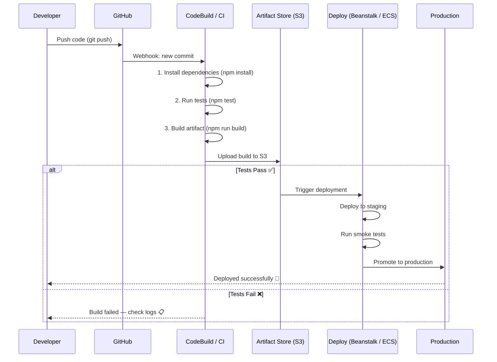

## CI/CD on AWS

**CI/CD (Continuous Integration / Continuous Deployment)** automates the process of building, testing, and deploying your application. When you push code, the pipeline automatically deploys it to AWS.

> **Analogy:** CI/CD is like an automated factory assembly line. You push code (raw materials) at one end, and the pipeline builds, tests, and ships it to production (finished product) at the other end.

---

### CI/CD Pipeline Flow



---

### Option 1: AWS CodePipeline (Native)

**CodePipeline** is AWS's fully managed CI/CD service.

```bash
# Create a pipeline
aws codepipeline create-pipeline --cli-input-json file://pipeline.json
```

```json
// pipeline.json — simplified example
{
  "pipeline": {
    "name": "my-app-pipeline",
    "stages": [
      {
        "name": "Source",
        "actions": [{
          "name": "Source",
          "actionTypeId": {
            "category": "Source",
            "owner": "ThirdParty",
            "provider": "GitHub"
          },
          "configuration": {
            "Owner": "my-org",
            "Repo": "my-app",
            "Branch": "main",
            "OAuthToken": "***"
          }
        }]
      },
      {
        "name": "Build",
        "actions": [{
          "name": "Build",
          "actionTypeId": {
            "category": "Build",
            "owner": "AWS",
            "provider": "CodeBuild"
          },
          "configuration": {
            "ProjectName": "my-app-build"
          }
        }]
      },
      {
        "name": "Deploy",
        "actions": [{
          "name": "DeployToBeanstalk",
          "actionTypeId": {
            "category": "Deploy",
            "owner": "AWS",
            "provider": "ElasticBeanstalk"
          }
        }]
      }
    ]
  }
}
```

---

### Option 2: GitHub Actions → AWS

More flexible and popular with developers:

```yaml
# .github/workflows/deploy.yml
name: Deploy to AWS

on:
  push:
    branches: [main]

jobs:
  deploy:
    runs-on: ubuntu-latest
    
    steps:
      - uses: actions/checkout@v4
      
      - name: Setup Node.js
        uses: actions/setup-node@v4
        with:
          node-version: 20
          
      - name: Install & Build
        run: |
          npm install
          npm run build
      
      - name: Run Tests
        run: npm test
      
      - name: Deploy to S3
        uses: jakejarvis/s3-sync-action@master
        with:
          args: --acl public-read --delete
        env:
          AWS_S3_BUCKET: ${{ secrets.AWS_S3_BUCKET }}
          AWS_ACCESS_KEY_ID: ${{ secrets.AWS_ACCESS_KEY_ID }}
          AWS_SECRET_ACCESS_KEY: ${{ secrets.AWS_SECRET_ACCESS_KEY }}
      
      - name: Invalidate CloudFront
        run: aws cloudfront create-invalidation --distribution-id ${{ secrets.CF_DIST_ID }} --paths "/*"
```

---

### Build Specification (buildspec.yml)

```yaml
# buildspec.yml — for AWS CodeBuild
version: 0.2

phases:
  install:
    runtime-versions:
      nodejs: 20
    commands:
      - npm install
      
  pre_build:
    commands:
      - npm test
      
  build:
    commands:
      - npm run build
      
  post_build:
    commands:
      - echo "Build completed on $(date)"

artifacts:
  files:
    - '**/*'
  base-directory: 'build'
```

---

### CI/CD Best Practices

| Practice | Why |
|----------|-----|
| **Run tests in CI** | Catch bugs before deployment |
| **Deploy to staging first** | Test in production-like environment |
| **Automated rollback** | Revert deployment if health checks fail |
| **Infrastructure as Code** | Use CloudFormation/Terraform, not manual clicks |
| **Secrets in CI** | Store AWS keys in GitHub Secrets or Parameter Store |
| **Deploy during low traffic** | Minimize impact of any issues |

---

### In Simple Words

- **CI/CD** automates building, testing, and deploying your app
- **AWS CodePipeline** and **GitHub Actions** are two popular options
- The pipeline: **push code → build → test → deploy to AWS**
- Always run **tests** in the pipeline — catch issues before production
- Use **staging** environments to validate before production rollout
- Save deployment secrets (AWS keys) in **CI secrets** — never in code
