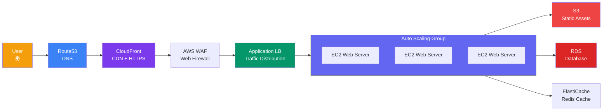
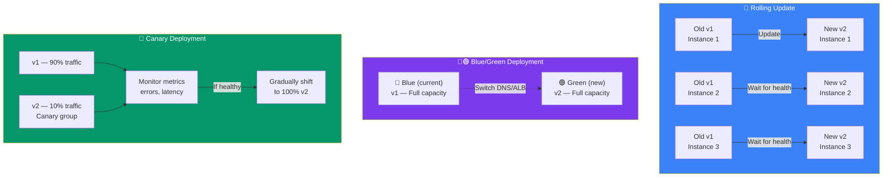
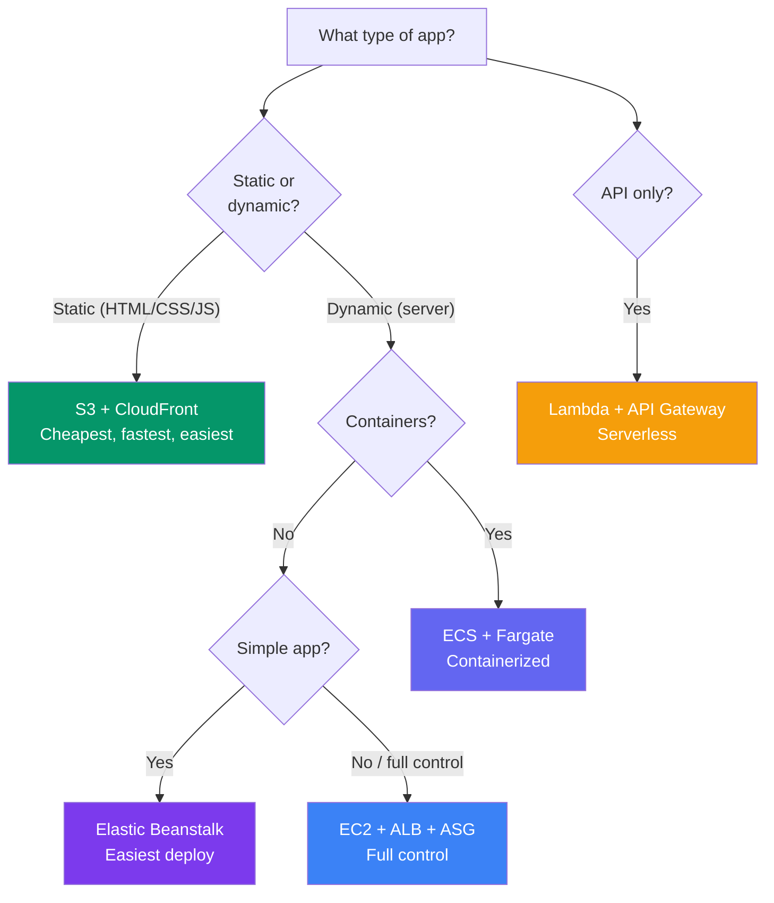

## Deploying a Web App

Let's walk through an **end-to-end production architecture** for deploying a web application on AWS, from domain to database.

> **Analogy:** Deploying a web app on AWS is like opening a restaurant. You need a location (EC2), a sign (Route53), a delivery service (CloudFront), a host who seats guests (ELB), a kitchen that scales (Auto Scaling), and a pantry (S3/RDS).

---

### Full Web App Architecture



---

### Deployment Strategies — Rolling vs Blue/Green vs Canary

Different strategies for updating your app with minimal downtime:



| Strategy | Risk | Speed | Zero-downtime? | Best For |
|----------|------|-------|----------------|----------|
| **Rolling** | Low | Medium | ✅ Yes | Most apps |
| **Blue/Green** | Very Low | Fast (swap) | ✅ Yes | Critical production |
| **Canary** | Minimal | Gradual | ✅ Yes | Testing with real traffic |

Elastic Beanstalk supports **rolling** and **immutable** (blue/green) deploys out of the box.

---

### Deployment Options by App Type

| App Type | Deployment Strategy | Where |
|----------|-------------------|-------|
| **Static site** (HTML/CSS/JS) | S3 + CloudFront | S3 static hosting + CloudFront CDN |
| **Single-page app** (React/Vue) | S3 + CloudFront | `npm run build` → sync to S3 |
| **Server-side app** (Node/Django) | EC2 + ALB or Elastic Beanstalk | Beanstalk handles everything |
| **Serverless API** | Lambda + API Gateway | No servers to manage |
| **Containerized app** (Docker) | ECS + Fargate | Serverless containers |

---

### Step-by-Step: Static Site on S3 + CloudFront

**1. Build your site**
```bash
# For React/Vue/Svelte
npm run build
# → creates build/ folder with index.html, assets/
```

**2. Upload to S3**
```bash
# Create bucket
aws s3 mb s3://my-app-website --region us-east-1

# Enable static hosting
aws s3 website s3://my-app-website \
    --index-document index.html \
    --error-document error.html

# Upload build
aws s3 sync ./build s3://my-app-website --acl public-read
```

**3. Set up CloudFront**
```bash
# Create distribution
aws cloudfront create-distribution \
    --origin-domain-name my-app-website.s3-website-us-east-1.amazonaws.com \
    --default-root-object index.html \
    --enabled
```

**4. Add domain with Route53**
```bash
# Create A record pointing to CloudFront
# Type: A → Alias: Yes → CloudFront distribution
```

**5. Done!** Your site is live at `https://www.yourdomain.com` 🚀

---

### Step-by-Step: Server App on Elastic Beanstalk

```bash
# 1. Initialize Beanstalk
eb init -p node.js-20 my-app --region us-east-1

# 2. Create environment
eb create production
# → Creates: EC2, ALB, ASG, security groups

# 3. Deploy updates
eb deploy

# 4. Open the site
eb open
```

**That's it!** Elastic Beanstalk handles:
- EC2 instance provisioning
- Load balancer configuration
- Auto scaling (configurable by CPU or request count)
- Rolling updates (zero-downtime deploys)
- CloudWatch monitoring

---

### Architecture Decision Flow



---

### In Simple Words

- **Static sites** = S3 + CloudFront — simplest, cheapest, fastest
- **Server apps** = Elastic Beanstalk (easy) or EC2 + ALB (full control)
- **Serverless APIs** = Lambda + API Gateway — no servers to manage
- **Route53** connects your domain; **CloudFront** adds CDN + HTTPS
- **ALB** distributes traffic; **Auto Scaling** handles load changes
- Start simple and add complexity as you grow
