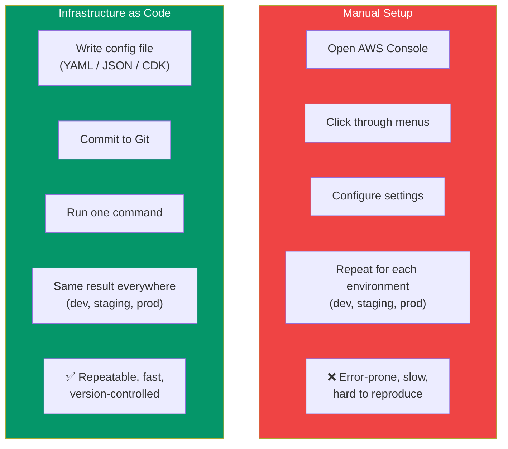
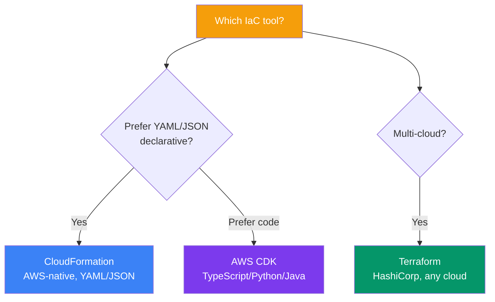
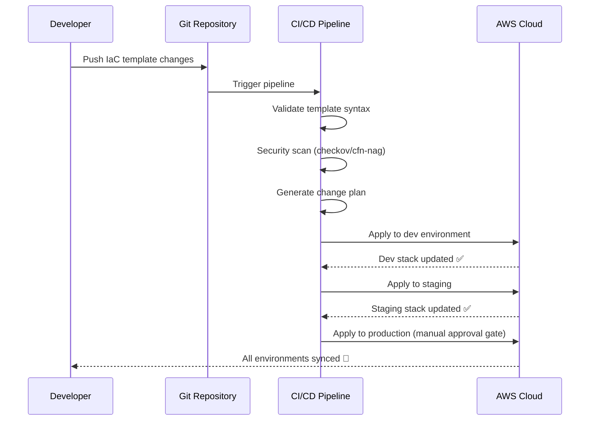

## Infrastructure as Code

**Infrastructure as Code (IaC)** is the practice of managing your infrastructure (servers, networks, databases) through code files, rather than manual configuration. IaC is one of the most important DevOps practices.

> **Analogy:** Manual AWS setup is like assembling furniture with instructions each time. IaC is like having a 3D printer — you define exactly what you want in a file, and it builds the same thing every time, perfectly, on any AWS account.

---

### Manual vs Infrastructure as Code



---

### IaC on AWS — Three Approaches



---

### CloudFormation

AWS's native IaC service — you define resources in YAML/JSON templates, and CloudFormation creates them in order.

```yaml
# template.yaml — CloudFormation example
AWSTemplateFormatVersion: '2010-09-09'
Description: Deploy a simple web server

Resources:
  WebServerSecurityGroup:
    Type: AWS::EC2::SecurityGroup
    Properties:
      GroupDescription: Allow HTTP and SSH
      SecurityGroupIngress:
        - IpProtocol: tcp
          FromPort: 80
          ToPort: 80
          CidrIp: 0.0.0.0/0
        - IpProtocol: tcp
          FromPort: 22
          ToPort: 22
          CidrIp: 203.0.113.0/32

  WebServer:
    Type: AWS::EC2::Instance
    Properties:
      ImageId: ami-0c55b159cbfafe1f0
      InstanceType: t2.micro
      SecurityGroups:
        - !Ref WebServerSecurityGroup
      UserData:
        Fn::Base64: |
          #!/bin/bash
          yum install -y httpd
          systemctl start httpd

Outputs:
  WebsiteURL:
    Value: !Sub http://${WebServer.PublicIp}
    Description: Web server public URL
```

```bash
# Create stack
aws cloudformation create-stack --stack-name my-web-server --template-body file://template.yaml

# Update stack
aws cloudformation update-stack --stack-name my-web-server --template-body file://template.yaml

# Delete stack (removes ALL resources!)
aws cloudformation delete-stack --stack-name my-web-server
```

---

### AWS CDK (Cloud Development Kit)

CDK lets you write infrastructure in your favorite programming language:

```typescript
// cdk-app.ts — AWS CDK example
import * as cdk from 'aws-cdk-lib';
import * as ec2 from 'aws-cdk-lib/aws-ec2';
import * as s3 from 'aws-cdk-lib/aws-s3';

export class MyStack extends cdk.Stack {
  constructor(scope: cdk.App, id: string) {
    super(scope, id);

    // S3 bucket — just 1 line!
    const bucket = new s3.Bucket(this, 'MyBucket', {
      versioned: true,
      removalPolicy: cdk.RemovalPolicy.DESTROY,
    });

    // EC2 instance
    const vpc = ec2.Vpc.fromLookup(this, 'VPC', { isDefault: true });
    const instance = new ec2.Instance(this, 'WebServer', {
      vpc,
      instanceType: ec2.InstanceType.of(
        ec2.InstanceClass.T3,
        ec2.InstanceSize.MICRO
      ),
      machineImage: ec2.MachineImage.latestAmazonLinux2(),
    });
  }
}
```

```bash
# CDK commands
cdk bootstrap        # Prepare AWS account
cdk synth            # Generate CloudFormation template
cdk deploy           # Deploy the stack
cdk destroy          # Tear down everything
```

---

### Terraform (HashiCorp)

Multi-cloud IaC — works with AWS, Azure, GCP, and more:

```hcl
# main.tf — Terraform example
provider "aws" {
  region = "us-east-1"
}

resource "aws_s3_bucket" "data" {
  bucket = "my-app-data-123"
  acl    = "private"
  
  versioning {
    enabled = true
  }

  tags = {
    Environment = "production"
  }
}

resource "aws_db_instance" "database" {
  engine         = "postgres"
  engine_version = "15"
  instance_class = "db.t3.micro"
  
  db_name  = "myapp"
  username = "admin"
  password = var.db_password
  
  skip_final_snapshot = true
}
```

```bash
# Terraform commands
terraform init           # Download providers
terraform plan           # Preview changes
terraform apply          # Create/update resources
terraform destroy        # Remove everything
```

---

### IaC Workflow



---

### IaC Best Practices

| Practice | Why |
|----------|-----|
| **Store templates in Git** | Version history, code review, rollback |
| **Use parameters/variables** | Reuse same template across dev/staging/prod |
| **Never hard-code secrets** | Use Parameter Store or Secrets Manager |
| **Test changes in dev first** | Catch errors before production |
| **Use drift detection** | Detect manual changes to IaC-managed resources |
| **Tag all resources** | Cost tracking, ownership identification |
| **Use state locking** | Prevent concurrent Terraform applies |

---

### In Simple Words

- **Infrastructure as Code** = manage cloud resources through code files, not the console
- **CloudFormation** = AWS-native (YAML/JSON) — best for pure AWS
- **AWS CDK** = define infrastructure in TypeScript/Python — more expressive
- **Terraform** = multi-cloud — best for AWS + Azure/GCP together
- Benefits: **repeatable, version-controlled, reviewable, automatable**
- Always store IaC in **Git**, test in **dev**, and approve for **production**
