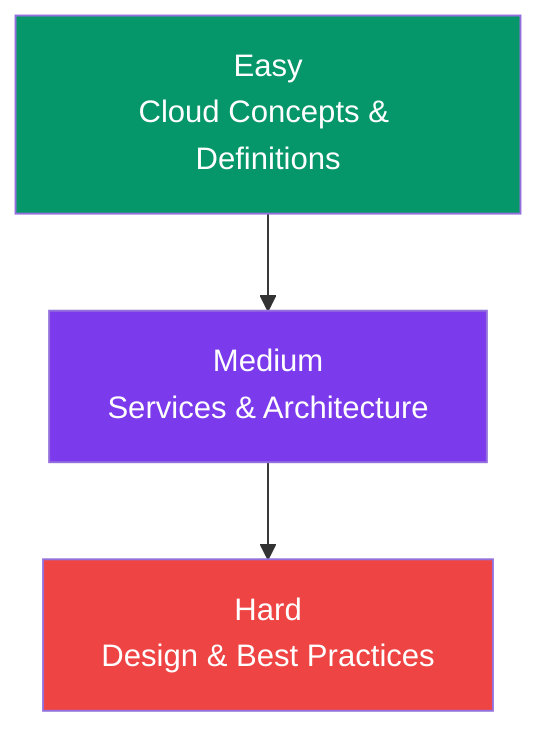

## Cloud & AWS Interview Questions

This page covers the most common cloud/AWS interview questions — from **beginner** to **advanced**. Use these to prepare for your next interview.

---

### Quick Reference

---

### Easy Questions

**Q1: What is cloud computing?**

Cloud computing is the on-demand delivery of IT resources over the internet with pay-as-you-go pricing. Instead of buying and maintaining physical data centers, you access computing power, storage, and databases from providers like AWS, Azure, or Google Cloud.

**Q2: What is the difference between IaaS, PaaS, and SaaS?**

**IaaS** (Infrastructure as a Service) provides virtual servers and storage — you manage the OS and apps. **PaaS** (Platform as a Service) provides a platform for deploying apps — you manage only the code. **SaaS** (Software as a Service) provides ready-to-use software — you just use it.

**Q3: What is an AWS Region and Availability Zone?**

A **Region** is a geographic area with multiple data centers (e.g., `us-east-1`). An **Availability Zone (AZ)** is one or more data centers within a region, isolated from other AZs for fault tolerance.

**Q4: What is IAM and why is it important?**

**IAM** (Identity and Access Management) controls who can access AWS resources and what they can do. It's important because it enforces the **principle of least privilege** — giving only the necessary permissions.

**Q5: What is the difference between a Security Group and a NACL?**

Security Groups operate at the **instance level** and are **stateful** (return traffic is automatically allowed). NACLs operate at the **subnet level** and are **stateless** (return traffic must be explicitly allowed).

---

### Medium Questions

**Q6: What is the difference between EC2 and Lambda?**

| Aspect | EC2 | Lambda |
|--------|-----|--------|
| Management | You manage OS, patches, scaling | AWS manages everything |
| Duration | No limit | 15 minutes max |
| Scaling | Manual or auto-scaling group | Instant, automatic |
| Pricing | Per hour | Per 1ms of execution |
| State | Persistent (local disk) | Stateless |

**Q7: Explain the difference between S3, EBS, and EFS.**

**S3** is object storage — files accessed via HTTP, unlimited scaling. **EBS** is block storage — like a virtual hard drive attached to one EC2 instance. **EFS** is file storage — like a network shared drive that multiple EC2 instances can mount simultaneously.

**Q8: What is an Auto Scaling Group and how does it work?**

An Auto Scaling Group maintains a desired number of EC2 instances across availability zones. Based on **scaling policies** (e.g., CPU > 70%), it launches or terminates instances to match demand while staying within configured min/max limits.

**Q9: What is CloudFront and when would you use it?**

**CloudFront** is a CDN (Content Delivery Network) that caches content at 300+ edge locations worldwide. Use it to reduce latency, offload traffic from your origin, and protect against DDoS attacks.

**Q10: What is the difference between a public and private subnet?**

A **public subnet** has a route to an Internet Gateway — instances can receive inbound traffic from the internet. A **private subnet** does not — instances can only access the internet through a NAT Gateway (outbound only).

---

### Hard Questions

**Q11: How would you design a highly available web application on AWS?**

1. **Multi-AZ** — Deploy EC2 instances across at least 2 Availability Zones
2. **Load balancer** — ALB distributes traffic across AZs
3. **Auto Scaling** — Automatically replace failed instances
4. **Multi-AZ RDS** — Database with standby replica in another AZ
5. **CloudFront** — CDN for static assets and DDoS protection
6. **Route53 health checks** + failover routing
7. **S3** for static assets and backups

**Q12: How would you reduce AWS costs?**

1. Right-size EC2 instances (don't over-provision)
2. Use Reserved Instances or Savings Plans for steady workloads
3. Use Spot Instances for fault-tolerant batch jobs
4. S3 lifecycle policies — move infrequent data to Glacier
5. Delete unattached EBS volumes, old snapshots, unused load balancers
6. Set AWS Budgets with alerts
7. Use Lambda instead of EC2 for sporadic workloads

**Q13: What is the difference between Vertical and Horizontal scaling?**

**Vertical scaling** = making the instance bigger (t2.micro → t2.large). Limited by max instance size. **Horizontal scaling** = adding more instances (2 EC2 → 10 EC2). Virtually unlimited and provides better fault tolerance.

**Q14: How does S3 achieve 99.999999999% durability?**

S3 automatically replicates objects across **multiple Availability Zones** within a region. It also uses **checksums** to detect and repair data corruption, and **redundant storage** across multiple devices. Even if two facilities fail, your data survives.

**Q15: Explain the shared responsibility model in AWS.**

**AWS is responsible for security OF the cloud** — hardware, software, networking, and facilities. **You are responsible for security IN the cloud** — customer data, IAM permissions, OS patching, network configuration, encryption, and firewall rules. The boundary shifts based on the service (e.g., Lambda shifts more responsibility to AWS than EC2).

---

### Quick Reference

| Topic | Key Points |
|-------|------------|
| **Cloud models** | IaaS (servers), PaaS (platform), SaaS (software) |
| **Global infrastructure** | Regions → AZs → Edge Locations |
| **Compute** | EC2 (servers), Lambda (serverless), Beanstalk (PaaS) |
| **Storage** | S3 (objects), EBS (block), EFS (files) |
| **Networking** | VPC (network), Route53 (DNS), CloudFront (CDN), ELB (distribution) |
| **Security** | IAM (access), Security Groups (firewall), KMS (encryption) |
| **Scaling** | Auto Scaling (instances), ELB (traffic), DynamoDB (throughput) |
| **CI/CD** | CodePipeline, CodeBuild, GitHub Actions |

---

### In Simple Words

- Know the **cloud models** (IaaS/PaaS/SaaS) and **global infrastructure** (Regions/AZs)
- Understand the **core services**: EC2, S3, Lambda, RDS, VPC, IAM
- Explain the difference between **vertical vs horizontal scaling**
- Know **when to use Lambda vs EC2** and **S3 vs EBS vs EFS**
- Understand **security groups vs NACLs** and the **shared responsibility model**
- Practice designing a **highly available architecture** across multiple AZs
