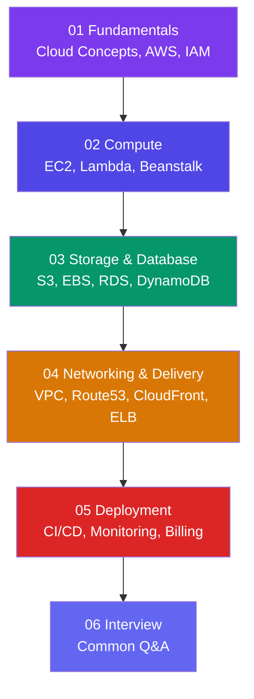

# Cloud & AWS

**Amazon Web Services (AWS)** is the world's most popular cloud platform, offering over 200 services for compute, storage, databases, networking, and more. This track covers cloud fundamentals and the most important AWS services.

> **Analogy:** On-premises servers are like owning your own car — you buy it, maintain it, insure it, and it sits in your garage. Cloud computing is like using a ride-sharing app — you pay only when you use it, and someone else handles maintenance.

---

## Learning Path

---

## Sections

| Section | What You'll Learn |
|---------|-------------------|
| **01 Fundamentals** | Cloud models (IaaS/PaaS/SaaS), AWS global infrastructure, IAM security |
| **02 Compute** | EC2 virtual servers, Lambda serverless, Elastic Beanstalk & ECS |
| **03 Storage & Database** | S3 object storage, EBS/S3/EFS comparison, RDS, DynamoDB, ElastiCache |
| **04 Networking & Delivery** | VPC, Route53 DNS, CloudFront CDN, load balancing & auto scaling |
| **05 Deployment** | End-to-end web app deploy, CI/CD pipelines, monitoring & cost management |
| **06 Interview** | Common AWS/cloud interview questions and answers |

---

## Prerequisites

This track is for **developers and DevOps beginners**. No AWS experience needed. Basic knowledge of servers, databases, and networking helps but isn't required.

---

## How This Track Works

- Each page starts with an **analogy** or plain-English explanation
- Concepts are followed by **concrete examples** (console steps or CLI commands)
- Pages end with an **"In Simple Words"** summary
- **Mermaid diagrams** illustrate architectures and flows visually

Start with **[What is Cloud Computing?](./01-fundamentals/what-is-cloud-computing)** to begin!
