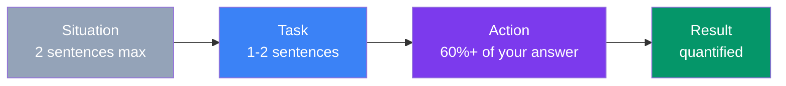
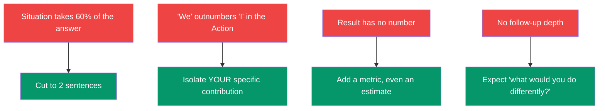

## The STAR Method

**STAR** is a structure for answering "tell me about a time..." questions: **S**ituation, **T**ask, **A**ction, **R**esult. It exists because unstructured answers ramble, bury the interesting part, and leave the interviewer unsure what you actually did.

> **Analogy:** STAR is like a news article's inverted pyramid — set the scene fast, then spend most of your words on what happened and why it matters. Don't write the whole backstory before you get to the point.

---

### The Four Parts

**Situation** — the context. Team, project, stakes. Keep it to two sentences; interviewers lose interest in setup fast.

**Task** — what you specifically were responsible for. Distinguish this from Situation: Situation is what was happening, Task is your role in it.

**Action** — what YOU did, step by step, in first person. This should be the majority of your answer by word count. Say "I", not "we", when describing your own contribution — interviewers are evaluating you, not your team.

**Result** — what happened, ideally with a number: time saved, bugs prevented, revenue protected, users affected, percentage improved. No number is a missed opportunity to make the answer memorable and verifiable.

---

### Where Most Answers Actually Fail

Candidates rarely fail STAR because they don't know the acronym. They fail because:

1. **Situation eats the clock.** Two minutes of backstory before anything interesting happens.
2. **"We" hides your contribution.** If a story is entirely "we", the interviewer can't tell what you personally did versus what your team did around you.
3. **Result is vague.** "It went well" or "the team was happy" isn't a result — it's a mood. Interviewers want to know: faster by how much? Fewer bugs by how much? Saved how much money or time?
4. **No prepared follow-up.** Every strong answer invites "what would you do differently?" or "what was your specific contribution?" — have that ready before you're asked.

---

### A Worked Example

**Question:** "Tell me about a time you disagreed with your manager's decision."

> **Situation:** My manager wanted to ship a payments feature without A/B testing to hit a Q3 deadline.
>
> **Task:** I owned the risk assessment for that launch.
>
> **Action:** I pulled data from a similar launch six months earlier that had shipped untested and caused a billing discrepancy affecting 2,000 accounts. I brought that data to a 15-minute 1:1, proposed a lightweight feature-flag rollout to 5% of traffic as a middle ground, and made clear I'd support whichever call she made. She chose the phased rollout.
>
> **Result:** We caught a rounding bug in the 5% rollout before full launch, fixed it in a day, and shipped to 100% a week later than the original date but with zero customer-facing incidents.

Notice: Situation and Task together are three sentences. Action is the bulk of the answer and is entirely first-person. Result has concrete numbers (2,000 accounts, 5%, a day, a week).

---

### In Simple Words

- **Situation + Task** should take roughly 20% of your answer — set the scene, move on
- **Action** should take 60%+ — this is what's actually being evaluated
- Use **"I"**, not "we", for your own specific contribution
- **Result** needs a number — time, money, users, percentage, anything countable
- Prepare for the follow-up: **"what was your individual contribution?"** and **"what would you do differently?"**
