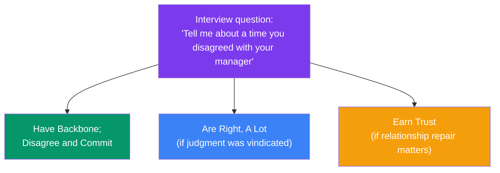

## Amazon Leadership Principles

Amazon's behavioral interviews (called "Bar Raiser" rounds among others) are structured almost entirely around **16 Leadership Principles (LPs)**. Every question you're asked is silently mapped to one or more LPs, and your interviewer is scoring you against that specific principle — not just "was this a good story."

> **Analogy:** The LPs are less a checklist and more a set of lenses. The same story about shipping a feature under a deadline can be scored against Deliver Results, Ownership, or Customer Obsession depending on what the interviewer chooses to probe.

---

### The 16 Principles

| Principle | What it's really probing for |
|-----------|-------------------------------|
| **Customer Obsession** | Do you start from the customer and work backward, even against internal pressure? |
| **Ownership** | Do you act like an owner beyond your narrow job scope — fix things nobody assigned you? |
| **Invent and Simplify** | Do you find non-obvious solutions and remove unnecessary complexity? |
| **Are Right, A Lot** | Do you have strong, evidence-based judgment, and can you defend it under pushback? |
| **Learn and Be Curious** | Do you proactively grow your skills, not just react to gaps when forced? |
| **Hire and Develop the Best** | Do you invest in growing others' careers, not just your own output? |
| **Insist on the Highest Standards** | Do you hold a bar higher than what's minimally asked, and raise that bar for others? |
| **Think Big** | Do you propose ambitious solutions, not just safe incremental ones? |
| **Bias for Action** | Can you decide and act under uncertainty rather than waiting for perfect information? |
| **Frugality** | Can you accomplish more with less through resourcefulness, not just smaller scope? |
| **Earn Trust** | Do you listen, admit mistakes, and treat others with respect — even without prior relationship? |
| **Dive Deep** | Do you verify with primary data rather than accepting a surface explanation? |
| **Have Backbone; Disagree and Commit** | Can you voice disagreement respectfully, then commit fully once a decision is made? |
| **Deliver Results** | Do you hit the outcome despite setbacks, with the right prioritization, not just effort? |
| **Strive to be Earth's Best Employer** | Do you make the environment better for the people around you? |
| **Success and Scale Bring Broad Responsibility** | Do you consider second-order effects of decisions at scale — fairness, safety, environment? |

---

### How the Mapping Works

One story can be scored against multiple LPs depending on which details the interviewer probes with follow-ups. This is exactly why the [Story Bank](/behavioral) lets you tag one story with multiple categories — a single "botched release" story might cover **failure**, **delivery/deadlines**, **conflict**, and **growth/feedback** all at once.

---

### Preparing Against LPs, Not Just Questions

Rather than memorizing answers to specific questions, build stories that clearly demonstrate 2-3 LPs each, so you can flex the same story to whichever principle the interviewer is probing:

1. Pick a real story with genuine stakes.
2. Ask: which 2-3 LPs does this actually demonstrate?
3. In the Action section, make sure the details that prove those specific LPs are explicit, not implied.
4. Cross-check against the [Question Bank](/behavioral) — filter by "Amazon (LP)" company style to see real questions mapped to each principle with rubrics and sample answers.

---

### In Simple Words

- Amazon behavioral questions are silently scored against one or more of **16 Leadership Principles**
- The same story can demonstrate multiple LPs depending on what's probed
- Prepare **stories that map to principles**, not memorized answers to specific questions
- **Have Backbone; Disagree and Commit** and **Ownership** come up especially often — make sure at least one story nails each
