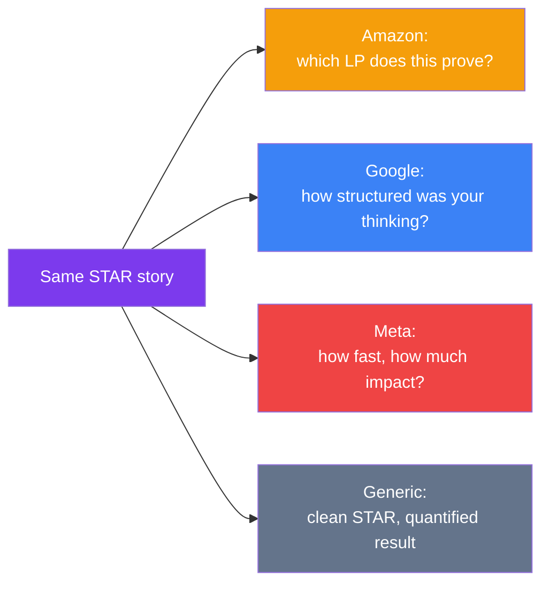

## Company Interview Styles

The STAR structure holds everywhere, but **what interviewers are listening for** differs meaningfully by company. The same story needs a different emphasis depending on who's asking.

> **Analogy:** It's the same dish, different judges. One judge scores for technique (Amazon's LP rubric), one for creativity and collaboration (Google), one for speed and ownership (Meta).

---

### Amazon — Leadership Principle Rounds

- Every question maps explicitly to one or more of the [16 Leadership Principles](./02-amazon-leadership-principles).
- Interviewers probe hard with follow-ups: "What was YOUR specific contribution?", "What would you have done if X hadn't worked?"
- A **Bar Raiser** — an interviewer from outside the hiring team — sits in specifically to catch inflated or vague stories and challenge weak evidence.
- **Adjust your stories to:** make the LP being demonstrated explicit through details, not adjectives. Don't say "I showed ownership" — show the specific unassigned problem you fixed anyway.

### Google — Googleyness & Collaboration

- Less about a fixed principle list, more about **structured thinking, intellectual humility, and collaborative problem-solving**.
- Interviewers often probe for how you handled ambiguity and whether you can synthesize disagreement into a better outcome, not just win it.
- Google explicitly values people who improve the people around them — mentoring, unblocking, facilitating.
- **Adjust your stories to:** show your reasoning process, not just the outcome. If a disagreement is involved, show both sides had merit and the resolution was a genuine synthesis.

### Meta — Move Fast, Have Impact

- Heavy emphasis on **speed, data-driven decisions, and individual ownership under ambiguity**.
- Interviewers want to see you making calls quickly with incomplete information and correcting course based on data, not analysis paralysis.
- "Impact" is a specific word Meta interviewers listen for — vague contributions score poorly.
- **Adjust your stories to:** emphasize how fast you moved and what data changed your mind, and be ready to state impact in a concrete number.

### Generic / Most Other Companies

- Most companies without a codified framework still evaluate the same underlying traits: ownership, communication, conflict handling, and results.
- Without a specific rubric to reverse-engineer, default to a clean, quantified STAR answer — it holds up everywhere.

---

### Comparing the Emphasis

---

### In Simple Words

- **Amazon**: map every answer to a Leadership Principle explicitly, expect a Bar Raiser to challenge weak evidence
- **Google**: show structured thinking and collaborative synthesis, not just a good outcome
- **Meta**: emphasize speed, data-driven pivots, and concrete individual impact
- **Generic**: a clean, quantified STAR answer works almost everywhere
- Use the [Question Bank](/behavioral)'s company-style filter to drill each style specifically before that interview
