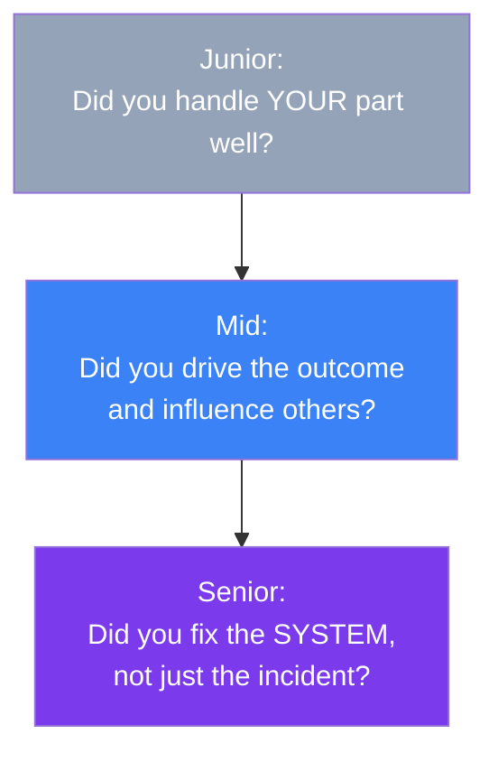

## What Changes By Seniority

Interviewers ask the exact same question — "tell me about a time you disagreed with your manager" — to a new grad and a staff engineer. What changes isn't the question. It's the **bar for what counts as a strong answer**.

> **Analogy:** Asking "tell me about a time you fixed a bug" gets judged differently for a junior (did you find and fix it correctly?) versus a senior (did you fix the class of bug, for everyone, permanently?).

---

### The Pattern Across Levels

**Junior:** the bar is competence and self-awareness. Did you handle the situation reasonably, learn from mistakes, and communicate clearly? Scope is usually "your own task."

**Mid:** the bar adds influence and ownership beyond your immediate task. Did you drive an outcome across a small team, push back with judgment, mentor someone junior, or de-risk a project proactively?

**Senior:** the bar shifts to systemic and organizational impact. Did you change a process so the problem can't recur for anyone? Did you influence multiple teams or a whole org? Is the "result" measured in team-wide or company-wide terms, not just your own output?

---

### Worked Example: "Tell me about a mistake you made"

| Level | What a strong answer includes |
|-------|-------------------------------|
| **Junior** | Owns the mistake honestly, explains the specific fix, shows a personal lesson learned |
| **Mid** | Owns it, fixes it fast, and adds a check (a test, a review step) so *they* don't repeat it |
| **Senior** | Owns it, fixes it, and changes the **team's process or tooling** so nobody on the team can make that class of mistake again |

The mistake itself can be the same story — what differs is what happens after it, and at what scope.

---

### How This Affects Story Selection

When you [tag stories in the Story Bank](/behavioral), pick stories whose scope matches the level you're interviewing for:

- Interviewing **junior-to-mid**: stories about your own task execution, learning from feedback, and small-team collaboration work well.
- Interviewing **senior**: prioritize stories with cross-team scope, a systemic fix (not a one-off patch), or a case where your judgment overrode initial pushback and was later vindicated with evidence.

If your best stories all read as "I fixed my own bug," that's a signal to consciously build 1-2 stories with broader scope — mentoring, cross-team alignment, or a process change with lasting impact — before a senior-level interview.

---

### In Simple Words

- Same question, different bar: **junior** = handled your part well, **mid** = drove the outcome and influenced others, **senior** = fixed the system, not the incident
- Result scope should roughly match level: personal → team → org
- If prepping for a senior loop, deliberately build stories with **cross-team or systemic** impact, not just individual task completion
- The [Question Bank](/behavioral) tags each question's applicable levels and includes a "what a senior answer adds" note — use it to calibrate your own stories
