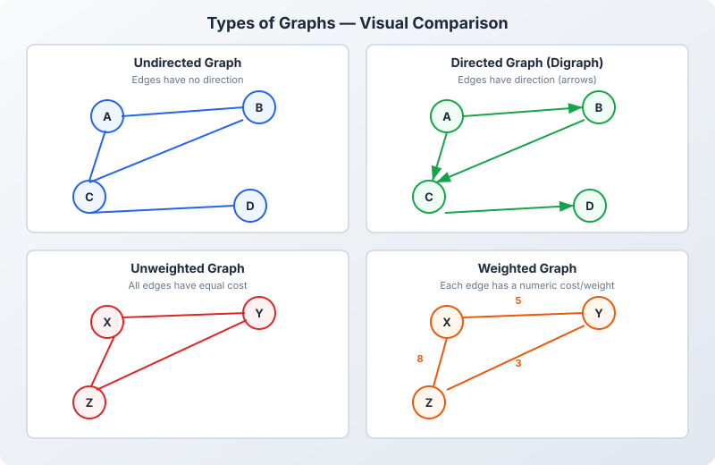

# 📊 Introduction to Graphs

> A comprehensive overview of graphs — what they are, key terminologies, and the different types you'll encounter in interviews.

---

## What is a Graph?

A **graph** is a non-linear data structure consisting of a set of **vertices** (nodes) connected by **edges** (links). Unlike trees (which are a special type of graph), graphs can have cycles, disconnected components, and edges pointing in any direction.



**Simple Example:**
```
    (A)-----(B)
     |     / |
     |    /  |
     |   /   |
    (C)-----(D)
         |
        (E)

Vertices: A, B, C, D, E
Edges: A-B, A-C, B-C, B-D, C-D, C-E
```

---

## Key Terminologies

| Term | Definition | Real-World Example |
|------|------------|-------------------|
| **Vertex (Node)** | A fundamental unit/point in a graph | Cities on a map |
| **Edge** | A connection between two vertices | Roads between cities |
| **Degree** | Number of edges connected to a vertex | City with 3 roads → degree 3 |
| **In-Degree** | Edges coming INTO a vertex (directed) | Twitter followers |
| **Out-Degree** | Edges going OUT of a vertex (directed) | Twitter following |
| **Path** | A sequence of vertices connected by edges | Route from A to E |
| **Simple Path** | A path with no repeated vertices | Direct route, no backtracking |
| **Cycle** | A path that starts and ends at the same vertex | A → B → C → A |
| **Self-Loop** | An edge from a vertex to itself | A → A |
| **Neighbor** | Vertex directly connected by an edge | Adjacent cities |
| **Connected** | Every vertex reachable from every other vertex | One continent |
| **Component** | A maximal connected subgraph | Islands in a sea |
| **Weight** | A value/cost assigned to an edge | Distance in kilometers |

---

## Types of Graphs

### 1. Directed vs Undirected

| Undirected | Directed (Digraph) |
|------------|-------------------|
| Edges have **no direction** — A-B means both A→B and B→A | Edges have **direction (arrows)** — A→B does NOT imply B→A |
| Used for: social networks (friendships), road networks | Used for: web pages (hyperlinks), Twitter follows |

```
Undirected:         Directed:
   A --- B            A ---> B
   |     |            |       |
   C --- D            v       v
                      C <--- D
```

### 2. Weighted vs Unweighted

| Unweighted | Weighted |
|------------|----------|
| All edges are equal | Each edge has a numeric cost/weight |
| Used for: hop count, simple connectivity | Used for: shortest path (distance, time, cost) |

```
Unweighted:         Weighted:
   A --- B            A --5-- B
   |     |            |       |
   C --- D           10      3
                     |       |
                     C --7-- D
```

### 3. Cyclic vs Acyclic

| Cyclic | Acyclic (DAG) |
|--------|---------------|
| Contains at least one cycle | No cycle possible |
| Used for: detecting deadlocks | Used for: task scheduling, build systems |

```
Cyclic:             Acyclic (DAG):
   A → B               A → B
   ↑   ↓               ↓   ↓
   D ← C               C   D
                        ↓
                       E
```

### 4. Connected vs Disconnected

| Connected | Disconnected |
|-----------|-------------|
| All nodes reachable from every other node | Some nodes are isolated (multiple components) |

```
Connected:          Disconnected:
   A --- B            A --- B     D --- E
   |     |                         |
   C --- D                         F
```

### 5. Special Graph Types

| Type | Description | Edges |
|------|-------------|-------|
| **Tree** | Connected, acyclic, undirected | N-1 edges for N nodes |
| **Forest** | Collection of disjoint trees | Multiple trees |
| **Complete Graph (Kₙ)** | Every pair of vertices is connected | N×(N-1)/2 edges |
| **Bipartite Graph** | Vertices split into 2 groups; edges only between groups | No odd-length cycles |
| **DAG** | Directed graph with no cycles | Used for scheduling, dependency resolution |

---

## Next Steps

Now that you understand what graphs are and their types, move on to learn about [Graph Representations](/DSA-Notes-Problems/data-structures/graphs/02-representations) — how to store and work with graphs in code.

---

## Related Topics

- [Tree Data Structure](/DSA-Notes-Problems/data-structures/trees) — Trees are a special case of graphs (acyclic, connected)
- [Recursion & Backtracking](/DSA-Notes-Problems/data-structures/recursion/recursion-and-backtracking) — Used in DFS traversal
