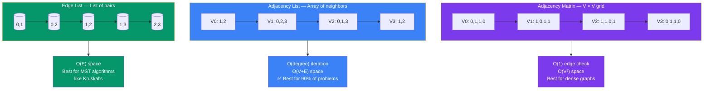

# Graph Representations

> Learn how to store and represent graphs in code. The right representation can make or break your algorithm's performance.

---

## Comparison Overview



> **Rule of thumb:** Use Adjacency List for 90% of interview problems. Reserve Adjacency Matrix for dense graphs where O(1) edge lookup matters.

---

## 1. Adjacency Matrix

A 2D array of size **V×V** where `matrix[i][j] = 1` (or weight) if there's an edge from vertex i to j.

```
Graph:           Adjacency Matrix:
  0---1             0  1  2  3
  |\ |           0 [0, 1, 1, 0]
  | \|           1 [1, 0, 1, 1]
  2---3          2 [1, 1, 0, 1]
                 3 [0, 1, 1, 0]

matrix[0][1] = 1 → edge exists between 0 and 1
matrix[0][3] = 0 → no edge between 0 and 3
```

**Pros:**
- **O(1)** edge lookup — "Is there an edge between u and v?"
- Simple to implement
- Good for dense graphs (E ≈ V²)

**Cons:**
- **O(V²)** space — wasteful for sparse graphs
- **O(V)** to find all neighbors of a vertex

**When to use:** Small graphs (< 1000 nodes), dense graphs, when you need fast edge existence checks.

---

## 2. Adjacency List

An array/map of size V, where each entry contains a list of neighbors.

```
Graph:           Adjacency List:
  0---1          0: [1, 2]
  |\ |           1: [0, 2, 3]
  | \|           2: [0, 1, 3]
  2---3          3: [1, 2]

For weighted graphs:
  0: [(1, weight=5), (2, weight=3)]
```

**Pros:**
- **O(V + E)** space — memory efficient for sparse graphs
- **O(degree(v))** to iterate over neighbors
- Most commonly used in interview problems

**Cons:**
- **O(degree(v))** edge lookup — slower than matrix for dense graphs

**When to use:** Most interview problems, sparse graphs, when you need to iterate over neighbors.

> **🔑 Rule of thumb:** Use **Adjacency List** for 90% of interview problems. Reserve **Adjacency Matrix** for when you need O(1) edge existence checks on small/dense graphs.

---

## 3. Edge List

A simple list of all edges as pairs (or triples for weighted).

```
Graph:           Edge List:
  0---1          [(0,1), (0,2), (1,2), (1,3), (2,3)]
  |\ |
  | \|           Weighted Edge List:
  2---3          [(0,1,5), (0,2,3), (1,2,2), (1,3,7), (2,3,4)]
                  (u, v, weight)
```

**Pros:**
- **O(E)** space
- Simple; useful for algorithms like Kruskal's (MST)

**Cons:**
- **O(E)** edge lookup — must scan entire list
- Not efficient for traversal

**When to use:** Algorithms that process edges sorted by weight (Kruskal's MST), when space is at a premium.

---

## Space & Time Trade-offs

| Operation | Adjacency Matrix | Adjacency List | Edge List |
|-----------|-----------------|----------------|-----------|
| **Space** | O(V²) | O(V + E) | O(E) |
| **Add Edge** | O(1) | O(1) | O(1) |
| **Remove Edge** | O(1) | O(degree) | O(E) |
| **Check Edge** | O(1) | O(degree) | O(E) |
| **Get Neighbors** | O(V) | O(degree) | O(E) |
| **Best For** | Dense graphs | Sparse graphs | MST algorithms |

> **💡 Interview Tip:** When a problem asks to find if a path exists between two nodes, **always build an adjacency list first**, even if the input is an edge list. Building a proper graph structure makes traversal algorithms much simpler.

---

## Implementation Templates

### Adjacency List (Most Common)

```javascript
// For unweighted graphs
const graph = new Map();
for (const [u, v] of edges) {
  if (!graph.has(u)) graph.set(u, []);
  if (!graph.has(v)) graph.set(v, []);
  graph.get(u).push(v);
  graph.get(v).push(u); // Omit for directed graphs
}

// For weighted graphs
const graph = new Map();
for (const [u, v, w] of weightedEdges) {
  if (!graph.has(u)) graph.set(u, []);
  graph.get(u).push([v, w]);
}
```

### Adjacency Matrix

```javascript
const matrix = Array.from({ length: V }, () => Array(V).fill(0));
for (const [u, v] of edges) {
  matrix[u][v] = 1;
  matrix[v][u] = 1; // Omit for directed graphs
}
// Check edge: matrix[u][v] !== 0
```

### Edge List

```javascript
// Already in this format from input!
// Just use edges array directly
const edges = [[0,1], [0,2], [1,2], [1,3], [2,3]];
```

---

## Next Steps

Now that you know how to represent graphs, learn about [Time and Space Complexity](/DSA-Notes-Problems/data-structures/graphs/03-complexity) to understand how algorithms perform on different graph representations.

---

## Related Topics

- [BFS Traversal](/DSA-Notes-Problems/data-structures/graphs/04-traversals) — BFS requires efficient neighbor iteration (adjacency list)
- [Union-Find](/DSA-Notes-Problems/data-structures/graphs/05-patterns) — Edge list is perfect for Kruskal's algorithm
