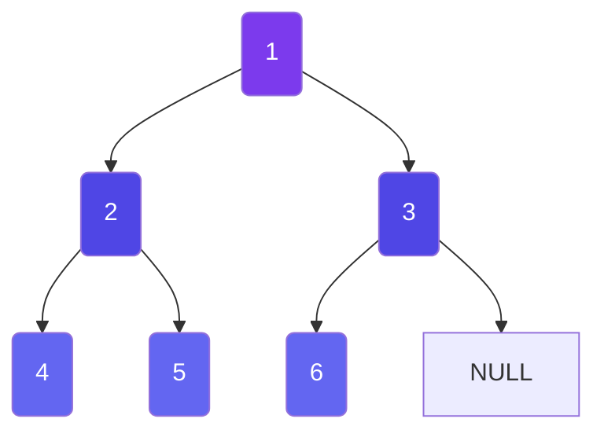
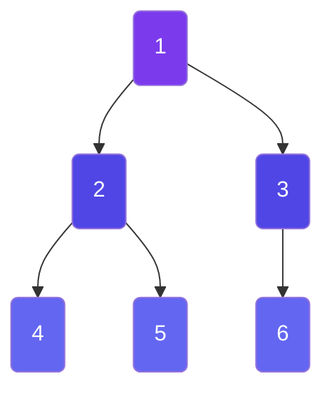

# Graph Traversal Algorithms

> BFS and DFS are the two fundamental ways to explore a graph. Mastering them is essential for every graph problem.

---

## Breadth-First Search (BFS)

BFS explores a graph **level by level** — visiting all neighbors at the current depth before moving deeper. It uses a **Queue (FIFO)**.

### BFS Traversal Visual



```
BFS order: 1 → 2 → 3 → 4 → 5 → 6
(queue-based, level by level)
```

### How BFS Works

```
Graph:                BFS from node 1:
    1                 
   / \                Level 0: [1]
  2   3               Level 1: [2, 3]
 / \   \              Level 2: [4, 5, 6]
4   5   6

Visit order: 1 → 2 → 3 → 4 → 5 → 6
```

**Step-by-Step BFS:**

```
Initial: Queue = [1],  Visited = {1}

Step 1: Dequeue 1, enqueue neighbors 2, 3
        Queue = [2, 3],  Visited = {1, 2, 3}

Step 2: Dequeue 2, enqueue neighbors 4, 5
        Queue = [3, 4, 5],  Visited = {1, 2, 3, 4, 5}

Step 3: Dequeue 3, enqueue neighbor 6
        Queue = [4, 5, 6],  Visited = {1, 2, 3, 4, 5, 6}

Step 4: Dequeue 4 → no new neighbors
Step 5: Dequeue 5 → no new neighbors
Step 6: Dequeue 6 → no new neighbors
        Queue = [] → BFS complete!
```

### Key Properties

| Property | Description |
|----------|-------------|
| Data Structure | **Queue** (FIFO) |
| Path Found | **Shortest** (in unweighted graphs) |
| Memory | O(V) — can be large for wide graphs |
| Best For | Shortest path, level-by-level traversal, multi-source spread |

---

## Depth-First Search (DFS)

DFS explores a graph by going as **deep as possible** before backtracking. It uses a **Stack** (or recursion).

### DFS Traversal Visual



```
DFS order: 1 → 2 → 4 → 5 → 3 → 6
(stack/recursion-based, goes deep first)
```

### How DFS Works

```
Graph:                DFS from node 1:
    1                 
   / \                Go deep: 1 → 2 → 4 → backtrack
  2   3               → 5 → backtrack → backtrack
 / \   \              → 3 → 6 → done
4   5   6

Visit order: 1 → 2 → 4 → 5 → 6 → 3
```

**Step-by-Step DFS (Recursive):**

```
DFS(1):
  Mark 1 as visited
  For neighbor 2:
    DFS(2):
      Mark 2 as visited
      For neighbor 4: DFS(4) → mark 4, return
      For neighbor 5: DFS(5) → mark 5, return
  For neighbor 3:
    DFS(3):
      Mark 3 as visited
      For neighbor 6: DFS(6) → mark 6, return
```

### Key Properties

| Property | Description |
|----------|-------------|
| Data Structure | **Stack** (or recursion, which uses the call stack) |
| Path Found | Any path (not guaranteed shortest) |
| Memory | O(V) — depth of recursion |
| Best For | Cycle detection, topological sort, connected components |

---

## BFS vs DFS — Comparison

| Aspect | BFS | DFS |
|--------|-----|-----|
| **Data Structure** | Queue (FIFO) | Stack / Recursion |
| **Path Found** | Shortest (unweighted) | Any path (not shortest) |
| **Memory** | O(V) — can be large | O(V) — depth of recursion |
| **Best For** | Shortest path, levels | Cycles, components, topological sort |
| **Graph Type** | Wide, shallow graphs | Deep, narrow graphs |

### When to Use BFS

| Use BFS When | Example Problems |
|-------------|------------------|
| Shortest path (unweighted) | Word Ladder, Minimum steps to reach goal |
| Level-by-level traversal | Binary tree level order |
| Minimum steps to reach goal | Knight's tour, sliding puzzle |
| Multi-source spreading | Rotting Oranges, 01 Matrix |
| Finding nodes at distance K | All nodes distance K in binary tree |

### When to Use DFS

| Use DFS When | Example Problems |
|-------------|------------------|
| Cycle detection | Detecting cycles in graphs |
| Topological sort | Course schedule ordering |
| Connected components | Number of Islands |
| Backtracking problems | N-Queens, Sudoku solver |
| Path existence check | Find if path exists in graph |
| Maze solving | Any path (not shortest) |

---

## Implementation Templates

### BFS Template

```javascript
function bfs(graph, start) {
  const visited = new Set([start]);
  const queue = [start];
  const result = [];

  while (queue.length > 0) {
    const node = queue.shift();
    result.push(node);

    for (const neighbor of (graph.get(node) || [])) {
      if (!visited.has(neighbor)) {
        visited.add(neighbor);  // ⚠️ Mark visited BEFORE enqueueing!
        queue.push(neighbor);
      }
    }
  }
  return result;
}
```

### DFS Template (Recursive)

```javascript
function dfs(graph, start, visited = new Set(), result = []) {
  visited.add(start);
  result.push(start);

  for (const neighbor of (graph.get(start) || [])) {
    if (!visited.has(neighbor)) {
      dfs(graph, neighbor, visited, result);
    }
  }
  return result;
}
```

### DFS Template (Iterative)

```javascript
function dfsIterative(graph, start) {
  const visited = new Set();
  const stack = [start];
  const result = [];

  while (stack.length > 0) {
    const node = stack.pop();
    if (visited.has(node)) continue;
    visited.add(node);
    result.push(node);

    // Push neighbors in reverse order for left-to-right traversal
    const neighbors = graph.get(node) || [];
    for (let i = neighbors.length - 1; i >= 0; i--) {
      if (!visited.has(neighbors[i])) {
        stack.push(neighbors[i]);
      }
    }
  }
  return result;
}
```

---

## ⚠️ Critical BFS Mistake to Avoid

```javascript
// ❌ WRONG - Can cause infinite loops / TLE!
function bfsWrong(graph, start) {
  const queue = [start];
  while (queue.length > 0) {
    const node = queue.shift();
    // visited.add(node);  // ❌ Marking visited AFTER dequeueing
    for (const neighbor of graph.get(node) || []) {
      if (!visited.has(neighbor)) {
        queue.push(neighbor);  // Same neighbor added multiple times!
      }
    }
  }
}

// ✅ CORRECT - Mark visited when enqueueing
function bfsCorrect(graph, start) {
  const visited = new Set([start]); // Mark start BEFORE queue
  const queue = [start];
  while (queue.length > 0) {
    const node = queue.shift();
    for (const neighbor of graph.get(node) || []) {
      if (!visited.has(neighbor)) {
        visited.add(neighbor); // ✅ Mark NOW, not later
        queue.push(neighbor);
      }
    }
  }
}
```

> **Why?** Without early marking, the same node can be added to the queue multiple times by different parents → memory explosion or TLE!

---

## Next Steps

Now that you can traverse graphs, learn about [Important Graph Patterns](/DSA-Notes-Problems/data-structures/graphs/05-patterns) — common patterns that appear in interview problems.

---

## Related Topics

- [Stack (LIFO)](/DSA-Notes-Problems/data-structures/stacks-queues/stack-lifo) — DFS uses a stack (implicitly via recursion or explicitly)
- [Queue (FIFO)](/DSA-Notes-Problems/data-structures/stacks-queues/queue-fifo) — BFS uses a queue for level-by-level traversal
