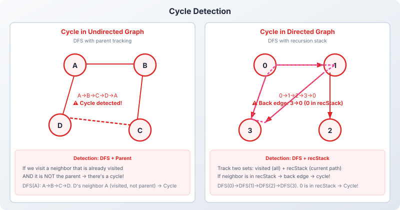
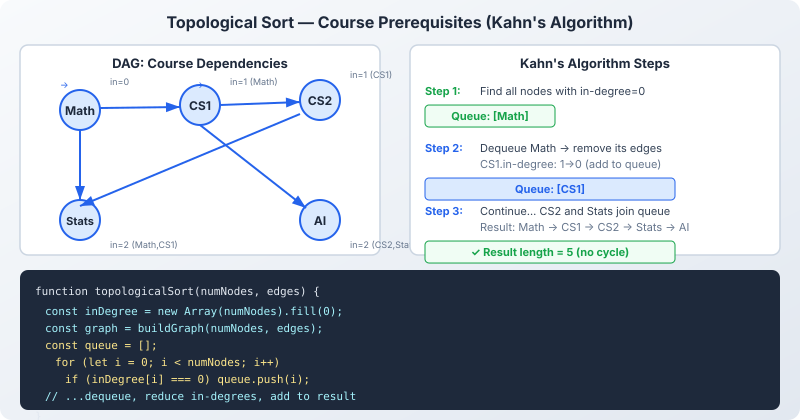

# Important Graph Patterns

> These 8 patterns form the foundation of most graph interview problems. Master them to recognize solutions quickly.

---

## Pattern 1: BFS for Shortest Path (Unweighted)

**Problem:** Find the shortest path from source to target in an unweighted graph.

**Key Insight:** BFS guarantees the first time we reach a node, it's via the shortest path.

```
Graph (unweighted):        BFS from A, find shortest path to F:
A - B - D                  
|   |   |                  A(0) → B(1), C(1)
C - E - F                  B(1) → D(2), E(2)
                           C(1) → E(2)
                           D(2) → F(3)  ← first time F reached!
                           
Shortest path: A → B → D → F (length 3)
```

**Template:**
```javascript
function bfsShortestPath(graph, start, end) {
  const queue = [[start, [start]]];  // [node, path]
  const visited = new Set([start]);

  while (queue.length > 0) {
    const [node, path] = queue.shift();
    if (node === end) return path;

    for (const neighbor of graph[node] || []) {
      if (!visited.has(neighbor)) {
        visited.add(neighbor);
        queue.push([neighbor, [...path, neighbor]]);
      }
    }
  }
  return null;  // No path found
}
```

---

## Pattern 2: DFS for Connected Components / Islands

**Problem:** Count the number of connected components (islands) in a graph or grid.

**Key Insight:** Each DFS from an unvisited node explores one complete component.

```
Grid (Number of Islands):
1 1 0 0 0
1 1 0 0 0        Islands found: 3
0 0 1 0 0        
0 0 0 1 1        
```

**Template:**
```javascript
function countComponents(grid) {
  let count = 0;

  function dfs(r, c) {
    if (r < 0 || r >= grid.length || c < 0 || c >= grid[0].length) return;
    if (grid[r][c] !== 1) return;
    grid[r][c] = 0;  // Mark visited by modifying grid
    dfs(r + 1, c); dfs(r - 1, c);
    dfs(r, c + 1); dfs(r, c - 1);
  }

  for (let r = 0; r < grid.length; r++) {
    for (let c = 0; c < grid[0].length; c++) {
      if (grid[r][c] === 1) {
        dfs(r, c);
        count++;
      }
    }
  }
  return count;
}
```

---

## Pattern 3: Cycle Detection



### In Undirected Graphs (DFS + Parent Tracking)

**Key Insight:** If we visit a node that is already visited AND it's not the parent of the current node, there's a cycle.

```
Has cycle:              No cycle (tree):
  0 --- 1                 0 --- 1
  |     |                 |     |
  3 --- 2                 3     2

DFS from 0: 0→1→2→3→0 (0 already visited, not parent)
→ Cycle detected!
```

```javascript
function hasCycleUndirected(graph, numNodes) {
  const visited = new Set();

  function dfs(node, parent) {
    visited.add(node);
    for (const neighbor of graph[node] || []) {
      if (!visited.has(neighbor)) {
        if (dfs(neighbor, node)) return true;
      } else if (neighbor !== parent) {
        return true;  // Cycle: visited neighbor is not parent
      }
    }
    return false;
  }

  for (let i = 0; i < numNodes; i++) {
    if (!visited.has(i)) {
      if (dfs(i, -1)) return true;
    }
  }
  return false;
}
```

### In Directed Graphs (DFS + Recursion Stack)

**Key Insight:** Track both `visited` (globally) and `recStack` (current DFS path). If we visit a node that's in `recStack`, there's a cycle.

```
Has cycle:             No cycle (DAG):
  0 → 1                 0 → 1
  ↑   ↓                 ↓   ↓
  3 ← 2                 2   3

recStack during DFS: {0, 1, 2, 3}
3 → 0: 0 is in recStack → Back edge → Cycle!
```

```javascript
function hasCycleDirected(graph, numNodes) {
  const visited = new Set();
  const recStack = new Set();

  function dfs(node) {
    visited.add(node);
    recStack.add(node);
    for (const neighbor of graph[node] || []) {
      if (!visited.has(neighbor)) {
        if (dfs(neighbor)) return true;
      } else if (recStack.has(neighbor)) {
        return true;  // Back edge → cycle!
      }
    }
    recStack.delete(node);
    return false;
  }

  for (let i = 0; i < numNodes; i++) {
    if (!visited.has(i)) {
      if (dfs(i)) return true;
    }
  }
  return false;
}
```

---

## Pattern 4: Topological Sort

Topological Sort orders vertices in a **DAG** such that for every edge u→v, u comes before v.

**Use cases:** Task scheduling, build systems, course prerequisites



### Kahn's Algorithm (BFS-based)

```
1. Compute in-degree for all vertices
2. Add all 0 in-degree vertices to queue
3. Dequeue vertex → add to result → reduce neighbor in-degrees
4. If neighbor's in-degree becomes 0, enqueue it
5. If result length < V, cycle exists
```

```javascript
function topologicalSort(numNodes, edges) {
  const graph = Array.from({ length: numNodes }, () => []);
  const inDegree = new Array(numNodes).fill(0);

  for (const [u, v] of edges) {
    graph[u].push(v);
    inDegree[v]++;
  }

  const queue = [];
  for (let i = 0; i < numNodes; i++) {
    if (inDegree[i] === 0) queue.push(i);
  }

  const result = [];
  while (queue.length > 0) {
    const node = queue.shift();
    result.push(node);
    for (const neighbor of graph[node]) {
      inDegree[neighbor]--;
      if (inDegree[neighbor] === 0) queue.push(neighbor);
    }
  }

  return result.length === numNodes ? result : null;  // null = cycle
}
```

### DFS-based Topological Sort

```
1. Do DFS on all unvisited nodes
2. After ALL neighbors of a node are processed, push node to stack
3. Final result = reverse of stack (post-order + reverse)
```

---

## Pattern 5: Shortest Path Algorithms — Overview

| Algorithm | Graph Type | Handles Negative? | Complexity | Best For |
|-----------|-----------|-------------------|------------|----------|
| **BFS** | Unweighted | N/A | O(V + E) | Simple shortest path |
| **Dijkstra** | Weighted | No | O((V+E) log V) | GPS, network routing |
| **Bellman-Ford** | Weighted | Yes | O(V × E) | Negative weight detection |
| **Floyd-Warshall** | All pairs | Yes (no neg cycles) | O(V³) | All-pairs shortest path |

---

## Pattern 6: Union-Find (Disjoint Set Union)

Efficiently tracks which elements belong to the same connected component.

**Operations:**
- `find(x)`: Which component does x belong to?
- `union(x, y)`: Merge the components of x and y

```
Initial:  {0} {1} {2} {3} {4}

union(0,1): {0,1} {2} {3} {4}
union(2,3): {0,1} {2,3} {4}
union(0,3): {0,1,2,3} {4}

find(1) === find(2)?  → Yes! (same component)
find(1) === find(4)?  → No!  (different component)
```

**Key Optimizations:**
- **Path Compression:** `find(x)` flattens the tree → O(α(N)) amortized
- **Union by Rank:** Always attach smaller tree under larger → keeps tree flat

> **💡 Interview Tip:** Union-Find is ideal for dynamic connectivity problems (connecting nodes over time, checking if path exists).

---

## Pattern 7: Bipartite Graph Check

A graph is **bipartite** if its vertices can be colored with 2 colors such that no two adjacent vertices share the same color. Equivalently, it contains **no odd-length cycles**.

```
Bipartite:              NOT Bipartite:
  R - B - R               R - B
  |       |               |\ |
  B - R - B               B  R
  
(R=Red, B=Blue)        Triangle: R-B-R-R? Can't 2-color!
```

**Algorithm:** BFS/DFS with 2-coloring. If we ever try to assign the same color to two adjacent nodes, the graph is not bipartite.

```javascript
function isBipartite(graph, numNodes) {
  const color = new Array(numNodes).fill(-1);  // -1=uncolored, 0/1=colors

  for (let start = 0; start < numNodes; start++) {
    if (color[start] === -1) {
      color[start] = 0;
      const queue = [start];

      while (queue.length > 0) {
        const node = queue.shift();
        for (const neighbor of graph[node] || []) {
          if (color[neighbor] === -1) {
            color[neighbor] = 1 - color[node];
            queue.push(neighbor);
          } else if (color[neighbor] === color[node]) {
            return false;  // Same color → not bipartite!
          }
        }
      }
    }
  }
  return true;
}
```

---

## Pattern 8: Multi-Source BFS

Start BFS from **multiple sources simultaneously**. Used when you need the minimum distance from ANY of several source nodes.

```
Problem: "Rotting Oranges" — Find minimum time until all oranges are rotten.
Grid:        Solution: Add ALL rotten oranges (2s) to queue at time 0, then BFS!
  2 1 1
  1 1 0      Time 0: Queue = [(0,0), ...] (all initial rotten)
  0 1 1      Time 1: Spread to all fresh neighbors
```

**Template:**
```javascript
function multiSourceBFS(grid) {
  const rows = grid.length, cols = grid[0].length;
  const queue = [];
  let fresh = 0;

  // Initialize: add all sources to queue
  for (let r = 0; r < rows; r++) {
    for (let c = 0; c < cols; c++) {
      if (grid[r][c] === 2) queue.push([r, c, 0]);  // [row, col, time]
      else if (grid[r][c] === 1) fresh++;
    }
  }

  if (fresh === 0) return 0;

  const dirs = [[0,1],[0,-1],[1,0],[-1,0]];
  let maxTime = 0;

  while (queue.length > 0) {
    const [r, c, time] = queue.shift();
    maxTime = Math.max(maxTime, time);

    for (const [dr, dc] of dirs) {
      const nr = r + dr, nc = c + dc;
      if (nr >= 0 && nr < rows && nc >= 0 && nc < cols && grid[nr][nc] === 1) {
        grid[nr][nc] = 2;   // Rotten!
        fresh--;
        queue.push([nr, nc, time + 1]);
      }
    }
  }

  return fresh === 0 ? maxTime : -1;  // -1 = some oranges never rot
}
```

---

## Pattern Cheat Sheet

| Pattern | Technique | Key Data Structure | When to Use |
|---------|-----------|-------------------|-------------|
| Shortest Path | BFS | Queue | Unweighted graphs, minimum steps |
| Connected Components | DFS / BFS loop | Visited Set | Island counting, group detection |
| Cycle Detection | DFS + tracking | Parent / recStack | Deadlock detection, valid tree |
| Topological Sort | Kahn's / DFS | Queue / Stack | Task ordering, prerequisites |
| Union-Find | DSU | Parent + Rank arrays | Dynamic connectivity, MST |
| Bipartite Check | 2-coloring | Color array | Odd cycle detection, matching |
| Multi-Source BFS | Level BFS | Queue with time | Rotting oranges, 01 matrix |

---

## Next Steps

Now explore the [Key Graph Algorithms](/DSA-Notes-Problems/data-structures/graphs/06-algorithms) — Dijkstra, Bellman-Ford, Kruskal, and Prim.

---

## Related Topics

- [Tree Patterns](/DSA-Notes-Problems/data-structures/trees/07-patterns) — Compare tree patterns with graph patterns
- [Recursion](/DSA-Notes-Problems/data-structures/recursion/recursion-and-backtracking) — DFS relies heavily on recursion
