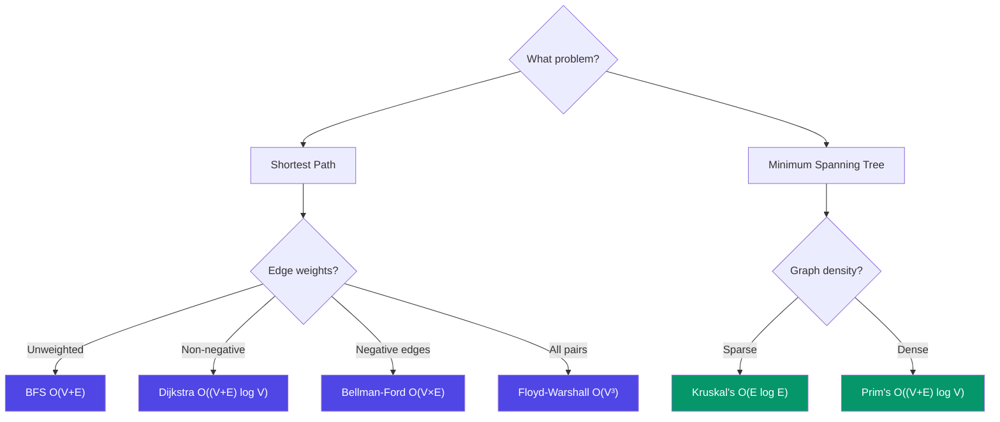

# Key Algorithms on Graphs

> Essential graph algorithms for shortest paths, minimum spanning trees, and more.

---

## Dijkstra's Algorithm

Find the **shortest path from a single source** to all other vertices in a weighted graph (non-negative weights only).

**Core Idea:** Greedily pick the unvisited vertex with the smallest known distance.

```
Graph:
     2       3
  A ──── B ──── D
  |      |      |
  1      4      1
  |      |      |
  C ──── E ──── F
     3       5

Finding shortest path from A:

Step 1: dist = {A:0, B:∞, C:∞, D:∞, E:∞, F:∞}
        MinHeap = [(0,A)]

Step 2: Pop A(0). Relax neighbors:
        B: 0+2=2, C: 0+1=1
        dist = {A:0, B:2, C:1, ...}
        MinHeap = [(1,C), (2,B)]

Step 3: Pop C(1). Relax neighbors:
        E: 1+3=4
        MinHeap = [(2,B), (4,E)]

Step 4: Pop B(2). Relax neighbors:
        D: 2+3=5, E: min(4, 2+4)=4 (no update)
        ...continues
```

**Key Properties:**
- Requires **non-negative** weights
- Time: O((V + E) log V) with min-heap
- Uses a **priority queue (min-heap)**

**⚠️ Important:** When you pop from heap, always check if the distance is stale:
```javascript
if (currDist > distances.get(node)) continue; // Stale entry, skip!
```

---

## Bellman-Ford Algorithm

Find shortest paths from a single source, handles **negative weights**, and detects **negative cycles**.

**Core Idea:** Relax ALL edges V-1 times. If we can still relax after V-1 rounds, there's a negative cycle.

```
Algorithm:
  dist[source] = 0, all others = ∞
  
  Repeat V-1 times:
    For each edge (u, v, w):
      if dist[u] + w < dist[v]:
        dist[v] = dist[u] + w
  
  // Check for negative cycles (V-th iteration)
  For each edge (u, v, w):
    if dist[u] + w < dist[v]:
      → Negative cycle detected!
```

**Why V-1 times?** A shortest path in a graph with V vertices can have at most V-1 edges.

| Property | Value |
|----------|-------|
| Time Complexity | O(V × E) |
| Space Complexity | O(V) |
| Handles Negative Weights | ✅ Yes |
| Detects Negative Cycles | ✅ Yes |
| Best For | Graphs with negative edges, currency arbitrage |

---

## Floyd-Warshall Algorithm

Find **shortest paths between ALL pairs** of vertices using dynamic programming.

```
dist[i][j] = shortest distance from i to j

Initialize:
  dist[i][i] = 0
  dist[i][j] = edge weight if edge exists, else ∞

For each intermediate vertex k:
  For each pair (i, j):
    dist[i][j] = min(dist[i][j], dist[i][k] + dist[k][j])
                 └── direct path ─┘  └─── via k ────────┘
```

**Intuition:** Try every vertex as a potential "middle stop" between all pairs.

| Property | Value |
|----------|-------|
| Time Complexity | O(V³) |
| Space Complexity | O(V²) |
| Best For | Small graphs (V < 500), all-pairs shortest path |

---

## Kruskal's Algorithm (Minimum Spanning Tree)

Find the **minimum spanning tree** — a subset of edges connecting all vertices with minimum total weight and no cycles.

```
Steps:
  1. Sort all edges by weight (ascending)
  2. For each edge (u, v, w) in sorted order:
     If u and v are in DIFFERENT components (use Union-Find):
       Add edge to MST
       Union(u, v)
  3. Stop when MST has V-1 edges

Example:
  Edges sorted: [(A,C,1), (A,B,2), (B,D,3), (C,E,3), (B,E,4)]
  
  (A,C,1): A and C different → Add! MST={(A,C)}
  (A,B,2): A and B different → Add! MST={(A,C),(A,B)}
  (B,D,3): B and D different → Add! MST={(A,C),(A,B),(B,D)}
  (C,E,3): C and E different → Add! MST={(A,C),(A,B),(B,D),(C,E)}
  Done! (4 edges = V-1 for 5 vertices)
```

| Property | Value |
|----------|-------|
| Time Complexity | O(E log E) — dominated by sorting |
| Space Complexity | O(V) |
| Data Structure | Union-Find (Disjoint Set) |
| Best For | Sparse graphs |

---

## Prim's Algorithm (Minimum Spanning Tree)

Alternative MST algorithm. Grows the MST one edge at a time from a starting vertex.

```
Steps:
  1. Start with any vertex, add to MST set
  2. Add all edges from MST vertices to min-heap
  3. Pop smallest edge that connects to unvisited vertex
  4. Add that vertex and its edges to the process
  5. Repeat until all vertices included
```

| Property | Value |
|----------|-------|
| Time Complexity | O((V + E) log V) with min-heap |
| Space Complexity | O(V) |
| Best For | Dense graphs |

> **💡 When to use which?** Prim's is better for **dense** graphs; Kruskal's for **sparse** graphs. Kruskal's also naturally produces a forest (useful for disconnected graphs).

---

## Choosing the Right Algorithm



```
Shortest Path?
├── Unweighted → BFS (O(V+E))
├── Weighted, no negatives → Dijkstra (O((V+E)log V))
├── Negative edges → Bellman-Ford (O(V×E))
└── All pairs → Floyd-Warshall (O(V³))

Minimum Spanning Tree?
├── Sparse graph → Kruskal's (O(E log E))
└── Dense graph → Prim's (O((V+E) log V))
```

---

## Next Steps

Apply these algorithms using our [Problem-Solving Approach](/DSA-Notes-Problems/data-structures/graphs/07-problem-solving) and check the [Code Examples](/DSA-Notes-Problems/data-structures/graphs/08-code-examples) for implementations.

---

## Related Topics

- [Tree Algorithms](/DSA-Notes-Problems/data-structures/trees/06-traversals) — Compare tree and graph traversal approaches
