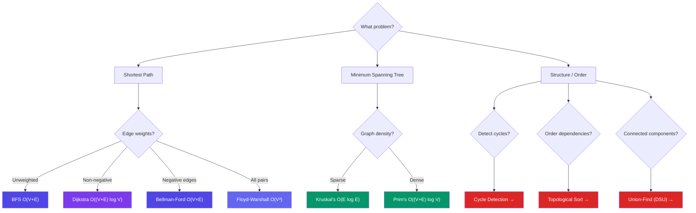

# Key Algorithms on Graphs

> Essential graph algorithms for shortest paths, minimum spanning trees, and more. Each major algorithm now has its own detailed page.

---

## Dedicated Pages

Each algorithm is explained in depth on its own page:

| Algorithm | Page | Best For |
|-----------|------|----------|
| **Dijkstra** | [Dijkstra's Algorithm →](/DSA-Notes-Problems/data-structures/graphs/12-dijkstra) | Shortest path, non-negative weights |
| **Bellman-Ford** | [Bellman-Ford Algorithm →](/DSA-Notes-Problems/data-structures/graphs/13-bellman-ford) | Shortest path, handles negative weights |
| **Floyd-Warshall** | [Floyd-Warshall Algorithm →](/DSA-Notes-Problems/data-structures/graphs/14-floyd-warshall) | All-pairs shortest path |
| **Topological Sort** | [Topological Sort →](/DSA-Notes-Problems/data-structures/graphs/15-topological-sort) | Ordering DAGs (dependencies, build systems) |
| **Union-Find (DSU)** | [Union-Find (Disjoint Set) →](/DSA-Notes-Problems/data-structures/graphs/16-union-find-dsu) | Track connected components, detect cycles |
| **MST (Kruskal & Prim)** | [Minimum Spanning Tree →](/DSA-Notes-Problems/data-structures/graphs/17-mst-kruskal-prim) | Kruskal vs Prim for MST |
| **Cycle Detection** | [Cycle Detection →](/DSA-Notes-Problems/data-structures/graphs/18-cycle-detection) | Detect cycles in directed/undirected graphs |

---

## Choosing the Right Algorithm

---

## Next Steps

Apply these algorithms using our [Problem-Solving Approach](/DSA-Notes-Problems/data-structures/graphs/07-problem-solving) and check the [Code Examples](/DSA-Notes-Problems/data-structures/graphs/08-code-examples) for implementations.

---

## Related Topics

- [Tree Algorithms](/DSA-Notes-Problems/data-structures/trees/06-traversals) — Compare tree and graph traversal approaches
