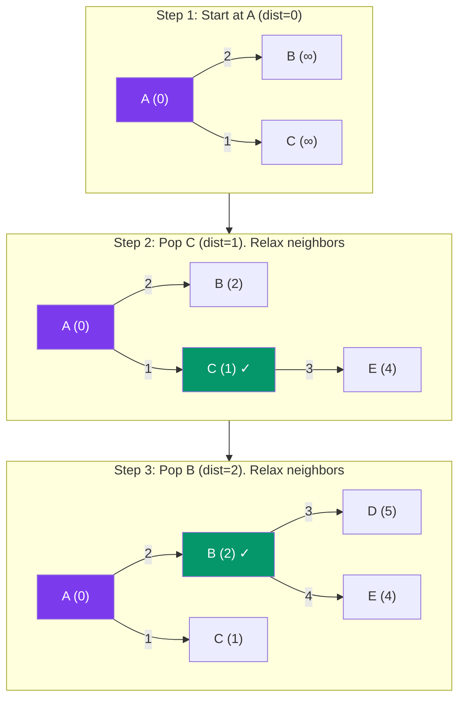

# Dijkstra's Algorithm

> Dijkstra finds the **shortest path from a single source** to all other vertices in a weighted graph with **non-negative** weights. It's a **greedy** algorithm.

---

## Visual: Relaxing Edges



**Core Idea:** Greedily pick the unvisited vertex with the smallest known distance. "Relax" its neighbors (update if you found a shorter path).

---

## Implementation with Min-Heap

```javascript
function dijkstra(graph, start) {
  // graph: Map<vertex, Map<neighbor, weight>>
  const distances = new Map();
  const visited = new Set();
  const heap = new MinHeap(); // priority queue

  // Initialize distances
  for (const vertex of graph.keys()) {
    distances.set(vertex, Infinity);
  }
  distances.set(start, 0);
  heap.insert({ vertex: start, dist: 0 });

  while (heap.size() > 0) {
    const { vertex: u, dist: currDist } = heap.extractMin();

    if (visited.has(u)) continue; // stale entry
    visited.add(u);

    for (const [v, weight] of graph.get(u)) {
      if (visited.has(v)) continue;

      const newDist = currDist + weight;
      if (newDist < distances.get(v)) {
        distances.set(v, newDist);
        heap.insert({ vertex: v, dist: newDist });
      }
    }
  }

  return distances;
}
```

> **⚠️ Important:** When you pop from heap, check if `currDist > distances.get(vertex)` — if so, it's a stale entry, skip it!

---

## Dry Run

```
Graph:
     2       3
  A ──── B ──── D
  |      |      |
  1      4      1
  |      |      |
  C ──── E ──── F
     3       5

Finding shortest path from A:

Step 1: dist = {A:0, B:∞, C:∞, D:∞, E:∞, F:∞}
        MinHeap = [{A,0}]

Step 2: Pop A(0). Relax neighbors:
        B: 0+2=2, C: 0+1=1
        Heap = [{C,1}, {B,2}]

Step 3: Pop C(1). Relax E: 1+3=4
        Heap = [{B,2}, {E,4}]

Step 4: Pop B(2). Relax D:5, E: min(4, 2+4=6) → no update
        Heap = [{E,4}, {D,5}]

...continues until all visited
```

---

## Complexity

| Metric | Value |
|--------|-------|
| Time | **O((V + E) log V)** with binary min-heap |
| Space | O(V) for distances + heap |

---

## Key Properties

- Requires **non-negative** weights (negative edges break the greedy assumption)
- Uses a **priority queue (min-heap)** for efficient extraction
- Can't detect negative cycles

---

## In Simple Words

- Dijkstra = pick the closest unvisited node, update its neighbors.
- Works like expanding a wave from the start — the first time you reach a node is the shortest way.
- Use a min-heap to always pick the nearest node fast.
