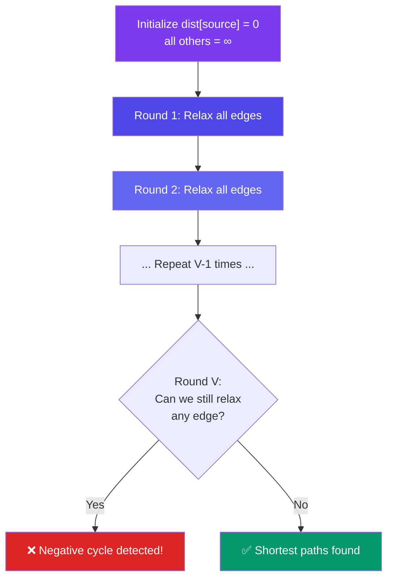

# Bellman-Ford Algorithm

> Bellman-Ford finds shortest paths from a single source, **handles negative weights**, and can **detect negative cycles**. It's slower than Dijkstra but more general.

---

## Core Idea

Relax **ALL edges** V-1 times. If you can still relax after V-1 rounds, there's a negative cycle.

**Why V-1 times?** A shortest path in a graph with V vertices can have at most V-1 edges.

---

## Visual: Relaxation Flow



---

## Implementation

```javascript
function bellmanFord(vertices, edges, start) {
  // edges: [{from, to, weight}, ...]
  const dist = {};
  for (const v of vertices) dist[v] = Infinity;
  dist[start] = 0;

  // Relax all edges V-1 times
  for (let i = 0; i < vertices.length - 1; i++) {
    let updated = false;
    for (const { from, to, weight } of edges) {
      if (dist[from] !== Infinity && dist[from] + weight < dist[to]) {
        dist[to] = dist[from] + weight;
        updated = true;
      }
    }
    if (!updated) break; // Early exit — nothing changed
  }

  // Check for negative cycles
  for (const { from, to, weight } of edges) {
    if (dist[from] !== Infinity && dist[from] + weight < dist[to]) {
      throw new Error("Negative cycle detected");
    }
  }

  return dist;
}

// Example
const V = ['A', 'B', 'C', 'D'];
const E = [
  { from: 'A', to: 'B', weight: 4 },
  { from: 'A', to: 'C', weight: 3 },
  { from: 'B', to: 'C', weight: -2 },  // negative!
  { from: 'B', to: 'D', weight: 2 },
  { from: 'C', to: 'D', weight: 3 },
];

bellmanFord(V, E, 'A');
// dist: { A: 0, B: 4, C: 2, D: 5 }
// (C gets 2 via B's -2 edge instead of direct 3)
```

---

## Complexity

| Metric | Value |
|--------|-------|
| Time | **O(V × E)** |
| Space | O(V) |
| Handles Negative Weights | ✅ Yes |
| Detects Negative Cycles | ✅ Yes |
| Best For | Graphs with negative edges, currency arbitrage |

---

## Applications

| Use Case | Why Bellman-Ford? |
|----------|-------------------|
| Currency arbitrage | Detect negative cycles → profit opportunity |
| Graphs with negative edges | Dijkstra fails with negative weights |
| Routing protocols (RIP) | Distributed version of Bellman-Ford |

---

## In Simple Words

- Relax every edge V-1 times. Each round finds paths one edge longer.
- If edges still relax after V-1 rounds, there's a negative cycle (bad!).
- It's slower than Dijkstra (O(V×E) vs O((V+E)logV)) but handles negative weights.
