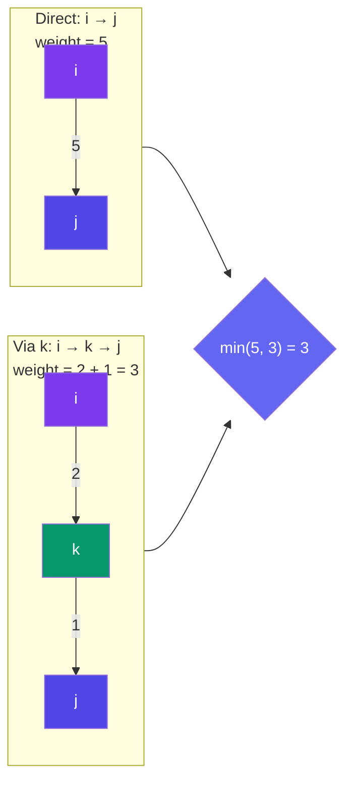

# Floyd-Warshall Algorithm

> Floyd-Warshall finds the **shortest path between ALL pairs** of vertices in one go. It uses **dynamic programming** — try every vertex as a potential "middle stop."

---

## Core Idea

```
dist[i][j] = shortest distance from i to j

For each intermediate vertex k:
  For each pair (i, j):
    dist[i][j] = min(dist[i][j], dist[i][k] + dist[k][j])
                 └── direct path ─┘  └─── via k ────────┘
```

---

## Visual: Trying Each Intermediate Vertex



**Intuition:** For each vertex k, ask: "Does going through k make the path shorter?" Repeat for all k.

---

## Implementation

```javascript
function floydWarshall(graph) {
  // graph: adjacency matrix (Infinity for no edge)
  const V = graph.length;
  const dist = graph.map(row => [...row]); // copy

  for (let k = 0; k < V; k++) {
    for (let i = 0; i < V; i++) {
      if (dist[i][k] === Infinity) continue; // skip impossible
      for (let j = 0; j < V; j++) {
        if (dist[k][j] === Infinity) continue;
        dist[i][j] = Math.min(dist[i][j], dist[i][k] + dist[k][j]);
      }
    }
  }

  return dist;
}

// Example
const INF = Infinity;
const G = [
  [0,   3,   INF, 7],
  [3,   0,   2,   INF],
  [INF, 2,   0,   1],
  [7,   INF, 1,   0],
];

const result = floydWarshall(G);
// result[0][3] = min(7, 3+2+1=6) = 6 (via B and C)
```

---

## Complexity

| Metric | Value |
|--------|-------|
| Time | **O(V³)** |
| Space | O(V²) for the distance matrix |
| Best For | Small graphs (V < 500), all-pairs shortest path |

---

## When to Use

| Use | Don't Use |
|-----|-----------|
| Need distances between all pairs | Only need single-source paths |
| Graph is small (V < 500) | Graph is large (V > 1000) |
| Simple implementation preferred | Memory-constrained (V² matrix) |

---

## In Simple Words

- Floyd-Warshall tries every vertex as a possible middle stop between every pair.
- Three nested loops: for each k, check if k shortens i→j.
- It's elegant and short, but O(V³) — only use for small graphs.
