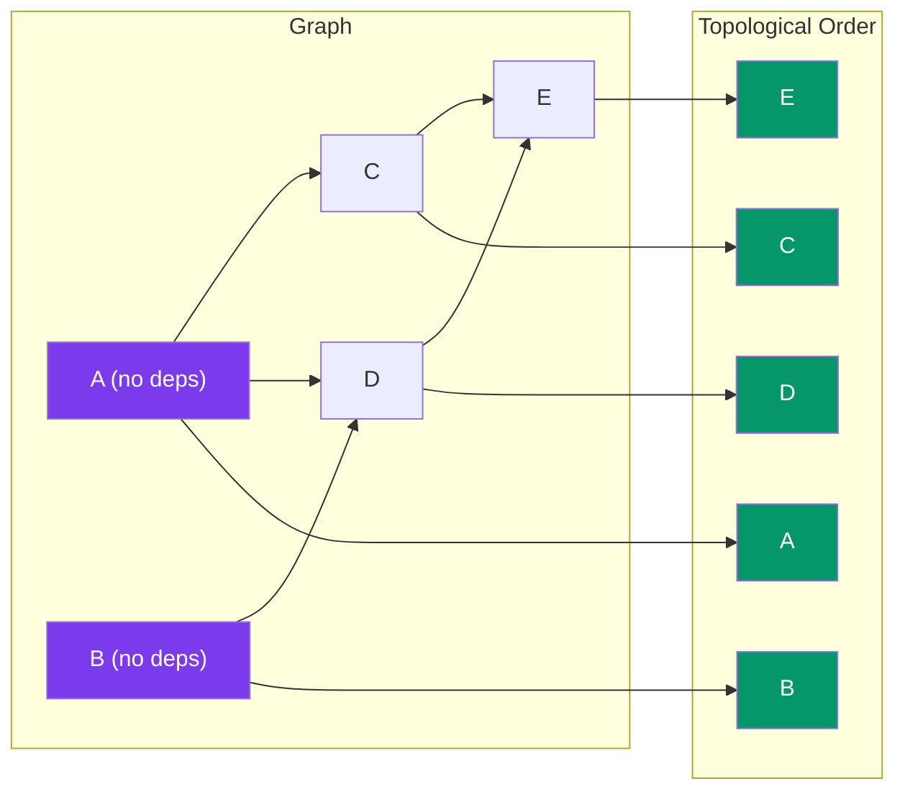

# Topological Sort

> A **topological sort** of a Directed Acyclic Graph (DAG) is an ordering of vertices where for every directed edge `u → v`, `u` comes before `v` in the order.

**Analogy:** Course prerequisites — you must take Math 101 before Math 201.

---

## Visual: Sorting a DAG



**Valid orders:** A→B→C→D→E, B→A→C→D→E, A→B→D→C→E, etc.

---

## Kahn's Algorithm (BFS-based)

Count in-degrees, process vertices with zero in-degree.

```javascript
function topologicalSort(graph) {
  // graph: Map<vertex, neighbor[]>
  const inDegree = new Map();
  for (const v of graph.keys()) inDegree.set(v, 0);

  // Count in-degrees
  for (const [u, neighbors] of graph) {
    for (const v of neighbors) {
      inDegree.set(v, (inDegree.get(v) || 0) + 1);
    }
  }

  // Start with zero in-degree vertices
  const queue = [];
  for (const [v, deg] of inDegree) {
    if (deg === 0) queue.push(v);
  }

  const result = [];
  while (queue.length > 0) {
    const u = queue.shift();
    result.push(u);

    for (const v of graph.get(u) || []) {
      const deg = inDegree.get(v) - 1;
      inDegree.set(v, deg);
      if (deg === 0) queue.push(v);
    }
  }

  // If result doesn't include all vertices, there's a cycle!
  if (result.length !== graph.size) {
    throw new Error("Graph has a cycle — topological sort impossible");
  }

  return result;
}

// Graph: { A: [C, D], B: [D], C: [E], D: [E], E: [] }
// In-degrees: A:0, B:0, C:1, D:2, E:2
// Queue: [A, B] → process A → C: inDeg 0, D: inDeg 1
// Result: [A, B, C, D, E]
```

**Time:** O(V + E) · **Space:** O(V)

---

## DFS-Based Topological Sort

```javascript
function topologicalSortDFS(graph) {
  const visited = new Set();
  const stack = [];

  function dfs(u) {
    visited.add(u);
    for (const v of graph.get(u) || []) {
      if (!visited.has(v)) dfs(v);
    }
    stack.push(u); // post-order: add after processing neighbors
  }

  for (const v of graph.keys()) {
    if (!visited.has(v)) dfs(v);
  }

  return stack.reverse(); // reverse post-order = topological order
}
```

---

## Use Cases

| Use Case | Why Topological Sort? |
|----------|----------------------|
| **Build systems** (`make`) | Determine file compilation order |
| **Course scheduling** | Prerequisite resolution |
| **Dependency resolution** | Package manager install order |
| **Task scheduling** | Which task runs first |

---

## Key Rules

- Only works on **DAGs** (no cycles)
- A DAG can have **multiple valid** topological orders
- Kahn's algorithm can also **detect cycles** (if not all vertices are processed)

---

## In Simple Words

- Topological sort orders items so dependencies come before dependents.
- Kahn's algorithm: repeatedly remove nodes with no incoming edges.
- Only works for directed acyclic graphs (DAGs).
