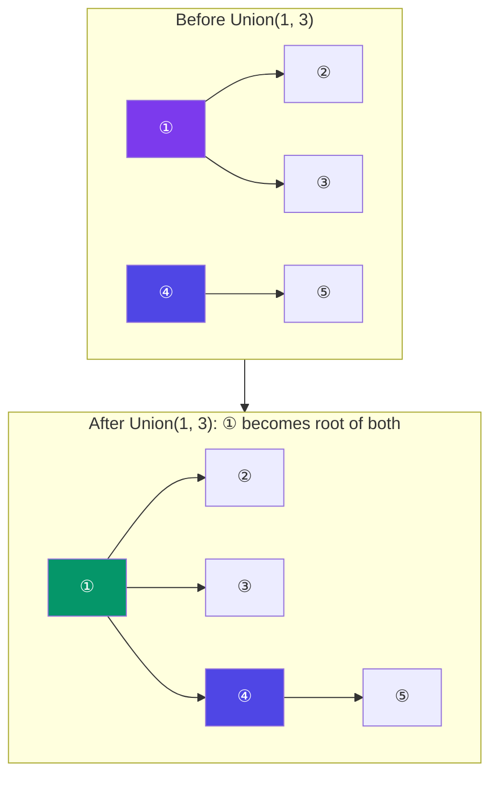

# Union-Find (Disjoint Set Union)

> Union-Find tracks which elements belong to which **group** (set). It supports two operations:
> - **Find:** Which group does this element belong to?
> - **Union:** Merge two groups together.

**Analogy:** At a party, people form groups. If Alice knows Bob and Bob knows Charlie, all three are in the same group. Union-Find tracks who's in which group.

---

## Visual: Merging Two Trees



---

## Implementation with Optimizations

```javascript
class UnionFind {
  constructor(n) {
    this.parent = Array.from({ length: n }, (_, i) => i); // each element is its own parent
    this.rank   = new Array(n).fill(0);                    // tree height
  }

  // Find with path compression
  find(x) {
    if (this.parent[x] !== x) {
      this.parent[x] = this.find(this.parent[x]); // flatten the tree
    }
    return this.parent[x];
  }

  // Union by rank
  union(x, y) {
    const px = this.find(x);
    const py = this.find(y);
    if (px === py) return false; // already in same set

    // Attach shorter tree under taller tree
    if (this.rank[px] < this.rank[py]) {
      this.parent[px] = py;
    } else if (this.rank[px] > this.rank[py]) {
      this.parent[py] = px;
    } else {
      this.parent[py] = px;
      this.rank[px]++;
    }
    return true;
  }

  // Check if two elements are in the same set
  connected(x, y) {
    return this.find(x) === this.find(y);
  }
}

// Usage
const uf = new UnionFind(5);
uf.union(0, 1);  // group {0, 1}
uf.union(2, 3);  // group {2, 3}
uf.union(1, 3);  // merge → group {0, 1, 2, 3}
console.log(uf.connected(0, 4)); // false — 4 is alone
console.log(uf.connected(2, 0)); // true — all in one group
```

---

## Complexity

With both **path compression** and **union by rank**, each operation is nearly O(1):

| Operation | Time (amortized) |
|-----------|:----------------:|
| Find | **O(α(N))** — inverse Ackermann (almost constant) |
| Union | **O(α(N))** |
| Connected | **O(α(N))** |

---

## Use Cases

| Problem | How Union-Find Helps |
|---------|---------------------|
| **Kruskal's MST** | Check if adding an edge creates a cycle |
| **Number of islands** | Track connected land cells |
| **Friend circles** | Group connected friends |
| **Graph cycle detection** | If union connects already-connected nodes → cycle |
| **Redundant connection** | Find edge that creates a cycle in a tree |

---

## In Simple Words

- Union-Find tracks groups. `find` tells you which group, `union` merges groups.
- Path compression keeps trees flat (find → parent of parent directly).
- Union by rank attaches smaller tree under larger tree.
- Together, they make operations almost O(1).
