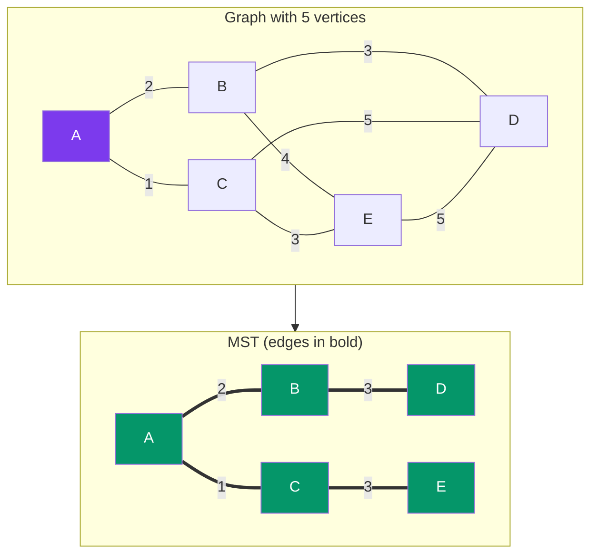

# Minimum Spanning Tree

> A **Minimum Spanning Tree (MST)** is a subset of edges that connects all vertices with the **minimum total weight** and **no cycles**. For a graph with V vertices, an MST has exactly V-1 edges.

---

## Visual: MST Growing Edge by Edge



**Total weight:** 1 + 2 + 3 + 3 = **9**

---

## Kruskal's Algorithm

Sort all edges by weight, then add the smallest edge that doesn't create a cycle.

```javascript
function kruskal(vertices, edges) {
  // edges: [{from, to, weight}]
  edges.sort((a, b) => a.weight - b.weight);
  const uf = new UnionFind(vertices.length);
  const mst = [];
  let totalWeight = 0;

  for (const { from, to, weight } of edges) {
    if (uf.union(from, to)) { // union returns false if already connected
      mst.push({ from, to, weight });
      totalWeight += weight;
      if (mst.length === vertices.length - 1) break;
    }
  }

  return { mst, totalWeight };
}

// Edges sorted: [(A,C,1), (A,B,2), (B,D,3), (C,E,3), (B,E,4), ...]
// (A,C,1): union → add ✓
// (A,B,2): union → add ✓
// (B,D,3): union → add ✓
// (C,E,3): union → add ✓
// Done! MST has 4 edges (V-1)
```

| Property | Value |
|----------|-------|
| Time | **O(E log E)** — dominated by sorting |
| Space | O(V) for Union-Find |
| Best for | **Sparse** graphs (few edges per vertex) |

---

## Prim's Algorithm

Grow the MST one edge at a time from a starting vertex using a min-heap.

```javascript
function prim(graph, start) {
  // graph: adjacency list Map<vertex, [{neighbor, weight}]>
  const visited = new Set();
  const heap = new MinHeap();
  const mst = [];
  let totalWeight = 0;

  visited.add(start);
  for (const { neighbor, weight } of graph.get(start)) {
    heap.insert({ vertex: start, neighbor, weight });
  }

  while (heap.size() > 0) {
    const { vertex: u, neighbor: v, weight } = heap.extractMin();
    if (visited.has(v)) continue;

    visited.add(v);
    mst.push({ from: u, to: v, weight });
    totalWeight += weight;

    for (const { neighbor: w, weight: wgt } of graph.get(v)) {
      if (!visited.has(w)) {
        heap.insert({ vertex: v, neighbor: w, weight: wgt });
      }
    }
  }

  return { mst, totalWeight };
}
```

| Property | Value |
|----------|-------|
| Time | **O((V + E) log V)** with min-heap |
| Space | O(V) |
| Best for | **Dense** graphs (many edges per vertex) |

---

## Which One to Use?

| Factor | Choose |
|--------|--------|
| Sparse graph (E ≈ V) | **Kruskal's** — O(E log E) |
| Dense graph (E ≈ V²) | **Prim's** — O((V+E) log V) |
| Disconnected graph | **Kruskal's** — naturally produces a forest |
| Need to process edges one-by-one (e.g., streaming) | **Kruskal's** |

---

## In Simple Words

- MST = cheapest set of edges to connect all vertices.
- Kruskal: sort edges cheap-first, union-find to avoid cycles.
- Prim: start at one vertex, greedily add the cheapest edge to an unvisited vertex.
- Pick Kruskal for sparse graphs, Prim for dense graphs.
