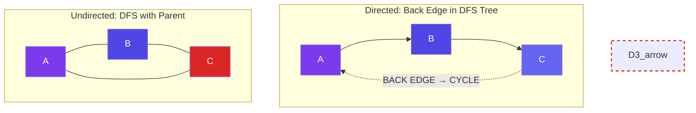

# Cycle Detection

> A **cycle** is a path where the first and last vertex are the same (and you don't reuse edges). Detecting cycles is critical for many algorithms.

---

## Directed Graph: DFS with Recursion Stack

**Idea:** Track nodes in the current recursion path. If we revisit a node on the same path → cycle.

```javascript
function hasCycleDirected(graph) {
  // graph: Map<vertex, neighbor[]>
  const visited = new Set();
  const inStack = new Set(); // recursion stack

  function dfs(u) {
    visited.add(u);
    inStack.add(u);

    for (const v of graph.get(u) || []) {
      if (!visited.has(v)) {
        if (dfs(v)) return true;
      } else if (inStack.has(v)) {
        // Back edge to a node still in recursion stack → cycle!
        return true;
      }
    }

    inStack.delete(u);
    return false;
  }

  for (const v of graph.keys()) {
    if (!visited.has(v)) {
      if (dfs(v)) return true;
    }
  }
  return false;
}
```

**Time:** O(V + E) · **Space:** O(V)

---

## Undirected Graph: DFS with Parent Tracking

**Idea:** Track the parent. If we reach an already-visited node that's NOT the parent → cycle.

```javascript
function hasCycleUndirected(graph) {
  const visited = new Set();

  function dfs(u, parent) {
    visited.add(u);

    for (const v of graph.get(u) || []) {
      if (!visited.has(v)) {
        if (dfs(v, u)) return true;
      } else if (v !== parent) {
        // Visited neighbor that's not parent → cycle!
        return true;
      }
    }
    return false;
  }

  for (const v of graph.keys()) {
    if (!visited.has(v)) {
      if (dfs(v, null)) return true;
    }
  }
  return false;
}
```

**Time:** O(V + E) · **Space:** O(V)

---

## Undirected Graph: Union-Find

**Idea:** For each edge `(u, v)`, if `u` and `v` are already in the same set → adding this edge creates a cycle.

```javascript
function hasCycleUnionFind(vertices, edges) {
  const uf = new UnionFind(vertices.length);

  for (const [u, v] of edges) {
    if (uf.connected(u, v)) return true; // already connected → cycle!
    uf.union(u, v);
  }
  return false;
}
```

**Time:** O(E × α(V)) — nearly linear · **Space:** O(V)

---

## Visual: Cycle Types



---

## Summary

| Graph Type | Method | Key Check |
|-----------|--------|-----------|
| **Directed** | DFS + recursion stack | Node already in current path? |
| **Undirected** | DFS + parent tracking | Visited neighbor that's not parent? |
| **Undirected** | Union-Find | Edge connects two already-connected nodes? |
| **Directed** (Kahn's) | Topological sort | Not all vertices processed? → cycle |

---

## In Simple Words

- Directed cycles = backtracking in a dependency graph (bad for build systems).
- Undirected cycles = DFS with parent check: if a neighbor was visited and it's not your parent → cycle.
- Union-Find detects cycles in undirected graphs very efficiently.
- Kahn's topological sort also detects cycles: if not all nodes are processed, there's a cycle.
