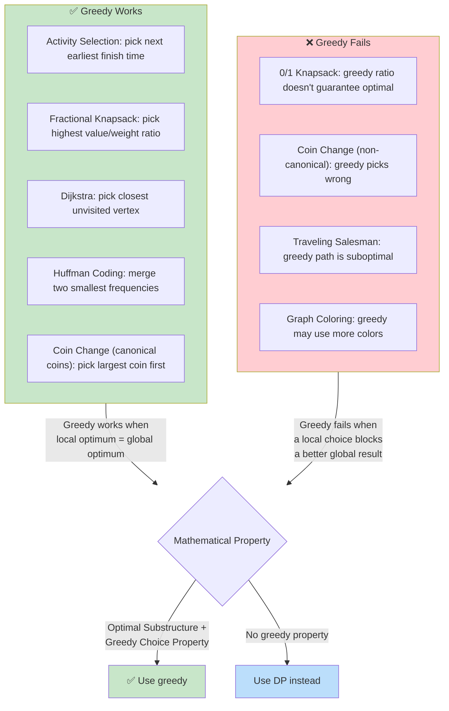

# 💰 Greedy Algorithms — Introduction

## 🎯 What Is a Greedy Algorithm?

A **greedy algorithm** makes the **best choice at each step** — the locally optimal choice — hoping it leads to the globally optimal solution.

**Analogy:** Imagine hiking to a mountain summit. A greedy approach: at every fork, take the path that looks steepest upward. This often gets you to the top, but not always — you might get stuck on a small peak while a bigger peak is behind you.

---

## 🔹 The Greedy Template

```javascript
function greedyTemplate(problem) {
  let result = initialValue;

  while (notDone(problem)) {
    // 1. Choose the BEST option right now
    const bestChoice = makeLocalOptimalChoice(problem);

    // 2. Commit to it
    result = updateResult(result, bestChoice);

    // 3. Reduce the problem (move forward)
    problem = reduceProblem(problem);
  }

  return result;
}
```

---

## 🔹 When Greedy Works vs Fails



---

## 🔹 Greedy vs Dynamic Programming

| Aspect | Greedy | Dynamic Programming |
|--------|--------|-------------------|
| Decision | One choice per step, never revisit | Explores all choices, uses previous results |
| Memory | O(1) or small | O(n) or O(n²) table |
| Proof needed | "Greedy choice property" + "optimal substructure" | Optimal substructure + overlapping subproblems |
| Typical time | O(n) or O(n log n) | O(n²) or more |
| Example | Activity Selection | 0/1 Knapsack |
| Analogy | Hiking straight up | Checking a map for all possible routes |

---

## 🔹 How to Spot a Greedy Problem

Ask these questions:

1. **Can I make a choice now that doesn't block future choices?** (Greedy choice property)
2. **Is the best solution made of the best solutions to subproblems?** (Optimal substructure)
3. **If I make the "best looking" choice at each step, will it produce the globally best answer?**

**Common greedy indicators:**
- "Maximum" or "minimum" of something with constraints
- Scheduling / interval problems
- Problems with a natural ordering (sort first)
- Coin change with standard coin denominations

---

## ✅ In Simple Words

- **Greedy** = pick the best thing right now, hope it works out globally.
- It works when a **locally optimal choice is also globally optimal** (greedy choice property).
- It fails when a choice now **blocks a better** result later (use DP instead).
- To prove greedy works: show the first greedy choice doesn't prevent an optimal solution.
- **Activity selection, Huffman coding, Dijkstra** are classic greedy successes.
- **0/1 Knapsack, TSP** are classic greedy failures.
