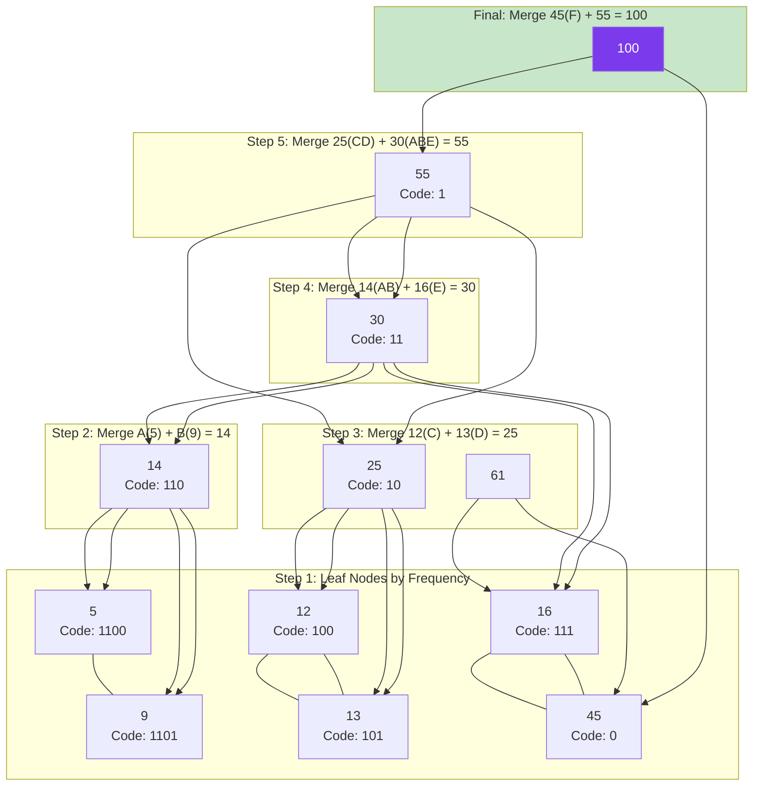

# 🌳 Huffman Coding

## 🎯 What Is Huffman Coding?

Huffman coding is a **lossless data compression algorithm**. It assigns **variable-length codes** to characters — shorter codes for more frequent characters, longer codes for less frequent ones.

**Analogy:** In English, common letters like "e" and "t" are short, while "q" and "z" are long. Huffman does the same for any data — automatically.

---

## 🔹 The Algorithm

```
1. Count frequency of each character
2. Create a leaf node for each character (weight = frequency)
3. While more than one node remains:
   a. Pick the TWO nodes with the smallest frequencies
   b. Create a new parent node with weight = sum of both
   c. The new node's children are the two picked nodes
   d. Put the new node back
4. The last node remaining is the ROOT of the Huffman tree
5. Traverse tree: left = '0', right = '1' to get each character's code
```

---

## 🔹 Huffman Tree Construction



---

## 🔹 Resulting Codes

From the final tree:

| Character | Frequency | Code | Code Length |
|-----------|-----------|------|-------------|
| F | 45 | `0` | 1 bit |
| C | 12 | `100` | 3 bits |
| D | 13 | `101` | 3 bits |
| A | 5 | `1100` | 4 bits |
| B | 9 | `1101` | 4 bits |
| E | 16 | `111` | 3 bits |

**Total bits:** (45 × 1) + (12 × 3) + (13 × 3) + (5 × 4) + (9 × 4) + (16 × 3) = **224 bits**

Fixed-length would need 3 bits per char × 100 chars = **300 bits**. Huffman saved **25%**.

---

## 🔹 JavaScript Implementation

```javascript
class Node {
  constructor(char, freq) {
    this.char = char;
    this.freq = freq;
    this.left = null;
    this.right = null;
  }
}

function buildHuffmanTree(text) {
  // Step 1: Count frequencies
  const freq = {};
  for (const ch of text) {
    freq[ch] = (freq[ch] || 0) + 1;
  }

  // Step 2: Create min-heap (simplified — use array + sort)
  const heap = Object.entries(freq).map(([char, f]) => new Node(char, f));
  heap.sort((a, b) => a.freq - b.freq);

  // Step 3: Build tree
  while (heap.length > 1) {
    const left = heap.shift();   // Smallest
    const right = heap.shift();  // Second smallest

    const parent = new Node(null, left.freq + right.freq);
    parent.left = left;
    parent.right = right;

    heap.push(parent);
    heap.sort((a, b) => a.freq - b.freq);
  }

  return heap[0];  // Root
}

function buildCodes(node, prefix = "", codes = {}) {
  if (!node) return codes;

  if (node.char !== null) {
    // Leaf node — this is a character
    codes[node.char] = prefix;
    return codes;
  }

  buildCodes(node.left, prefix + "0", codes);
  buildCodes(node.right, prefix + "1", codes);

  return codes;
}

function encode(text, codes) {
  return text.split("").map(ch => codes[ch]).join("");
}

function decode(encoded, root) {
  let result = "";
  let current = root;

  for (const bit of encoded) {
    current = bit === "0" ? current.left : current.right;
    if (current.char !== null) {
      result += current.char;
      current = root;
    }
  }

  return result;
}

// Usage
const text = "AAAAABBBBBBBBBCCCCCCCCCCC";
// Wait — let's use the example from our diagram
const sample = "FF" + "C".repeat(12) + "D".repeat(13) + "A".repeat(5) +
               "B".repeat(9) + "E".repeat(16);

const root = buildHuffmanTree(sample);
const codes = buildCodes(root);
console.log(codes);
// { F: "0", C: "100", D: "101", A: "1100", B: "1101", E: "111" }

const encoded = encode(sample, codes);
console.log("Compression ratio:", encoded.length / (sample.length * 8));
```

**Time:** O(n log n) with priority queue | **Space:** O(k) where k is distinct characters

---

## 🔹 Key Properties

| Property | Description |
|----------|-------------|
| **Prefix-free** | No code is a prefix of another — unambiguous decoding |
| **Optimal** | No other prefix-free code compresses better for the given frequencies |
| **Lossless** | Original data can be perfectly reconstructed |
| **Greedy** | Always merges two smallest frequencies — the greedy choice property holds |

---

## ✅ In Simple Words

- Huffman coding assigns **shorter codes to frequent characters**, longer codes to rare ones.
- Build a **binary tree** by repeatedly merging the two smallest-frequency nodes.
- Traverse left = `0`, right = `1` to get each character's code.
- The codes are **prefix-free** — no code is the start of another, so decoding is unambiguous.
- It's a **greedy algorithm** because merging the two smallest frequencies at each step produces the globally optimal tree.
- Used in **ZIP, JPEG, MP3** and many compression formats.
