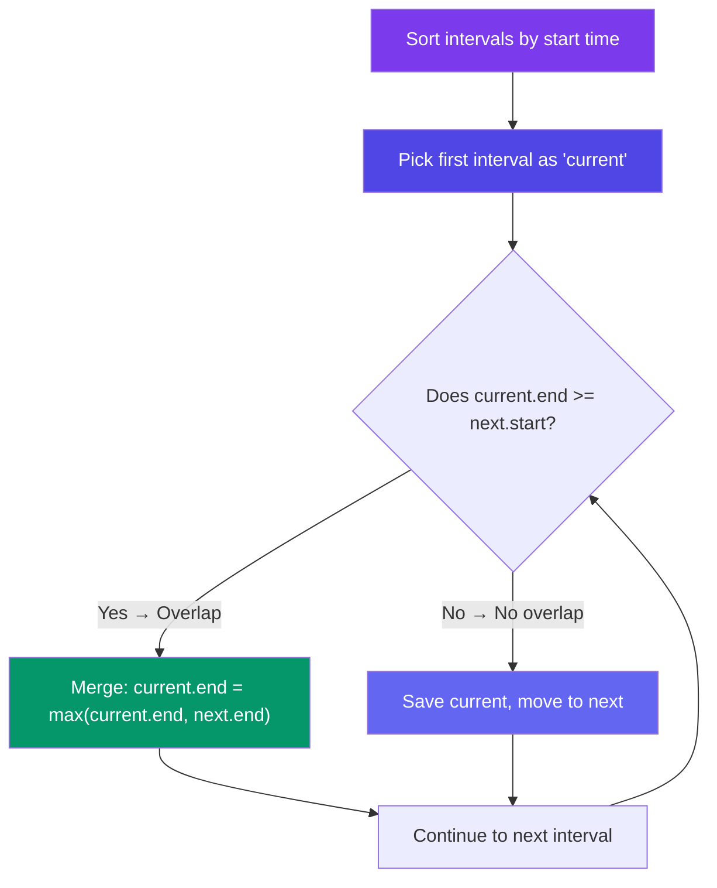

# Merge Intervals

> Sort intervals by their **start** time, then iterate: if the current interval overlaps with the next, merge them. If not, push the current one and move on.

---

## When to Spot This Pattern

- "Merge overlapping intervals"
- "Insert interval into a sorted list"
- "Interval intersection"
- "Meeting rooms" (check if a person can attend all meetings)
- "Minimum platforms needed" (train scheduling)

---

## Core Idea



---

## Merge Overlapping Intervals

```javascript
function merge(intervals) {
  if (intervals.length === 0) return [];

  intervals.sort((a, b) => a[0] - b[0]);
  const result = [intervals[0]];

  for (let i = 1; i < intervals.length; i++) {
    const [curStart, curEnd] = intervals[i];
    const last = result[result.length - 1];

    if (curStart <= last[1]) {
      // Overlap — merge by extending end
      last[1] = Math.max(last[1], curEnd);
    } else {
      // No overlap — push new interval
      result.push([curStart, curEnd]);
    }
  }

  return result;
}

// intervals = [[1,3],[2,6],[8,10],[15,18]]
// Sorted: [[1,3],[2,6],[8,10],[15,18]]
// [1,3] & [2,6] overlap → [1,6]
// [1,6] & [8,10] no overlap → push [8,10]
// [8,10] & [15,18] no overlap → push [15,18]
// Result: [[1,6],[8,10],[15,18]]
```

**Time:** O(N log N) for sorting · **Space:** O(N)

---

## Insert Interval

**Problem:** Insert a new interval into a sorted, non-overlapping list, merging as needed.

```javascript
function insert(intervals, newInterval) {
  const result = [];
  let [newStart, newEnd] = newInterval;
  let i = 0;

  // Add all intervals that end before new interval starts
  while (i < intervals.length && intervals[i][1] < newStart) {
    result.push(intervals[i]);
    i++;
  }

  // Merge all overlapping intervals
  while (i < intervals.length && intervals[i][0] <= newEnd) {
    newStart = Math.min(newStart, intervals[i][0]);
    newEnd   = Math.max(newEnd, intervals[i][1]);
    i++;
  }
  result.push([newStart, newEnd]);

  // Add remaining intervals
  while (i < intervals.length) {
    result.push(intervals[i]);
    i++;
  }

  return result;
}

// intervals = [[1,3],[6,9]], newInterval = [2,5]
// [1,3] ends before 2? No → merge!
// [1,3] overlaps → new = [1,5]
// Result: [[1,5],[6,9]]
```

**Time:** O(N) · **Space:** O(N)

---

## Meeting Rooms

**Problem:** Check if a person can attend all meetings (no overlap).

```javascript
function canAttendMeetings(intervals) {
  intervals.sort((a, b) => a[0] - b[0]);

  for (let i = 1; i < intervals.length; i++) {
    if (intervals[i][0] < intervals[i - 1][1]) {
      return false; // overlap!
    }
  }
  return true;
}

// [[0,30],[5,10],[15,20]] → false
// [[7,10],[2,4]] → true
```

---

## In Simple Words

- Sort by start time → iterate and check overlap.
- Overlap = `current.end >= next.start`. Merge by extending the end.
- Non-overlap = push the current interval and move on.
- Also useful for meeting rooms, train platforms, and free time scheduling.
