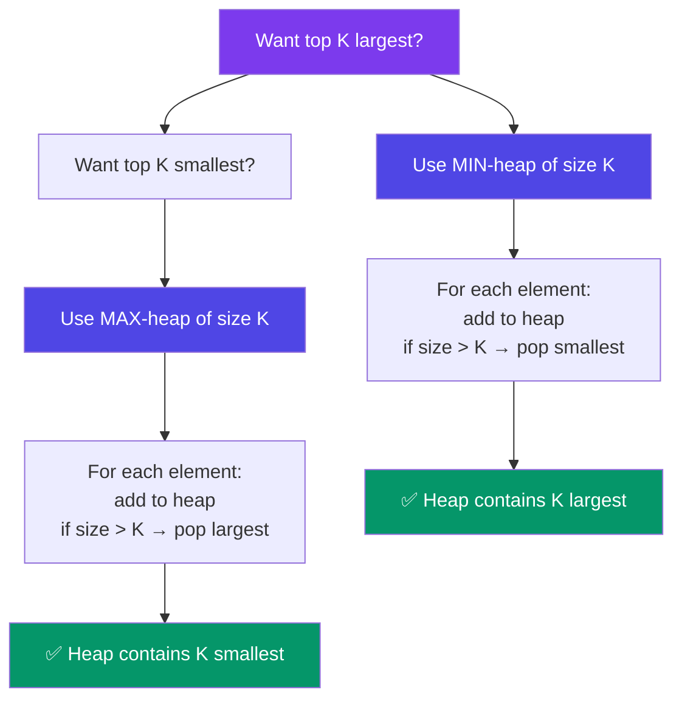

# Top K Elements (Heap)

> Use a **min-heap of size K** to find the K largest elements. For each new element, add it, then if the heap exceeds K, pop the smallest. The heap always holds the K largest so far.

---

## When to Spot This Pattern

- "Kth largest/smallest element"
- "Top K frequent elements"
- "K closest points to origin"
- "K smallest/largest in a stream"
- "Sort characters by frequency"

---

## Core Idea



---

## Kth Largest Element in an Array

```javascript
function findKthLargest(nums, k) {
  const minHeap = [];

  for (const num of nums) {
    minHeap.push(num);
    minHeap.sort((a, b) => a - b); // keep sorted (use real heap for efficiency)
    if (minHeap.length > k) minHeap.shift(); // remove smallest
  }

  return minHeap[0]; // Kth largest
}

// For a real O(N log K) solution, use a proper heap:
function findKthLargestHeap(nums, k) {
  const heap = new MinHeap();
  for (const num of nums) {
    heap.insert(num);
    if (heap.size() > k) heap.extractMin();
  }
  return heap.peek();
}

// nums = [3,2,1,5,6,4], k = 2
// Heap: [3] → [2,3] → [2,3] (1<2, skip) → [3,5] → [3,5,6] → [4,5,6]
// Result: 5
```

**Time:** O(N log K) · **Space:** O(K)

---

## Top K Frequent Elements

**Problem:** Find the K most frequent elements.

**Idea:** Count frequencies with a Map, then push into a min-heap of size K.

```javascript
function topKFrequent(nums, k) {
  // Count frequencies
  const freq = new Map();
  for (const num of nums) {
    freq.set(num, (freq.get(num) || 0) + 1);
  }

  // Min-heap of size K
  const heap = [];
  for (const [num, count] of freq) {
    heap.push([count, num]);
    heap.sort((a, b) => a[0] - b[0]);
    if (heap.length > k) heap.shift();
  }

  return heap.map(([_, num]) => num);
}

// nums = [1,1,1,2,2,3], k = 2
// freq: {1: 3, 2: 2, 3: 1}
// heap: [3:1, 2:2] → skip 3 (1 < 2)
// Result: [1, 2]
```

**Time:** O(N log K) · **Space:** O(N) for freq map

---

## K Closest Points to Origin

**Problem:** Find K closest points to (0, 0).

**Idea:** Max-heap of size K (we want to keep the SMALLEST distances, so reject larger ones).

```javascript
function kClosest(points, k) {
  const heap = []; // max-heap

  for (const [x, y] of points) {
    const dist = x * x + y * y;
    heap.push([dist, x, y]);
    heap.sort((a, b) => b[0] - a[0]); // descending → max at front
    if (heap.length > k) heap.shift(); // remove farthest
  }

  return heap.map(([_, x, y]) => [x, y]);
}
```

---

## Data Stream Patterns

**Problem:** Find K largest numbers in a stream (online algorithm).

```javascript
class KthLargest {
  constructor(k, nums) {
    this.k = k;
    this.heap = new MinHeap();
    for (const num of nums) this.add(num);
  }

  add(val) {
    this.heap.insert(val);
    if (this.heap.size() > this.k) this.heap.extractMin();
    return this.heap.peek();
  }
}
```

---

## In Simple Words

- Top K largest = min-heap of size K. Smallest element of that heap is the Kth largest.
- Top K smallest = max-heap of size K. Largest element is the Kth smallest.
- For frequencies, first count with a Map, then use the same heap trick.
- This keeps memory at O(K) and time at O(N log K).
