# Types of Linked Lists

---

### The Three Types of Linked Lists

```mermaid
flowchart TB
    subgraph Singly[Singly Linked List
One-way ➡️]
        S1[HEAD] --> S2["Node: 10"]
        S2 --> S3["Node: 20"]
        S3 --> S4["Node: 30"]
        S4 --> SNULL[NULL]
    end
    
    subgraph Doubly[Doubly Linked List
Two-way ⬅️➡️]
        DNULL1[NULL] <--> D1["Node: 10"]
        D1 <--> D2["Node: 20"]
        D2 <--> D3["Node: 30"]
        D3 <--> DNULL2[NULL]
    end
    
    subgraph Circular[Circular Linked List
Loop 🔄]
        C1[HEAD] --> C2["Node: 10"]
        C2 --> C3["Node: 20"]
        C3 --> C4["Node: 30"]
        C4 -.-> C2
    end
    
    style Singly fill:#7c3aed,color:#fff
    style Doubly fill:#3b82f6,color:#fff
    style Circular fill:#059669,color:#fff
    style S1 fill:#f59e0b,color:#fff
    style SNULL fill:#ef4444,color:#fff
    style DNULL1 fill:#ef4444,color:#fff
    style DNULL2 fill:#ef4444,color:#fff
    style C1 fill:#f59e0b,color:#fff
```



---

## 🔸 Singly Linked List (One-Way Street) ➡️

Each node points only to the **next** node. You can only move forward.

```js
class Node {
  constructor(val) {
    this.val = val;     // the data
    this.next = null;   // arrow to next node
  }
}
```

**Think of it as:** A one-way street 🚗 — you can only drive forward.

**Characteristics:**
- Simplest form of linked list
- Requires less memory (only one pointer per node)
- Can only traverse in one direction
- Deletion requires access to the previous node

---

## 🔸 Doubly Linked List (Two-Way Street) ⬅️➡️

Each node points to **both** the next AND the previous node.

```
NULL ◀── [●|10|●] ⇄ [●|20|●] ⇄ [●|30|●] ──▶ NULL
```

```js
class DNode {
  constructor(val) {
    this.val = val;
    this.prev = null;   // arrow to previous
    this.next = null;   // arrow to next
  }
}
```

**Think of it as:** A two-way street 🚗↔️ — drive forward OR backward.

| ✅ Good | ❌ Bad |
|---------|--------|
| Easy to go backward | Uses more memory (extra `prev` pointer) |
| Easy to delete a node | More complex to maintain |
| Can traverse in both directions | |

---

## 🔸 Circular Linked List (Loop) 🔄

The last node points back to the **first** node, forming a circle.

```
   ┌──────────────────────────────┐
   ▼                              │
[10|●] ──▶ [20|●] ──▶ [30|●] ─────┘
 HEAD
```

**Think of it as:** A merry-go-round 🎠 — keeps going round and round.

**Used in:**
- Music playlists on repeat 🎵
- Turn-based games 🎮
- Round-robin scheduling
- Operating system task scheduling

---

## Quick Comparison

| Feature | Singly | Doubly | Circular |
|---------|--------|--------|----------|
| Memory per node | 1 pointer | 2 pointers | 1 pointer |
| Forward traversal | ✅ | ✅ | ✅ (wraps) |
| Backward traversal | ❌ | ✅ | ❌ (singly) |
| Delete with only target node | ❌ | ✅ | ❌ |
| Complexity | Simple | Moderate | Simple |

---

## Next

- [Time & Space Complexity](/DSA-Notes-Problems/data-structures/linked-list/03-complexity)
- [Core Operations](/DSA-Notes-Problems/data-structures/linked-list/04-operations)
- [Important Patterns](/DSA-Notes-Problems/data-structures/linked-list/05-patterns)
