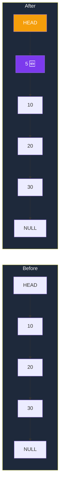
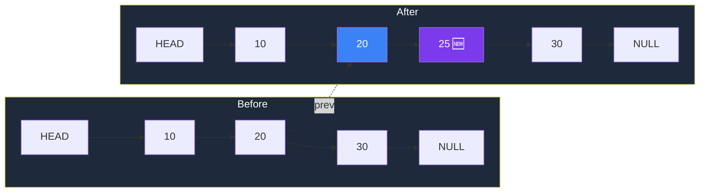
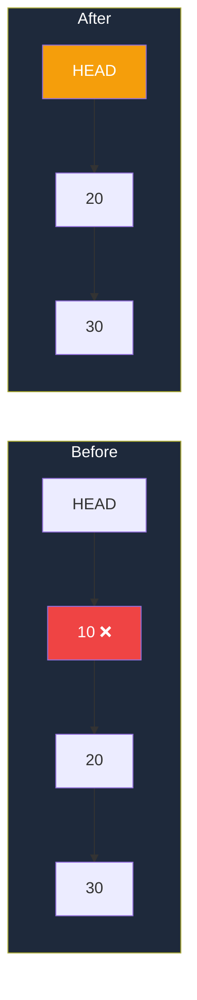

# Core Operations (Step by Step)

Let's build a Linked List from scratch — **slowly and clearly**.

---

## 🏗️ The Setup

```js
// A single node = one box with value + arrow
class Node {
  constructor(val) {
    this.val = val;
    this.next = null;
  }
}

// The Linked List itself = just remembers the HEAD
class LinkedList {
  constructor() {
    this.head = null;  // empty list to start
  }
}
```

---

## 🔸 Insertion

### ➕ Insert at the Beginning (Easy! O(1))

**Goal:** Add `5` to the start of `10 → 20 → 30`.



**Steps:**
1. Make a new node with value `5`.
2. Point new node's `next` to current head (`10`).
3. Update head to point to new node.

```js
insertAtHead(val) {
  const node = new Node(val);  // Step 1: create node
  node.next = this.head;       // Step 2: point to old head
  this.head = node;            // Step 3: head is now the new node
}
```

---

### ➕ Insert at the End (O(n))

**Goal:** Add `40` to end of `10 → 20 → 30`.


**Steps:**
1. Walk all the way to the **last node**.
2. Make last node's `next` point to the new node.

```js
insertAtTail(val) {
  const node = new Node(val);
  if (!this.head) {              // empty list? new node IS the list
    this.head = node;
    return;
  }
  let curr = this.head;
  while (curr.next) {            // walk until last node
    curr = curr.next;
  }
  curr.next = node;              // attach new node
}
```

---

### ➕ Insert in the Middle

**Goal:** Insert `25` between `20` and `30`.



**Steps:**
1. Walk to the node **just before** where you want to insert (i.e., `20`).
2. Make new node point to `prev.next` (which is `30`).
3. Make `prev.next` point to the new node.

```js
insertAt(val, idx) {
  if (idx === 0) return this.insertAtHead(val);

  const node = new Node(val);
  let prev = this.head;
  for (let i = 0; i < idx - 1; i++) prev = prev.next;

  node.next = prev.next;   // new node points to what prev pointed to
  prev.next = node;        // prev now points to new node
}
```

> ⚠️ **The Golden Rule:** Always set the new node's `next` **FIRST**, then change `prev.next`. If you do it the other way, you lose the rest of the list!

---

## 🔸 Deletion

### ➖ Delete from Beginning (Easy! O(1))

Just move the head one step forward.



```js
deleteHead() {
  if (!this.head) return;
  this.head = this.head.next;
}
```

---

### ➖ Delete a Specific Value

**Goal:** Delete `20` from `10 → 20 → 30`.

**Steps:**
1. Find the node **just before** `20` (which is `10`).
2. Skip `20` by pointing `10.next` directly to `30`.

```
Before:  [10] ──▶ [20] ──▶ [30] ──▶ NULL
          prev    target

After:   [10] ──────────▶ [30] ──▶ NULL
                  ↑
              [20] is now orphaned (garbage collected)
```

```js
deleteByValue(val) {
  if (!this.head) return;

  // Special case: deleting the head itself
  if (this.head.val === val) {
    this.head = this.head.next;
    return;
  }

  let curr = this.head;
  while (curr.next && curr.next.val !== val) {
    curr = curr.next;       // walk until next node has the target
  }

  if (curr.next) {
    curr.next = curr.next.next;  // skip the target
  }
}
```

---

## 🔸 Traversal (Walking the List)

Just like reading a treasure hunt, follow each clue until NULL.

```js
print() {
  let curr = this.head;
  while (curr) {
    process.stdout.write(curr.val + " -> ");
    curr = curr.next;
  }
  console.log("NULL");
}
// Output: 10 -> 20 -> 30 -> NULL
```

---

## 🔸 Searching

Walk and check each node.

```js
search(val) {
  let curr = this.head, idx = 0;
  while (curr) {
    if (curr.val === val) return idx;
    curr = curr.next;
    idx++;
  }
  return -1;  // not found
}
```

---

## Related

- [Types of Linked Lists](/DSA-Notes-Problems/data-structures/linked-list/02-types) — Singly, Doubly, Circular
- [Important Patterns](/DSA-Notes-Problems/data-structures/linked-list/05-patterns) — Fast & slow pointer, reversal, etc.
- [Key Algorithms](/DSA-Notes-Problems/data-structures/linked-list/06-algorithms) — Reverse, cycle detection, merge
