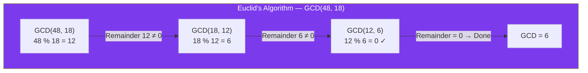

# 📐 GCD, LCM & Euclid's Algorithm

## 🎯 What Are GCD and LCM?

- **GCD** (Greatest Common Divisor): the largest number that divides both numbers evenly.
- **LCM** (Least Common Multiple): the smallest number that both numbers divide into evenly.

```
GCD(12, 18) = 6    (6 divides both 12 and 18)
LCM(12, 18) = 36   (both 12 and 18 divide 36)
```

**Relation:** `LCM(a, b) = (a × b) / GCD(a, b)`

---

## 🔹 Euclid's Algorithm

The most efficient way to find GCD. Based on the observation: `GCD(a, b) = GCD(b, a % b)`.



```javascript
// Recursive
function gcd(a, b) {
  if (b === 0) return a;
  return gcd(b, a % b);
}

// Iterative
function gcdIterative(a, b) {
  while (b !== 0) {
    [a, b] = [b, a % b];
  }
  return a;
}

gcd(48, 18);  // 6
gcd(12, 8);   // 4
gcd(17, 5);   // 1 (coprime)
```

**Time:** O(log min(a, b)) | **Space:** O(1) iterative

---

## 🔹 LCM from GCD

```javascript
function lcm(a, b) {
  return (a * b) / gcd(a, b);
}

lcm(12, 18);  // 36
lcm(4, 6);    // 12
```

**Watch out:** `a * b` can overflow in languages with fixed-size integers. Use `a / gcd(a, b) * b` to avoid overflow.

---

## 🔹 GCD of an Array

```javascript
function gcdArray(arr) {
  return arr.reduce((acc, num) => gcd(acc, num));
}

gcdArray([12, 18, 24]);  // 6
```

---

## 🔹 Extended Euclidean Algorithm

Finds integers `x` and `y` such that `ax + by = gcd(a, b)`.

```javascript
function extendedGcd(a, b) {
  if (b === 0) return { gcd: a, x: 1, y: 0 };

  const { gcd, x: x1, y: y1 } = extendedGcd(b, a % b);
  return { gcd, x: y1, y: x1 - Math.floor(a / b) * y1 };
}

extendedGcd(48, 18);
// { gcd: 6, x: -1, y: 3 }
// Check: 48 × (-1) + 18 × 3 = -48 + 54 = 6 ✓
```

**Use case:** Solving modular inverses (crucial for modular arithmetic).

---

## ✅ In Simple Words

- **GCD** = the biggest number that divides both. **Euclid's algorithm** finds it in O(log n) by repeatedly taking remainders.
- **LCM** = `a × b / GCD(a, b)`.
- Euclid's algorithm: replace `(a, b)` with `(b, a % b)` until b = 0, then a is the GCD.
- Extended Euclid also finds coefficients `x, y` such that `ax + by = GCD(a, b)` — used for modular inverses.
