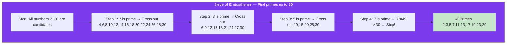

# 🔢 Primes & Sieve of Eratosthenes

## 🎯 What Is a Prime?

A **prime** is a number greater than 1 that has exactly two divisors: 1 and itself.

```
2, 3, 5, 7, 11, 13, 17, 19, 23, 29, 31, ...
```

A **composite** has more than two divisors.

```
4, 6, 8, 9, 10, 12, 14, 15, ...
```

---

## 🔹 Primality Test (Is It Prime?)

**Naive:** Check divisibility from 2 to n-1 — O(n).

**Optimized:** Check only up to `√n`. If `n` has a divisor larger than `√n`, the matching divisor is smaller.

```javascript
function isPrime(n) {
  if (n < 2) return false;
  if (n === 2) return true;
  if (n % 2 === 0) return false;

  for (let i = 3; i * i <= n; i += 2) {
    if (n % i === 0) return false;
  }

  return true;
}

isPrime(17);   // true
isPrime(25);   // false (5 × 5)
isPrime(97);   // true
```

**Time:** O(√n) | **Space:** O(1)

---

## 🔹 Sieve of Eratosthenes

Find **all primes up to n** efficiently by marking multiples as composite.



```javascript
function sieveOfEratosthenes(n) {
  const isPrime = new Array(n + 1).fill(true);
  isPrime[0] = isPrime[1] = false;

  for (let i = 2; i * i <= n; i++) {
    if (isPrime[i]) {
      // Mark all multiples of i as composite
      for (let j = i * i; j <= n; j += i) {
        isPrime[j] = false;
      }
    }
  }

  // Collect primes
  const primes = [];
  for (let i = 2; i <= n; i++) {
    if (isPrime[i]) primes.push(i);
  }

  return primes;
}

sieveOfEratosthenes(30);
// [2, 3, 5, 7, 11, 13, 17, 19, 23, 29]
```

**Time:** O(n log log n) | **Space:** O(n)

**Why start from i²?** Smaller multiples of i (like 2i, 3i, ...) were already crossed out by smaller primes.

---

## 🔹 Prime Factorization

Break a number into its prime factors.

```javascript
function primeFactors(n) {
  const factors = [];

  // Count factor 2
  while (n % 2 === 0) {
    factors.push(2);
    n /= 2;
  }

  // Check odd factors from 3 to √n
  for (let i = 3; i * i <= n; i += 2) {
    while (n % i === 0) {
      factors.push(i);
      n /= i;
    }
  }

  // If n is still > 1, it's a prime factor
  if (n > 1) factors.push(n);

  return factors;
}

primeFactors(84);   // [2, 2, 3, 7]  (84 = 2² × 3 × 7)
primeFactors(97);   // [97] (it's prime)
```

**Time:** O(√n) worst case | **Space:** O(log n)

---

## 🔹 Count Primes (LeetCode 204)

```javascript
function countPrimes(n) {
  if (n < 2) return 0;

  const isPrime = new Array(n).fill(true);
  isPrime[0] = isPrime[1] = false;

  for (let i = 2; i * i < n; i++) {
    if (isPrime[i]) {
      for (let j = i * i; j < n; j += i) {
        isPrime[j] = false;
      }
    }
  }

  return isPrime.filter(Boolean).length;
}

countPrimes(10);  // 4 (2, 3, 5, 7)
countPrimes(100); // 25
```

---

## ✅ In Simple Words

- **Primality test**: Check divisibility up to √n. If none → it's prime.
- **Sieve of Eratosthenes**: Mark multiples of each prime starting from i² — O(n log log n) for all primes up to n.
- **Prime factorization**: Divide by 2s, then odd numbers up to √n.
- The Sieve is the interview classic for "find all primes up to n."
