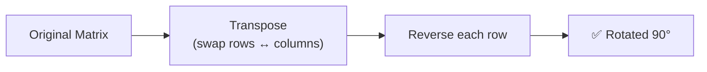

# Matrix Problems

---

## 1. Rotate Image (90° Clockwise)

**Problem:** Rotate an N×N matrix 90° clockwise **in-place**.

**Idea:** Transpose (swap `[i][j]` with `[j][i]`) then reverse each row.



```javascript
function rotate(matrix) {
  const n = matrix.length;

  // Step 1: Transpose
  for (let i = 0; i < n; i++) {
    for (let j = i; j < n; j++) {
      [matrix[i][j], matrix[j][i]] = [matrix[j][i], matrix[i][j]];
    }
  }

  // Step 2: Reverse each row
  for (let i = 0; i < n; i++) {
    matrix[i].reverse();
  }
}

// Input:
// [[1,2,3],
//  [4,5,6],
//  [7,8,9]]
//
// After transpose:
// [[1,4,7],
//  [2,5,8],
//  [3,6,9]]
//
// After reverse:
// [[7,4,1],
//  [8,5,2],
//  [9,6,3]]
```

**Time:** O(N²) · **Space:** O(1)

---

## 2. Spiral Matrix

**Problem:** Return all elements of a matrix in spiral order.

See the [Matrix Traversals](/DSA-Notes-Problems/data-structures/matrix/matrix-traversal) page for the full implementation.

**Time:** O(R × C) · **Space:** O(1)

---

## 3. Set Matrix Zeroes

**Problem:** If an element is `0`, set its entire row and column to `0`. Do it **in-place**.

**Idea:** Use the first row and first column as markers instead of extra space.

```javascript
function setZeroes(matrix) {
  const rows = matrix.length, cols = matrix[0].length;
  let firstRowZero = false, firstColZero = false;

  // Check if first row/col have zero
  for (let c = 0; c < cols; c++) if (matrix[0][c] === 0) firstRowZero = true;
  for (let r = 0; r < rows; r++) if (matrix[r][0] === 0) firstColZero = true;

  // Use first row/col as markers
  for (let r = 1; r < rows; r++) {
    for (let c = 1; c < cols; c++) {
      if (matrix[r][c] === 0) {
        matrix[r][0] = 0;
        matrix[0][c] = 0;
      }
    }
  }

  // Zero out based on markers
  for (let r = 1; r < rows; r++) {
    for (let c = 1; c < cols; c++) {
      if (matrix[r][0] === 0 || matrix[0][c] === 0) matrix[r][c] = 0;
    }
  }

  // Zero out first row/col if needed
  if (firstRowZero) for (let c = 0; c < cols; c++) matrix[0][c] = 0;
  if (firstColZero) for (let r = 0; r < rows; r++) matrix[r][0] = 0;
}
```

**Time:** O(R × C) · **Space:** O(1)

---

## 4. Search a 2D Matrix

**Problem:** Each row is sorted left→right, and the first element of each row is greater than the last element of the previous row. Find a target value.

**Idea:** Treat the matrix as one big sorted array → **binary search**.

```javascript
function searchMatrix(matrix, target) {
  const rows = matrix.length, cols = matrix[0].length;
  let left = 0, right = rows * cols - 1;

  while (left <= right) {
    const mid = Math.floor((left + right) / 2);
    const row = Math.floor(mid / cols);
    const col = mid % cols;
    const val = matrix[row][col];

    if (val === target) return true;
    if (val < target) left = mid + 1;
    else right = mid - 1;
  }
  return false;
}

// matrix = [[1,3,5,7],
//           [10,11,16,20],
//           [23,30,34,60]]
// searchMatrix(matrix, 3) → true
// searchMatrix(matrix, 13) → false
```

**Time:** O(log(R × C)) · **Space:** O(1)

---

## 5. Word Search

**Problem:** Given a grid of letters, find if a word exists by connecting adjacent cells (up/down/left/right). Same cell can't be used twice.

**Idea:** DFS + backtracking with a visited marker.

```javascript
function exist(board, word) {
  const rows = board.length, cols = board[0].length;

  function dfs(r, c, i) {
    if (i === word.length) return true;
    if (r < 0 || r >= rows || c < 0 || c >= cols) return false;
    if (board[r][c] !== word[i]) return false;

    const temp = board[r][c];
    board[r][c] = '#'; // mark visited

    const found = dfs(r + 1, c, i + 1) ||
                  dfs(r - 1, c, i + 1) ||
                  dfs(r, c + 1, i + 1) ||
                  dfs(r, c - 1, i + 1);

    board[r][c] = temp; // backtrack
    return found;
  }

  for (let r = 0; r < rows; r++) {
    for (let c = 0; c < cols; c++) {
      if (dfs(r, c, 0)) return true;
    }
  }
  return false;
}
```

**Time:** O(R × C × 4^L) · **Space:** O(L) where L = word length

---

## In Simple Words

- **Rotate** = transpose + reverse (or reverse + transpose for counter-clockwise).
- **Set zeroes** with O(1) space = use first row/col as markers.
- **Search sorted matrix** = treat it as one long sorted array → binary search.
- **Word search** = DFS + backtracking with a visited marker.
