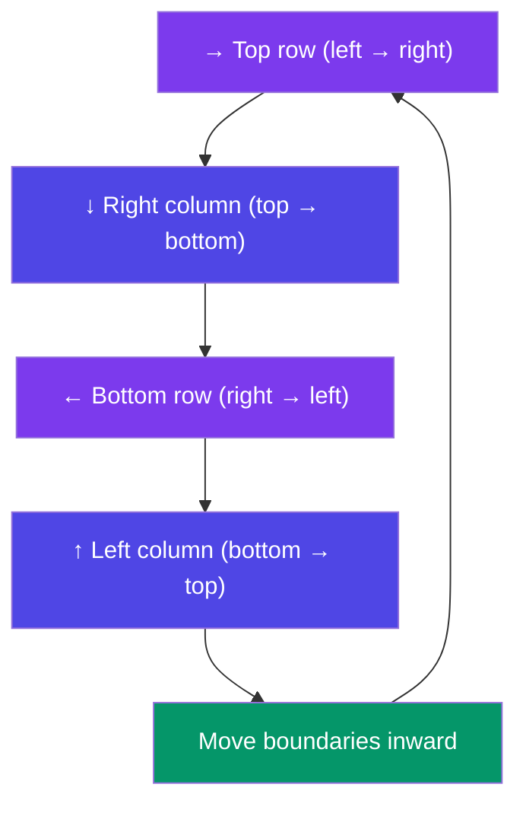

# Matrix Traversals

> A matrix is a 2D array (grid). Learning how to walk through it in different ways is the foundation of all matrix problems.

---

## Row-Wise Traversal

Visit every cell **left to right**, top row to bottom row.

```javascript
const matrix = [
  [1, 2, 3],
  [4, 5, 6],
  [7, 8, 9],
];

for (let r = 0; r < matrix.length; r++) {
  for (let c = 0; c < matrix[r].length; c++) {
    console.log(matrix[r][c]);
  }
}
// Output: 1, 2, 3, 4, 5, 6, 7, 8, 9
```

**Time:** O(R × C) · **Space:** O(1)

---

## Column-Wise Traversal

Visit every cell **top to bottom**, left column to right column.

```javascript
for (let c = 0; c < matrix[0].length; c++) {
  for (let r = 0; r < matrix.length; r++) {
    console.log(matrix[r][c]);
  }
}
// Output: 1, 4, 7, 2, 5, 8, 3, 6, 9
```

---

## Diagonal Traversal

### Main Diagonal (top-left to bottom-right)

```javascript
for (let i = 0; i < matrix.length; i++) {
  console.log(matrix[i][i]);
}
// Output: 1, 5, 9
```

### Anti-Diagonal (top-right to bottom-left)

```javascript
const n = matrix.length;
for (let i = 0; i < n; i++) {
  console.log(matrix[i][n - 1 - i]);
}
// Output: 3, 5, 7
```

---

## Spiral Traversal

Walk the outer perimeter, then move inward.



```javascript
function spiralOrder(matrix) {
  const result = [];
  let top = 0, bottom = matrix.length - 1;
  let left = 0, right = matrix[0].length - 1;

  while (top <= bottom && left <= right) {
    // Top row
    for (let i = left; i <= right; i++) result.push(matrix[top][i]);
    top++;

    // Right column
    for (let i = top; i <= bottom; i++) result.push(matrix[i][right]);
    right--;

    if (top <= bottom) {
      // Bottom row
      for (let i = right; i >= left; i--) result.push(matrix[bottom][i]);
      bottom--;
    }

    if (left <= right) {
      // Left column
      for (let i = bottom; i >= top; i--) result.push(matrix[i][left]);
      left++;
    }
  }
  return result;
}

// Example:
// [[1,2,3],
//  [4,5,6],
//  [7,8,9]]  →  [1,2,3,6,9,8,7,4,5]
```

**Time:** O(R × C) · **Space:** O(1) (excluding output)

---

## Boundaries & Common Edge Cases

| Case | What to Watch |
|------|---------------|
| Empty matrix | `matrix.length === 0` → return `[]` |
| Single row | `matrix.length === 1` → just row traversal |
| Single column | `matrix[0].length === 1` → just column traversal |
| Jagged arrays | Not all rows same length — use `matrix[r].length` per row |

---

## In Simple Words

- **Row-wise** is the default double loop: outer = rows, inner = columns.
- **Column-wise** swaps the loops: outer = columns, inner = rows.
- **Spiral** peels off four boundaries one at a time and shrinks them.
- Always check empty / single-row / single-column cases before coding.
