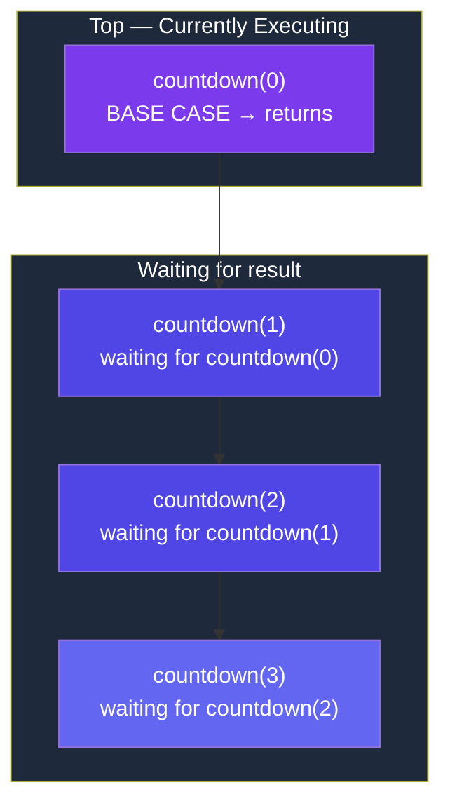

# Introduction to Recursion

## What Is Recursion?

**Recursion is when a function calls itself to solve a smaller version of the same problem, until it reaches a case so simple that it can be answered directly.**

```javascript
function doSomething() {
    // ... some work ...
    doSomething(); // ← the function calls ITSELF
}
```

## Why Is Recursion Used?

| Reason | Explanation |
|--------|-------------|
| **Natural fit for self-similar problems** | Trees, graphs, nested structures are inherently recursive |
| **Cleaner code** | Recursive solutions are often shorter and more elegant than iterative ones |
| **Divide & Conquer** | Break big problems into identical smaller sub-problems |
| **Required for backtracking** | Backtracking is built on top of recursion |
| **Foundation for DP** | Dynamic Programming starts with a recursive solution |

> **When NOT to use recursion:** When a simple loop does the job (e.g., summing an array). Don't force recursion.

## Real-Life Analogy

### Russian Nesting Dolls (Matryoshka)

Imagine you have a Russian nesting doll. You want to find the smallest doll inside.

```
Step 1: Open the biggest doll       → find a smaller doll inside
Step 2: Open the smaller doll       → find an even smaller doll inside
Step 3: Open the even smaller doll  → find the TINIEST doll (can't open)
Step 4: STOP. You found the smallest doll. ← This is the BASE CASE.
```

**The "opening" is the recursive step. The tiniest doll you can't open is the base case.**

### Counting People in a Line

You're standing in a long line and want to know your position. You can only talk to the person directly in front of you.

```
You:        "Hey, what position are you?"
Person 4:   "I don't know, let me ask..." → asks Person 3
Person 3:   "I don't know, let me ask..." → asks Person 2
Person 2:   "I don't know, let me ask..." → asks Person 1
Person 1:   "I'm FIRST!" (BASE CASE — they can see the front)
Person 2:   "Oh, then I'm 1 + 1 = 2" → tells Person 3
Person 3:   "Oh, then I'm 2 + 1 = 3" → tells Person 4
Person 4:   "Oh, then I'm 3 + 1 = 4" → tells you
You:        "I'm 4 + 1 = 5!"
```

> Notice: The question goes FORWARD (deeper), the answer comes BACKWARD (unwinding).

## Structure of a Recursive Function

Every recursive function has **exactly two essential parts**:

```
┌─────────────────────────────────────────────┐
│           RECURSIVE FUNCTION                │
│                                             │
│   1. BASE CASE (when to STOP)               │
│      └─ Returns a direct answer             │
│      └─ Without this → INFINITE RECURSION   │
│                                             │
│   2. RECURSIVE CASE (when to CONTINUE)      │
│      └─ Calls itself with SMALLER input     │
│      └─ Must make PROGRESS toward base case │
│                                             │
└─────────────────────────────────────────────┘
```

### Template

```javascript
function recursiveFunction(input) {
    // ===== BASE CASE =====
    if (input reaches simplest form) {
        return directAnswer;
    }

    // ===== RECURSIVE CASE =====
    return someOperation + recursiveFunction(smallerInput);
}
```

### Example: Countdown

```javascript
function countdown(n) {
    // BASE CASE: When n reaches 0, stop.
    if (n === 0) {
        console.log("Done!");
        return;
    }

    // RECURSIVE CASE: Print n, then count down from n-1.
    console.log(n);
    countdown(n - 1);  // ← n is getting SMALLER → progress toward base case
}

countdown(5);
// Output: 5, 4, 3, 2, 1, Done!
```

## Call Stack Visualization (Step-by-Step Dry Run)

Let's trace `countdown(3)` **step by step**:

```
STEP 1: countdown(3) is called
        → n = 3, not 0 → print 3 → call countdown(2)

STEP 2: countdown(2) is called
        → n = 2, not 0 → print 2 → call countdown(1)

STEP 3: countdown(1) is called
        → n = 1, not 0 → print 1 → call countdown(0)

STEP 4: countdown(0) is called
        → n = 0 → BASE CASE HIT → print "Done!" → return

STEP 5: countdown(1) finishes → return
STEP 6: countdown(2) finishes → return
STEP 7: countdown(3) finishes → return
```

**The Call Stack (visualized like a stack of plates):**



```
After base case, the stack UNWINDS (pops one by one from top):
    countdown(0) returns → popped
    countdown(1) returns → popped
    countdown(2) returns → popped
    countdown(3) returns → popped → DONE
```

---

## Key Takeaways

- **Every recursive function needs**: Base case, recursive case, and progress toward the base case
- **Recursion is not always the answer** — use it when the problem has a self-similar structure
- **Trust the recursion** — think about ONE level, not the entire call chain

---

**Next:** [Understanding the Call Stack](/DSA-Notes-Problems/data-structures/recursion/02-call-stack) →
