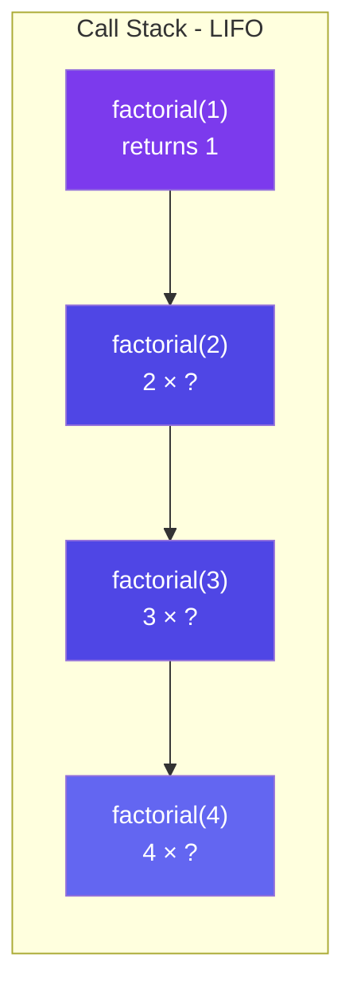

# Understanding the Call Stack

## How Function Calls Are Stored

When **any** function is called (not just recursive ones), the computer:

1. **Creates a "stack frame"** — a block of memory holding:
   - The function's local variables
   - The arguments passed
   - The return address (where to go back to when done)
2. **Pushes** this frame onto the **call stack**
3. When the function returns, its frame is **popped** off the stack



```
The Call Stack is a LIFO (Last In, First Out) data structure.

Think of it like a stack of cafeteria trays:
    - You can only add/remove from the TOP
    - The last tray put on top is the first one taken off
```


## Detailed Visual Dry Run

Let's trace `factorial(4)`:

```javascript
function factorial(n) {
    if (n <= 1) return 1;       // Base case
    return n * factorial(n - 1); // Recursive case
}
```

### Phase 1: WINDING (Going Deeper)

```
Call: factorial(4)
    → 4 * factorial(3)             // doesn't know factorial(3) yet, must compute

    Call: factorial(3)
        → 3 * factorial(2)         // doesn't know factorial(2) yet, must compute

        Call: factorial(2)
            → 2 * factorial(1)     // doesn't know factorial(1) yet, must compute

            Call: factorial(1)
                → returns 1        // BASE CASE HIT!
```

**Stack at deepest point:**
```
         ┌────────────────────────────┐
         │ factorial(1) → returns 1   │  ← TOP
         ├────────────────────────────┤
         │ factorial(2) → 2 * ???     │
         ├────────────────────────────┤
         │ factorial(3) → 3 * ???     │
         ├────────────────────────────┤
         │ factorial(4) → 4 * ???     │
         └────────────────────────────┘
               BOTTOM (first call)
```

### Phase 2: UNWINDING (Coming Back Up)

```
factorial(1) returns 1
    → factorial(2) now knows: 2 * 1 = 2, returns 2
        → factorial(3) now knows: 3 * 2 = 6, returns 6
            → factorial(4) now knows: 4 * 6 = 24, returns 24

ANSWER: 24
```

**Stack unwinding:**

```
Step A:  factorial(1) returns 1    → popped
         ┌────────────────────────────┐
         │ factorial(2) → 2 * 1 = 2  │  ← now computable
         ├────────────────────────────┤
         │ factorial(3) → 3 * ???    │
         ├────────────────────────────┤
         │ factorial(4) → 4 * ???    │
         └────────────────────────────┘

Step B:  factorial(2) returns 2    → popped
         ┌────────────────────────────┐
         │ factorial(3) → 3 * 2 = 6  │  ← now computable
         ├────────────────────────────┤
         │ factorial(4) → 4 * ???    │
         └────────────────────────────┘

Step C:  factorial(3) returns 6    → popped
         ┌────────────────────────────┐
         │ factorial(4) → 4 * 6 = 24 │  ← now computable
         └────────────────────────────┘

Step D:  factorial(4) returns 24   → popped
         ┌────────────────────────────┐
         │         (empty)            │
         └────────────────────────────┘

RESULT: 24
```

## Stack Overflow

**What happens if there is no base case, or the base case is never reached?**

```javascript
// ⚠️ DANGER: No base case!
function infinite(n) {
    return infinite(n);  // calls itself forever
}
```

```
Stack:
    ┌─────────────┐
    │ infinite(5)  │
    ├─────────────┤
    │ infinite(5)  │
    ├─────────────┤
    │ infinite(5)  │
    ├─────────────┤
    │     ...      │  ← Stack grows and grows
    ├─────────────┤
    │ infinite(5)  │
    └─────────────┘

Eventually the stack runs out of memory → CRASH!
Error: "Maximum call stack size exceeded" (Stack Overflow)
```

**Key rule:** Every recursive call MUST make progress toward the base case.

```
n → n-1 → n-2 → ... → 0 (base case)     ✅ Makes progress
n → n   → n   → ... → n (forever)         ❌ No progress
```

## Key Insights

- The **winding** phase pushes frames onto the stack (going deeper)
- The **unwinding** phase pops frames off the stack (returning results)
- Code BEFORE the recursive call executes during winding
- Code AFTER the recursive call executes during unwinding
- Stack depth = O(n) for linear recursion — this is why deep recursion can overflow

---

**Next:** [Types of Recursion](/DSA-Notes-Problems/data-structures/recursion/03-types) →
