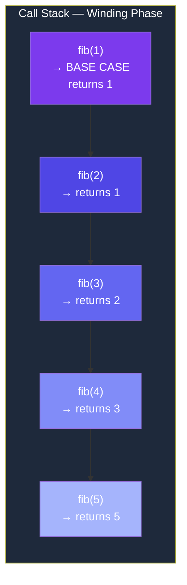
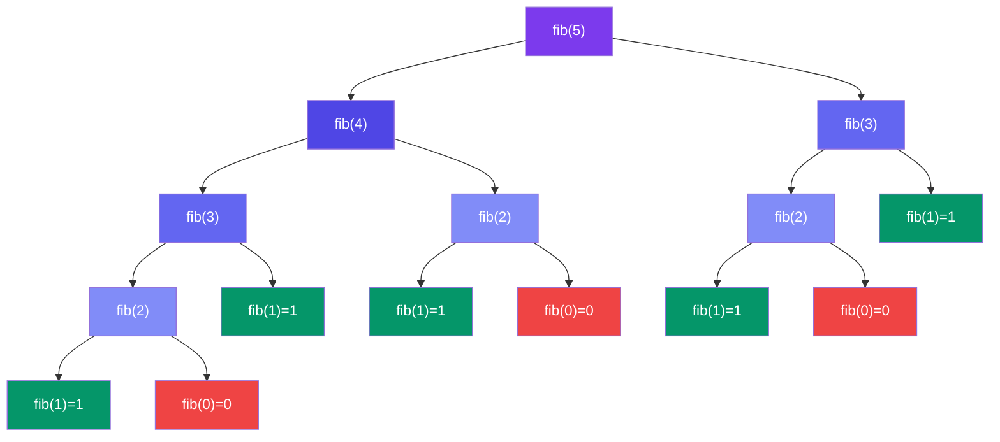
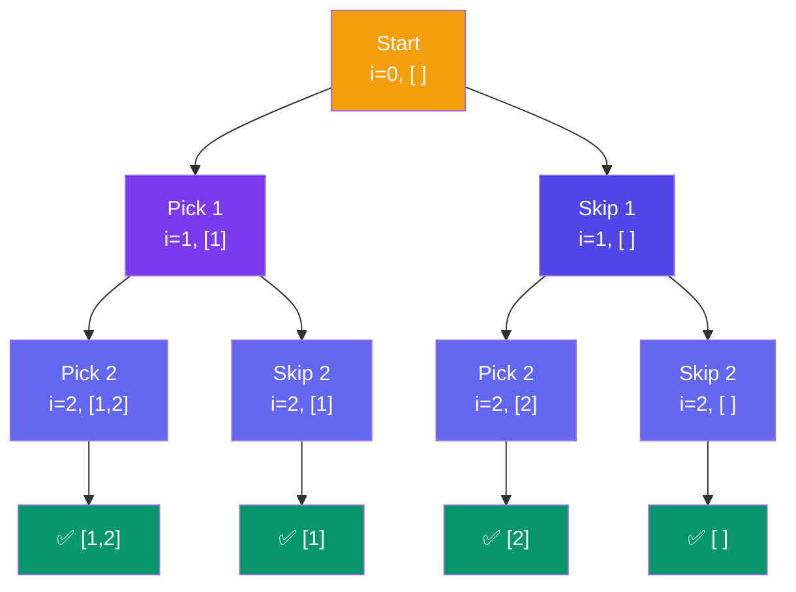
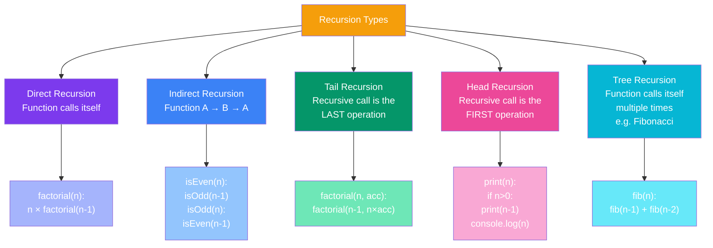

# Recursion & Backtracking

Welcome to the **Recursion & Backtracking** section — from absolute beginner to interview-ready. This guide covers everything from the fundamentals of recursive thinking to advanced backtracking patterns.

---

## Learning Path

| Step | Topic | What You'll Learn |
|------|-------|-------------------|
| 1 | [Introduction to Recursion](/DSA-Notes-Problems/data-structures/recursion/01-introduction) | What is recursion, analogies, function structure |
| 2 | [The Call Stack](/DSA-Notes-Problems/data-structures/recursion/02-call-stack) | How recursion uses the call stack, winding/unwinding |
| 3 | [Types of Recursion](/DSA-Notes-Problems/data-structures/recursion/03-types) | Direct, indirect, tail, head, tree recursion |
| 4 | [Basic Recursion Problems](/DSA-Notes-Problems/data-structures/recursion/04-basic-problems) | Factorial, Fibonacci, sum, reverse, subsequences |
| 5 | [Recursion Patterns](/DSA-Notes-Problems/data-structures/recursion/05-patterns) | Pick/Not Pick, Divide & Conquer, Backtracking foundation |
| 6 | [Introduction to Backtracking](/DSA-Notes-Problems/data-structures/recursion/06-backtracking-intro) | What is backtracking, decision trees, universal template |
| 7 | [Backtracking Patterns](/DSA-Notes-Problems/data-structures/recursion/07-backtracking-patterns) | Subsets, permutations, combination sum |
| 8 | [Advanced Backtracking](/DSA-Notes-Problems/data-structures/recursion/08-backtracking-advanced) | N-Queens, Sudoku, palindrome partitioning, word search |
| 9 | [Problem-Solving Approach](/DSA-Notes-Problems/data-structures/recursion/09-problem-solving) | How to identify & approach recursion problems |
| 10 | [Time & Space Complexity](/DSA-Notes-Problems/data-structures/recursion/10-complexity) | Analyzing recursive algorithms |
| 11 | [Code Examples](/DSA-Notes-Problems/data-structures/recursion/11-code-examples) | Additional JavaScript implementations |
| 12 | [Interview Questions](/DSA-Notes-Problems/data-structures/recursion/12-interview-questions) | Categorized by difficulty with solutions |
| 13 | [Common Mistakes & Tips](/DSA-Notes-Problems/data-structures/recursion/13-mistakes-tips) | Debugging, optimization, best practices |
| 14 | [Real-World Applications](/DSA-Notes-Problems/data-structures/recursion/14-applications) | File systems, game AI, compilers |

---

## Quick Visual Overview

### Call Stack

### Recursion Tree (Fibonacci)

### Backtracking Decision Tree (Subsets of [1,2])

### Types of Recursion

---

## Key Formulas

| Concept | Formula |
|---------|---------|
| Subsets | `O(2ⁿ)` total subsets for n elements |
| Permutations | `O(n!)` total permutations |
| Fibonacci (naive) | `T(n) = T(n-1) + T(n-2) + O(1) → O(2ⁿ)` |
| Fibonacci (memoized) | `O(n)` time, `O(n)` space |
| Divide & Conquer | `T(n) = 2T(n/2) + O(n) → O(n log n)` |

---

## Related Topics

- [Trees](/DSA-Notes-Problems/data-structures/trees) — Most tree algorithms are inherently recursive
- [Graphs](/DSA-Notes-Problems/data-structures/graphs) — DFS graph traversal uses recursion
- [Stacks & Queues](/DSA-Notes-Problems/data-structures/stacks-queues/stack-lifo) — The call stack is a LIFO structure

*Start with [Introduction to Recursion](/DSA-Notes-Problems/data-structures/recursion/01-introduction) →*
