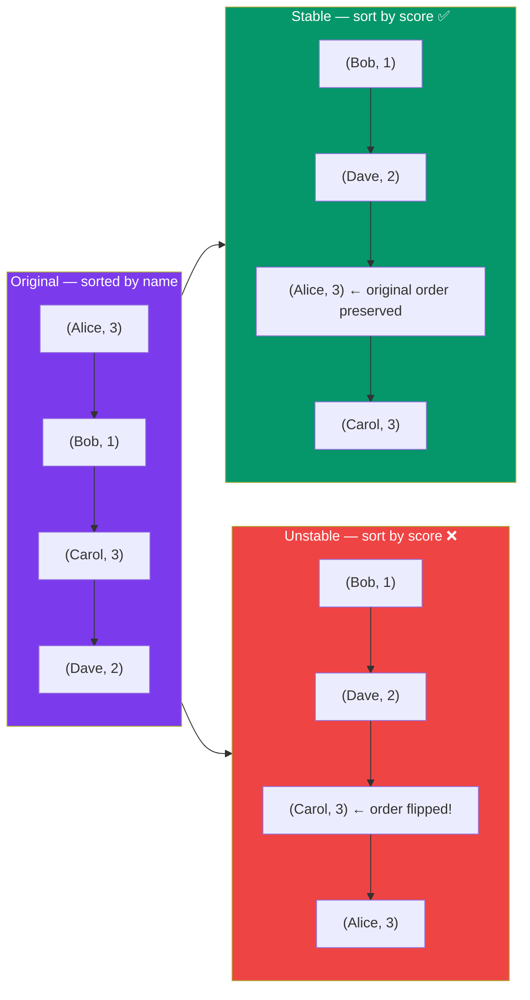

# Sorting Algorithms — Introduction

## 🎯 What Is Sorting?

**Sorting** is the process of arranging elements in a specific order — typically ascending or descending. It is one of the most fundamental operations in computer science.

```
Unsorted: [64, 25, 12, 22, 11]
Sorted:   [11, 12, 22, 25, 64]
```

Sorting is not just about numbers. You can sort:
- Strings (alphabetically)
- Objects (by a property like age, name, score)
- Custom data types (by any defined comparison)

---

## 🔹 Why Does Sorting Matter?

| Use Case | Why Sorting Helps |
|----------|-------------------|
| Binary Search | Only works on sorted arrays — reduces search to O(log n) |
| Finding duplicates | Adjacent elements become equal after sorting |
| Finding min/max | Trivially at start/end of sorted array |
| Merging datasets | Sorted data merges efficiently in O(n) |
| Displaying data | Users expect sorted lists, leaderboards, etc. |
| Database queries | ORDER BY relies on fast sorting |

---

## 🔹 Stable vs Unstable Sort

This is one of the most important properties of a sorting algorithm.

### Stable Sort

A sort is **stable** if elements with **equal keys** maintain their **original relative order** after sorting.



**When does stability matter?** Sorting by multiple keys (e.g., sort by department, then by salary within department).

### When Does Stability Matter?

```
Scenario: Sort employees first by department, then by salary within department.

Step 1: Sort by salary (any sort)      → [(Eve,$50k), (Bob,$60k), (Alice,$70k), (Carol,$80k)]
Step 2: Sort by department (STABLE)    → [(Alice,$70k), (Carol,$80k), (Bob,$60k), (Eve,$50k)]
                                               ↑ Engineering ↑         ↑ Sales ↑
                                        Within Engineering: $70k then $80k ✅ (salary order preserved)
```

**If Step 2 used an unstable sort, the salary ordering within each department would be lost.**

### Stable Algorithms
- Bubble Sort, Insertion Sort, Merge Sort, Tim Sort (JS `.sort()`)

### Unstable Algorithms
- Selection Sort, Quick Sort, Heap Sort

---

## 🔹 In-Place vs Out-of-Place Sort

### In-Place Sort
Uses **O(1) extra space** (constant auxiliary memory). Modifies the original array directly.

```javascript
// In-place: only using a few variables for swapping
function swap(arr, i, j) {
    let temp = arr[i];  // O(1) extra space
    arr[i] = arr[j];
    arr[j] = temp;
}
```

**In-place algorithms**: Bubble, Selection, Insertion, Heap, Quick Sort

### Out-of-Place Sort
Requires **O(n) or more extra space**. Creates new arrays during the process.

```javascript
// Out-of-place: creates new arrays for left and right halves
function mergeSort(arr) {
    if (arr.length <= 1) return arr;
    const mid = Math.floor(arr.length / 2);
    const left = mergeSort(arr.slice(0, mid));   // new array
    const right = mergeSort(arr.slice(mid));      // new array
    return merge(left, right);                    // new array
}
```

**Out-of-place algorithms**: Merge Sort

### Tradeoff

| Property | In-Place | Out-of-Place |
|----------|----------|--------------|
| Memory usage | O(1) | O(n) |
| Cache performance | Better | Worse (new allocations) |
| Parallelization | Harder | Easier |
| Practical use | Memory constrained systems | General-purpose |

---

## 🔹 Comparison vs Non-Comparison Sorts

### Comparison Sorts
Determine order by **comparing elements** to each other.

```
Is arr[i] > arr[j] ?  → Yes → swap them
                       → No  → leave them
```

**Theoretical lower bound**: O(n log n) — proven mathematically that no comparison sort can do better in the average/worst case.

**Examples**: All 6 algorithms in this section (Bubble, Selection, Insertion, Merge, Quick, Heap).

### Non-Comparison Sorts
Use **the actual values/digits** of elements, not comparisons. Can beat the O(n log n) barrier under specific conditions.

```
Counting Sort: Count frequency of each value, then reconstruct
Radix Sort:    Sort digit by digit (from least to most significant)
Bucket Sort:   Distribute into buckets, sort each bucket
```

| Algorithm | Time | When Applicable |
|-----------|------|-----------------|
| Counting Sort | O(n + k) | Integer keys in range [0, k] |
| Radix Sort | O(d × (n + k)) | Fixed-length integer/string keys |
| Bucket Sort | O(n) avg | Uniformly distributed float input |

> **Interview tip**: When interviewer asks "Can you sort faster than O(n log n)?", the answer is YES — with Counting/Radix/Bucket Sort — but only under specific constraints on the data.

---

## 📊 Full Algorithm Overview Table

| Algorithm | Best Case | Average Case | Worst Case | Space | Stable | In-Place | Strategy |
|-----------|-----------|--------------|------------|-------|--------|----------|----------|
| Bubble Sort | O(n) | O(n²) | O(n²) | O(1) | ✅ | ✅ | Adjacent swaps |
| Selection Sort | O(n²) | O(n²) | O(n²) | O(1) | ❌ | ✅ | Find minimum |
| Insertion Sort | O(n) | O(n²) | O(n²) | O(1) | ✅ | ✅ | Build sorted prefix |
| Merge Sort | O(n log n) | O(n log n) | O(n log n) | O(n) | ✅ | ❌ | Divide & conquer |
| Quick Sort | O(n log n) | O(n log n) | O(n²) | O(log n) | ❌ | ✅ | Pivot partition |
| Heap Sort | O(n log n) | O(n log n) | O(n log n) | O(1) | ❌ | ✅ | Max-heap extraction |

---

## 🔹 How Sorting Algorithms Are Classified

```mermaid
flowchart TB
    Sorts[Sorting Algorithms] --> Simple[Simple — O(n²)
Quadratic]
    Sorts --> Efficient[Efficient — O(n log n)
Linearithmic]
    Sorts --> Linear[Linear — O(n)
Non-Comparison]
    
    Simple --> Bubble[Bubble Sort
Stable, In-place]
    Simple --> Selection[Selection Sort
Unstable, In-place]
    Simple --> Insertion[Insertion Sort
Stable, In-place]
    
    Efficient --> Merge[Merge Sort
Stable, Out-of-place]
    Efficient --> Quick[Quick Sort
Unstable, In-place*]
    Efficient --> Heap[Heap Sort
Unstable, In-place]
    
    Linear --> Counting[Counting Sort
Stable, Out-of-place]
    Linear --> Radix[Radix Sort
Stable, Out-of-place]
    Linear --> Bucket[Bucket Sort
Stable, Out-of-place]
    
    style Sorts fill:#7c3aed,color:#fff
    style Simple fill:#f59e0b,color:#fff
    style Efficient fill:#059669,color:#fff
    style Linear fill:#3b82f6,color:#fff
```

*Quick Sort uses O(log n) stack space for recursion

---

## 🔹 Choosing a Sort — Mental Model

```mermaid
flowchart TB
    Q1{Input size n?} -->|n smaller than 20| Ins1[Insertion Sort
Low overhead, fast]
    Q1 -->|n at least 20| Q2{Data nearly<br/>sorted?}
    Q2 -->|Yes| Ins2[Insertion Sort
O(n) best case]
    Q2 -->|No| Q3{Need stable?}
    Q3 -->|Yes| Q4{Memory OK?}
    Q4 -->|Yes ✅| Merge1[Merge Sort
Guaranteed O(n log n)]
    Q4 -->|No ❌| NoOpt[(No O(1) space<br/>stable sort exists)]
    Q3 -->|No| Q5{Memory<br/>constrained?}
    Q5 -->|Yes| Heap1[Heap Sort
O(n log n), O(1) space]
    Q5 -->|No| Q6{Worst-case<br/>critical?}
    Q6 -->|Yes| Merge2[Merge or Heap Sort]
    Q6 -->|No| Quick1[Quick Sort
Fastest in practice]
    
    style Q1 fill:#7c3aed,color:#fff
    style Q2 fill:#3b82f6,color:#fff
    style Q3 fill:#f59e0b,color:#fff
    style Q5 fill:#ec4899,color:#fff
    style Q6 fill:#06b6d4,color:#fff
```

---

## 🧠 Key Terms Cheat Sheet

| Term | Meaning |
|------|---------|
| **Stable** | Equal elements keep original relative order |
| **In-place** | O(1) extra memory (beyond call stack) |
| **Adaptive** | Performs better when input is partially sorted |
| **Online** | Can sort elements as they arrive (Insertion Sort) |
| **Divide & Conquer** | Split into halves, solve recursively, combine |
| **Pivot** | Reference element used in Quick Sort partitioning |
| **Heapify** | Process of building/restoring heap property |
| **Comparison sort** | Sorts by comparing pairs of elements |

---

**Next:** [Bubble Sort](/DSA-Notes-Problems/data-structures/sorting/02-bubble-sort) →
