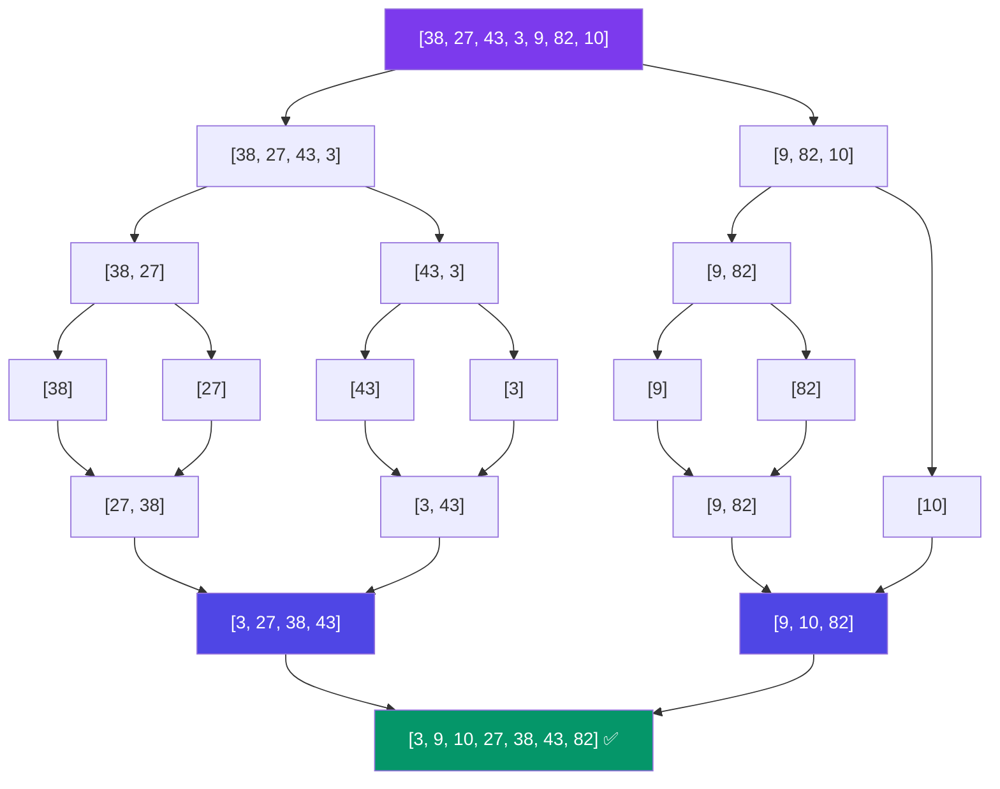

# Merge Sort

## 🎯 What Is Merge Sort?

Merge Sort is a **divide-and-conquer** sorting algorithm that splits the array into halves, recursively sorts each half, then **merges** the sorted halves back together.

> **Core Idea**: It's easier to merge two sorted arrays into one sorted array than to sort a single unsorted array. Split until you have trivial (1-element) arrays, then merge your way back up.

---

## 🔹 How It Works — The Three Steps

Merge Sort follows three steps for every recursive call:

1. **Divide**: Split the array into two halves (left and right)
2. **Conquer**: Recursively sort each half
3. **Combine**: Merge the two sorted halves into one sorted array


### Visual Walkthrough — Full Recursion Tree

Sort: `[38, 27, 43, 3, 9, 82, 10]`



```text
Level 0 (Divide):
                    [38, 27, 43, 3, 9, 82, 10]
                    /                          \
Level 1:    [38, 27, 43, 3]              [9, 82, 10]
              /         \                 /        \
Level 2: [38, 27]    [43, 3]          [9, 82]    [10]
          /    \      /    \           /    \       |
Level 3: [38]  [27]  [43]  [3]      [9]   [82]   [10]
           ↘    ↙     ↘    ↙         ↘     ↙       |
Level 2: [27, 38]    [3, 43]        [9, 82]     [10]
              ↘        ↙              ↘          ↙
Level 1:     [3, 27, 38, 43]          [9, 10, 82]
                    ↘                      ↙
Level 0:          [3, 9, 10, 27, 38, 43, 82]  ✅ SORTED!
```

### The Merge Process — Detailed

The merge step is the heart of Merge Sort. It takes two already-sorted arrays and combines them into one sorted array.

```text
Merge: [27, 38] + [3, 43] → [3, 27, 38, 43]

Step 1: Compare left[0]=27 vs right[0]=3
        3 < 27 → take 3    → result = [3]
        left = [27, 38], right = [43]

Step 2: Compare left[0]=27 vs right[0]=43
        27 < 43 → take 27   → result = [3, 27]
        left = [38], right = [43]

Step 3: Compare left[0]=38 vs right[0]=43
        38 < 43 → take 38   → result = [3, 27, 38]
        left = [], right = [43]

Step 4: Left is empty → copy remaining right
        take 43 → result = [3, 27, 38, 43] ✅
```

---

## 🔹 JavaScript Implementation

```javascript
// Merge function: combines two sorted arrays into one sorted array
function merge(left, right) {
    const result = [];
    let i = 0, j = 0;

    // Compare elements from both arrays and take the smaller one
    while (i < left.length && j < right.length) {
        if (left[i] <= right[j]) {
            result.push(left[i]);
            i++;
        } else {
            result.push(right[j]);
            j++;
        }
    }

    // Add remaining elements from the non-empty array
    // (at most one of these loops will execute)
    while (i < left.length) {
        result.push(left[i]);
        i++;
    }

    while (j < right.length) {
        result.push(right[j]);
        j++;
    }

    return result;
}

// Merge Sort: recursive divide-and-conquer
function mergeSort(arr) {
    // Base case: arrays with 0 or 1 element are already sorted
    if (arr.length <= 1) {
        return arr;
    }

    // Divide: split the array into two halves
    const mid = Math.floor(arr.length / 2);
    const left = arr.slice(0, mid);
    const right = arr.slice(mid);

    // Conquer: recursively sort both halves
    // Combine: merge the sorted halves
    return merge(mergeSort(left), mergeSort(right));
}

// Test
console.log(mergeSort([38, 27, 43, 3, 9, 82, 10]));
// Output: [3, 9, 10, 27, 38, 43, 82]

console.log(mergeSort([64, 34, 25, 12, 22, 11, 90]));
// Output: [11, 12, 22, 25, 34, 64, 90]
```

---

## 🔹 In-Place Merge (No Extra Array Creation)

The version above creates new arrays with `slice()`, which can be memory-intensive. An in-place merge reduces memory overhead:

```javascript
function mergeInPlace(arr, left, mid, right) {
    // Create temporary arrays for left and right halves
    const leftLen = mid - left + 1;
    const rightLen = right - mid;

    const leftArr = arr.slice(left, mid + 1);
    const rightArr = arr.slice(mid + 1, right + 1);

    let i = 0, j = 0, k = left;

    // Merge back into original array
    while (i < leftLen && j < rightLen) {
        if (leftArr[i] <= rightArr[j]) {
            arr[k] = leftArr[i];
            i++;
        } else {
            arr[k] = rightArr[j];
            j++;
        }
        k++;
    }

    // Copy remaining elements
    while (i < leftLen) {
        arr[k] = leftArr[i];
        i++;
        k++;
    }

    while (j < rightLen) {
        arr[k] = rightArr[j];
        j++;
        k++;
    }
}

function mergeSortInPlace(arr, left = 0, right = arr.length - 1) {
    if (left < right) {
        const mid = Math.floor((left + right) / 2);
        mergeSortInPlace(arr, left, mid);
        mergeSortInPlace(arr, mid + 1, right);
        mergeInPlace(arr, left, mid, right);
    }
    return arr;
}

// Test
const arr = [38, 27, 43, 3, 9, 82, 10];
console.log(mergeSortInPlace(arr));
// Output: [3, 9, 10, 27, 38, 43, 82]
```

---

## 🔹 Descending Order

```javascript
function mergeDescending(left, right) {
    const result = [];
    let i = 0, j = 0;

    while (i < left.length && j < right.length) {
        if (left[i] >= right[j]) {  // ← Change to >= for descending
            result.push(left[i]);
            i++;
        } else {
            result.push(right[j]);
            j++;
        }
    }

    while (i < left.length) result.push(left[i++]);
    while (j < right.length) result.push(right[j++]);

    return result;
}

function mergeSortDescending(arr) {
    if (arr.length <= 1) return arr;

    const mid = Math.floor(arr.length / 2);
    const left = mergeSortDescending(arr.slice(0, mid));
    const right = mergeSortDescending(arr.slice(mid));

    return mergeDescending(left, right);
}

console.log(mergeSortDescending([38, 27, 43, 3, 9, 82, 10]));
// Output: [82, 43, 38, 27, 10, 9, 3]
```

---

## 🔹 Bottom-Up (Iterative) Merge Sort

The recursive version is intuitive but uses O(log n) stack space. We can implement Merge Sort **iteratively** — merging progressively larger subarrays:

```javascript
function mergeSortIterative(arr) {
    const n = arr.length;

    // Start with subarrays of size 1, double each iteration
    for (let size = 1; size < n; size *= 2) {
        // Merge subarrays of current size
        for (let leftStart = 0; leftStart < n; leftStart += 2 * size) {
            const mid = Math.min(leftStart + size - 1, n - 1);
            const rightEnd = Math.min(leftStart + 2 * size - 1, n - 1);

            if (mid < rightEnd) {
                mergeInPlace(arr, leftStart, mid, rightEnd);
            }
        }
    }

    return arr;
}

// Test
console.log(mergeSortIterative([38, 27, 43, 3, 9, 82, 10]));
// Output: [3, 9, 10, 27, 38, 43, 82]
```

```text
Visual: Bottom-up Merge Sort (size doubles each round)

Initial: [38, 27, 43, 3, 9, 82, 10]
                  
size=1:  [27, 38] [3, 43] [9, 82] [10]
         └── merge adjacent 1-element arrays ──┘

size=2:  [3, 27, 38, 43]    [9, 10, 82]
         └── merge adjacent 2-element arrays ──┘

size=4:  [3, 9, 10, 27, 38, 43, 82]
         └── merge adjacent 4-element arrays ──┘
```

---

## 🔹 Sorting Objects

```javascript
function mergeByKey(arr, key) {
    if (arr.length <= 1) return arr;

    const mid = Math.floor(arr.length / 2);
    const left = mergeByKey(arr.slice(0, mid), key);
    const right = mergeByKey(arr.slice(mid), key);

    const result = [];
    let i = 0, j = 0;

    while (i < left.length && j < right.length) {
        if (left[i][key] <= right[j][key]) {
            result.push(left[i]);
            i++;
        } else {
            result.push(right[j]);
            j++;
        }
    }

    return [...result, ...left.slice(i), ...right.slice(j)];
}

const students = [
    { name: 'Alice', score: 85 },
    { name: 'Bob', score: 72 },
    { name: 'Carol', score: 91 },
    { name: 'Dave', score: 68 }
];

console.log(mergeByKey(students, 'score'));
// Output: sorted by score ascending
```

---

## 📊 Time & Space Complexity

| Case | Time Complexity | Explanation |
|------|----------------|-------------|
| **Best Case** | O(n log n) | Always splits into halves regardless of input order |
| **Average Case** | O(n log n) | Same number of comparisons regardless of input |
| **Worst Case** | O(n log n) | Guaranteed — Merge Sort never degrades to O(n²) |
| **Space (Recursive)** | O(n) auxiliary + O(log n) stack | Need temp arrays for merging |
| **Space (Iterative)** | O(n) auxiliary | No recursion stack overhead |

### Why O(n log n)?

```text
Level 0: 1 array of size n    →    n comparisons to merge
Level 1: 2 arrays of size n/2 →  2×(n/2) = n comparisons to merge
Level 2: 4 arrays of size n/4 →  4×(n/4) = n comparisons to merge
...
Level k: n arrays of size 1   →   n×(1) = n comparisons to merge

Number of levels = log₂(n)
Work per level   = O(n)
Total            = O(n log n)
```

### Merge Sort vs Other O(n log n) Sorts

| Algorithm | Time (All Cases) | Space | Stable | Cache Performance |
|-----------|-----------------|-------|--------|-------------------|
| Merge Sort | O(n log n) guaranteed | O(n) | ✅ Yes | Good (sequential access) |
| Quick Sort | O(n log n) avg, O(n²) worst | O(log n) | ❌ No | Excellent |
| Heap Sort | O(n log n) guaranteed | O(1) | ❌ No | Poor (random access) |

---

## 🔹 Stability

Merge Sort is **stable**. When merging, the condition `left[i] <= right[j]` ensures that equal elements from the left subarray are placed in the result before equal elements from the right subarray. Since elements in the left subarray originally came before elements in the right subarray, their relative order is preserved.

```javascript
// Use <= for stability
if (left[i] <= right[j])  // ✅ STABLE — equal elements from left come first
    result.push(left[i]);

// Use < for instability
if (left[i] < right[j])   // ❌ UNSTABLE — equal elements from right come first
    result.push(left[i]);
```

---

## 🔹 Properties Summary

| Property | Value |
|----------|-------|
| Time (Best) | O(n log n) |
| Time (Average) | O(n log n) |
| Time (Worst) | O(n log n) — guaranteed! |
| Space | O(n) auxiliary |
| Stable | ✅ Yes |
| In-Place | ❌ No (requires O(n) extra space) |
| Adaptive | ❌ No (always O(n log n)) |
| Online | ❌ No (requires full array) |
| Approach | Divide & Conquer |
| Recursive | ✅ Yes (can be iterative) |

---

## 🎯 When to Use Merge Sort

### Use Merge Sort When:

- You need **guaranteed O(n log n)** performance regardless of input
- **Stability** is important (equal elements must maintain relative order)
- You're sorting **linked lists** — Merge Sort works naturally with sequential access
- The data is stored on **external storage** (disk, tape) — sequential merge is ideal
- You're performing **external sorting** (sorting data too large for memory)

### Do NOT Use When:

- **Memory is constrained** — O(n) extra space is required
- **In-place** sorting is required
- The dataset is small (Insertion Sort is faster for n < 30–50)
- Constant factors matter more than asymptotic guarantees

### Real-World Usage

Merge Sort is widely used:

- **Python's `sorted()` and `.sort()`** — uses TimSort (hybrid of Merge Sort + Insertion Sort)
- **JavaScript's `.sort()`** — V8 uses TimSort since 2019
- **Java's `Arrays.sort(Object[])`** — uses TimSort
- **External sorting** — sorting large files on disk
- **Linked list sorting** — Merge Sort's sequential access pattern is ideal
- **Inversion counting** — a classic algorithm problem (count how far an array is from being sorted)

---

## 🔹 Counting Inversions with Merge Sort

Merge Sort's merge step naturally reveals **inversions** — pairs of elements that are out of order.

```javascript
function countInversions(arr) {
    let count = 0;

    function mergeCount(left, right) {
        const result = [];
        let i = 0, j = 0;

        while (i < left.length && j < right.length) {
            if (left[i] <= right[j]) {
                result.push(left[i]);
                i++;
            } else {
                // left[i] > right[j] — this is an inversion!
                // All remaining elements in left are > right[j]
                count += left.length - i;
                result.push(right[j]);
                j++;
            }
        }

        return [...result, ...left.slice(i), ...right.slice(j)];
    }

    function sort(arr) {
        if (arr.length <= 1) return arr;
        const mid = Math.floor(arr.length / 2);
        return mergeCount(sort(arr.slice(0, mid)), sort(arr.slice(mid)));
    }

    sort(arr);
    return count;
}

console.log(countInversions([2, 4, 1, 3, 5]));
// Output: 3
// Inversions: (2,1), (4,1), (4,3)

console.log(countInversions([5, 4, 3, 2, 1]));
// Output: 10  (completely reversed — max inversions = n(n-1)/2)
```

---

## 💡 Interview Tips

> **"Why is Merge Sort O(n log n)?"** — The array is divided log n times (splitting in half). At each of the log n levels, merging takes O(n) work. Total: O(n log n). This is a guaranteed bound, unlike Quick Sort.

> **"Is Merge Sort stable? How do you ensure stability?"** — Yes. Use `<=` instead of `<` when comparing elements during the merge. This ensures equal elements from the left subarray (which appear first in the original order) are placed before equal elements from the right subarray.

> **"What is the space complexity of Merge Sort?"** — O(n) auxiliary space for the temporary arrays during merging. The recursive version also uses O(log n) call stack space, but that's typically not counted in auxiliary space analysis.

> **"Merge Sort vs Quick Sort?"** — Merge Sort guarantees O(n log n) and is stable but uses O(n) space. Quick Sort is faster in practice (better cache locality), in-place, but has O(n²) worst case and is unstable.

> **"Can Merge Sort be done in-place?"** — Yes, but the implementations are complex and rarely used in practice. The standard in-place merge technique has a higher constant factor that often negates the memory benefit.

> **"Why does Merge Sort work well for linked lists?"** — Linked lists don't support random access, but Merge Sort only requires sequential access (linear traversal). No extra space is needed for linked lists because elements can be re-linked instead of copying.

---

**Next:** [Quick Sort](/DSA-Notes-Problems/data-structures/sorting/06-quick-sort) →
