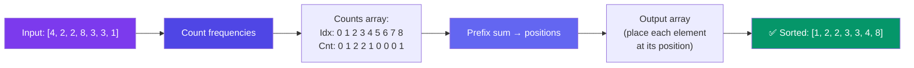

# Counting Sort

> Counting sort doesn't compare elements. Instead, it **counts how many times each value appears** and uses those counts to place elements directly in the correct position.

---

## How It Works



**Step-by-step on `[4, 2, 2, 8, 3, 3, 1]`:**

1. **Find range:** min=1, max=8 → counts array of size 9 (0..8)
2. **Count:** `counts = [0, 1, 2, 2, 1, 0, 0, 0, 1]`
3. **Prefix sum:** `positions = [0, 1, 3, 5, 6, 6, 6, 6, 7]`
4. **Place:** Walk input right-to-left, placing each element at `positions[value] - 1`

```javascript
function countingSort(arr) {
  if (arr.length === 0) return arr;

  const min = Math.min(...arr);
  const max = Math.max(...arr);
  const range = max - min + 1;
  const counts = new Array(range).fill(0);
  const output = new Array(arr.length);

  // Step 1: Count frequencies
  for (const num of arr) {
    counts[num - min]++;
  }

  // Step 2: Prefix sum (cumulative counts)
  for (let i = 1; i < range; i++) {
    counts[i] += counts[i - 1];
  }

  // Step 3: Build output (stable: traverse input backwards)
  for (let i = arr.length - 1; i >= 0; i--) {
    const val = arr[i];
    const idx = counts[val - min] - 1;
    output[idx] = val;
    counts[val - min]--;
  }

  return output;
}

// Input:  [4, 2, 2, 8, 3, 3, 1]
// Output: [1, 2, 2, 3, 3, 4, 8]
```

---

## Complexity

| Metric | Value |
|--------|-------|
| Time | O(N + K) where K = range of input |
| Space | O(N + K) for counts + output |
| Stable | ✅ Yes (if traversed backwards) |
| Comparison-based | ❌ No |

---

## When to Use

| Use | Don't Use |
|-----|-----------|
| Small range of integers (e.g., exam scores 0-100) | Large range (e.g., 1 to 10⁹) |
| When O(N log N) is too slow | Negative numbers with huge spread |
| Sorting grades, ages, frequencies | Floating point numbers |

---

## In Simple Words

- Counting sort counts occurrences, then places each number exactly where it belongs.
- It's blazing fast (O(N + K)) but only works for integers with a small range.
- Use it when you know the values are within a small range — like grades, ages, or ASCII characters.
