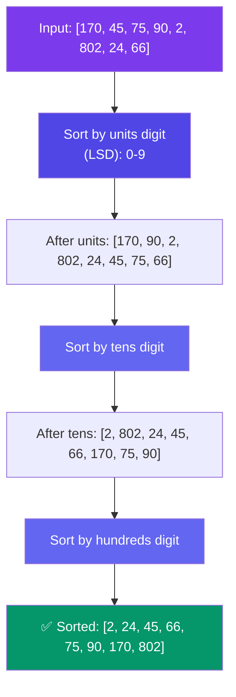

# Radix Sort

> Radix sort sorts numbers **one digit at a time**, from the least significant digit (LSD) to the most significant. It uses counting sort as a subroutine for each digit.

---

## How It Works



**What happens digit by digit:**

```
Original: 170, 045, 075, 090, 002, 802, 024, 066

By units (LSD):                           By tens:                           By hundreds:
  170 → digit 0 (placed)     → 170         002 → digit 0 (placed)    → 002     002 → digit 0    → 002
  045 → digit 5              → 090         802 → digit 0             → 002     024 → digit 0    → 024
  075 → digit 5              → 002         024 → digit 2             → 802     045 → digit 0    → 045
  090 → digit 0 (placed)     → 002         045 → digit 4             → 024     066 → digit 0    → 066
  002 → digit 2              → 802         066 → digit 6             → 045     075 → digit 0    → 075
  802 → digit 2              → 024         170 → digit 7             → 066     090 → digit 0    → 090
  024 → digit 4              → 045         075 → digit 7             → 170     170 → digit 1    → 170
  066 → digit 6              → 075         090 → digit 9             → 075     802 → digit 8    → 802
                          → 066                                → 090                            ✅
```

```javascript
function radixSort(arr) {
  if (arr.length === 0) return arr;

  const max = Math.max(...arr);
  const maxDigits = String(max).length;

  for (let place = 0; place < maxDigits; place++) {
    const buckets = Array.from({ length: 10 }, () => []);

    for (const num of arr) {
      const digit = Math.floor(Math.abs(num) / Math.pow(10, place)) % 10;
      buckets[digit].push(num);
    }

    arr = [].concat(...buckets);
  }

  return arr;
}

// Input:  [170, 45, 75, 90, 2, 802, 24, 66]
// Output: [2, 24, 45, 66, 75, 90, 170, 802]
```

---

## Complexity

| Metric | Value |
|--------|-------|
| Time | O(d × (N + K)) where d = number of digits, K = radix (10) |
| Space | O(N + K) |
| Stable | ✅ Yes (counting sort is stable) |

For integers, d is at most ~10 (fits in 32-bit). So effective time is **O(N)**.

---

## When to Use

| Use | Don't Use |
|-----|-----------|
| Large arrays of integers with limited digit count | Floating point numbers |
| When O(N log N) is too slow | Strings of very different lengths |
| Sorting phone numbers, IDs, dates | When extra O(N) memory is a problem |

---

## In Simple Words

- Radix sort sorts numbers digit by digit, from LSD to MSD.
- Each digit pass uses a simple bucket/stable sort.
- It runs in O(N) for fixed-width integers — faster than any comparison sort.
