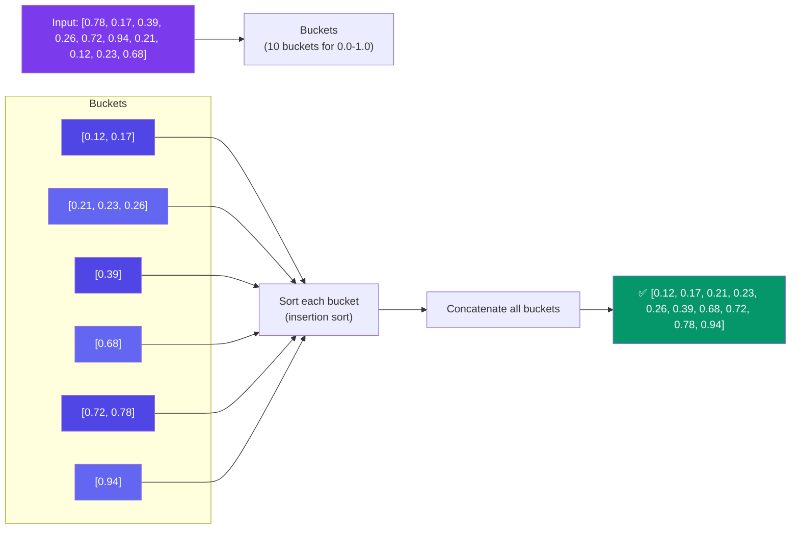

# Bucket Sort

> Bucket sort divides elements into **buckets** (ranges), sorts each bucket individually (usually with insertion sort), then concatenates the buckets.

---

## Visual: Buckets for Uniform Data



```javascript
function bucketSort(arr, bucketSize = 5) {
  if (arr.length === 0) return arr;

  const min = Math.min(...arr);
  const max = Math.max(...arr);
  const bucketCount = Math.floor((max - min) / bucketSize) + 1;
  const buckets = Array.from({ length: bucketCount }, () => []);

  // Scatter into buckets
  for (const num of arr) {
    const idx = Math.floor((num - min) / bucketSize);
    buckets[idx].push(num);
  }

  // Sort each bucket and gather
  const result = [];
  for (const bucket of buckets) {
    insertionSort(bucket); // small bucket → insertion is fast
    result.push(...bucket);
  }
  return result;
}

function insertionSort(arr) {
  for (let i = 1; i < arr.length; i++) {
    const key = arr[i];
    let j = i - 1;
    while (j >= 0 && arr[j] > key) {
      arr[j + 1] = arr[j];
      j--;
    }
    arr[j + 1] = key;
  }
}
```

---

## Complexity

| Condition | Time |
|-----------|------|
| Uniform distribution | **O(N + K)** — near linear |
| Worst case (all in one bucket) | O(N²) |
| Space | O(N + K) |

**Key insight:** Bucket sort is fastest when data is **uniformly distributed**. If data clusters, many items land in the same bucket and sorting that bucket is O(N²).

---

## When to Use

| Use | Don't Use |
|-----|-----------|
| Uniformly distributed floating point data | Heavily clustered data |
| When you need near-linear time on average | When worst-case matters |
| Sorting test scores, grades | Small arrays (N < 50) |

---

## Comparison: Counting vs Radix vs Bucket

| Sort | Type | Time | Best For |
|------|------|------|----------|
| Counting | Frequency counting | O(N + K) | Small integer range |
| Radix | Digit-by-digit | O(d × N) | Fixed-width integers |
| Bucket | Distribution + insertion | O(N + K) avg | Uniformly distributed floats |

---

## In Simple Words

- Bucket sort spreads items into ranges (buckets), sorts each one cheaply, then combines.
- Works great when data is evenly spread across the range.
- Use with floating point numbers that are uniformly distributed.
