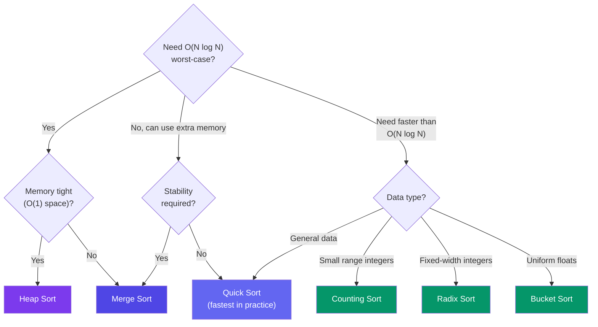

# Stability & When to Use Each Sort

> A sorting algorithm is **stable** if elements with equal keys keep their original relative order. Stability matters when data has multiple sort keys.

---

## Stable vs Unstable: An Example

Sort these students by **grade**, then by **name**:

```
Input:   [A:95, B:80, C:95, D:80, E:70]

Step 1: Sort by grade (ascending):
         [E:70, B:80, D:80, A:95, C:95]

Step 2: Sort by name (stable: equal grades keep grade-order):
         [E:70, B:80, D:80, A:95, C:95]
         (B before D preserved from grade sort)

Step 2: Sort by name (unstable: equal grades may swap):
         [E:70, D:80, B:80, C:95, A:95]
         (B and D swapped!)
```

---

## Stability of Common Sorts

| Algorithm | Stable? | Why |
|-----------|:-------:|-----|
| Bubble Sort | ✅ Yes | Only swaps adjacent — equal elements never cross |
| Insertion Sort | ✅ Yes | Inserts before the first larger element |
| Merge Sort | ✅ Yes | Left half comes first on tie |
| Counting Sort | ✅ Yes | Traverses backwards, preserves order |
| Selection Sort | ❌ No | Swaps non-adjacent elements |
| Quick Sort | ❌ No | Partitioning can cross equal elements |
| Heap Sort | ❌ No | Heapify and extraction shuffles |
| Radix Sort | ✅ Yes | Uses stable counting sort per digit |
| Bucket Sort | ✅ Yes | Stable inner sort → stable overall |

---

## Choosing the Right Sort



---

## Quick Decision Guide

| Scenario | Best Choice | Why |
|----------|-------------|-----|
| General purpose, average case | **Quick Sort** | Fastest in practice, in-place |
| Worst-case guarantee needed | **Merge Sort** / **Heap Sort** | O(N log N) guaranteed |
| Stability required | **Merge Sort** / **Insertion Sort** | Equal keys keep order |
| Small array (< 50 elements) | **Insertion Sort** | Low overhead, fast on small N |
| Almost sorted data | **Insertion Sort** | O(N) on nearly sorted input |
| Small integer range (grades 0-100) | **Counting Sort** | O(N + K), beats comparison sorts |
| Fixed-width integers (phone numbers) | **Radix Sort** | O(N), predictable |
| Uniformly distributed floats | **Bucket Sort** | Near linear on average |
| Memory is critical (embedded) | **Heap Sort** | O(1) extra space |

---

## In Simple Words

- Stable sort keeps equal elements in original order. Important for multi-key sorting.
- Quick Sort is the default — fast and in-place, but unstable and O(N²) worst case.
- Counting/Radix/Bucket sorts can beat O(N log N) when data has special structure.
- Choose based on: stability need? worst-case guarantee? data type? memory limit?
