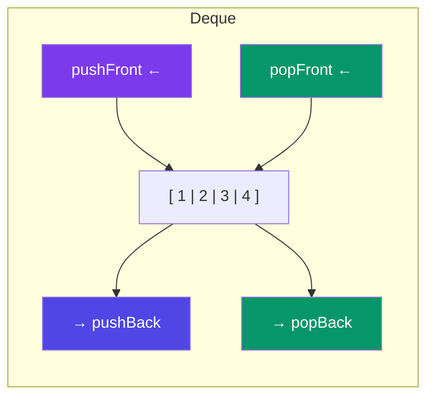

# Deque (Double-Ended Queue)

> A **deque** (pronounced "deck") is a queue where you can push and pop from **both ends**. It combines the power of a stack and a queue in one structure.

---

## Visual



---

## Implementation

```javascript
class Deque {
  constructor() {
    this.items = {};
    this.front = 0;
    this.back  = 0;
  }

  pushFront(val) {
    this.front--;
    this.items[this.front] = val;
  }

  pushBack(val) {
    this.items[this.back] = val;
    this.back++;
  }

  popFront() {
    if (this.isEmpty()) return null;
    const val = this.items[this.front];
    delete this.items[this.front];
    this.front++;
    return val;
  }

  popBack() {
    if (this.isEmpty()) return null;
    this.back--;
    const val = this.items[this.back];
    delete this.items[this.back];
    return val;
  }

  peekFront() {
    return this.isEmpty() ? null : this.items[this.front];
  }

  peekBack() {
    return this.isEmpty() ? null : this.items[this.back - 1];
  }

  isEmpty() {
    return this.front === this.back;
  }

  size() {
    return this.back - this.front;
  }
}

// Usage
const dq = new Deque();
dq.pushBack(10);            // [10]
dq.pushBack(20);            // [10, 20]
dq.pushFront(5);            // [5, 10, 20]
console.log(dq.popFront()); // 5  → [10, 20]
console.log(dq.popBack());  // 20 → [10]
```

All operations are **O(1)**.

---

## Use Cases

| Use Case | Why Deque? |
|----------|------------|
| **Sliding window max** | Maintain candidates, pop from both ends |
| **Undo/Redo** | Push new states to back, pop from front/back |
| **Palindrome check** | Compare and pop from both ends |
| **BFS with priority** | Push normal nodes to back, special nodes to front |

---

## JavaScript Built-in: `push`/`pop`/`shift`/`unshift`

JavaScript arrays support all four operations but `shift`/`unshift` are **O(N)**.

```javascript
// Works, but shift/unshift are slow for large arrays
const arr = [];
arr.push(1);        // back: O(1)
arr.unshift(0);     // front: O(N) — re-indexes all elements
arr.pop();          // back: O(1)
arr.shift();        // front: O(N) — re-indexes
```

For serious deque usage, use the custom implementation above or a linked list.

---

## In Simple Words

- Deque = stack + queue combined. Push/pop from both ends.
- Great for sliding window problems and palindrome checks.
- Don't rely on JavaScript's `shift`/`unshift` — they re-index and are O(N).
