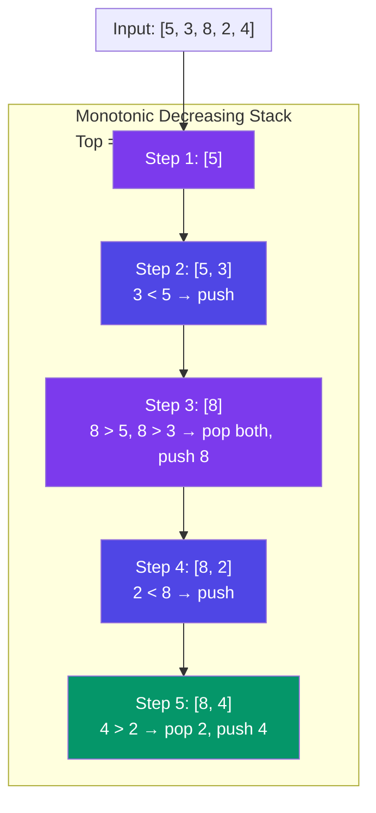

# Monotonic Stack

> A **monotonic stack** is a regular stack that keeps its elements in either increasing or decreasing order. You push new elements and pop any that break the ordering.

---

## Visual: Monotonically Decreasing Stack



---

## Pattern: Next Greater Element

**Problem:** For each element in an array, find the next element to its right that is greater.

**Idea:** Walk from right to left, maintain a monotonic increasing stack.

```javascript
function nextGreaterElement(nums) {
  const n = nums.length;
  const result = new Array(n).fill(-1);
  const stack = []; // monotonic increasing (from top)

  for (let i = n - 1; i >= 0; i--) {
    // Pop smaller or equal elements (they're useless now)
    while (stack.length && stack[stack.length - 1] <= nums[i]) {
      stack.pop();
    }
    // Top of stack is the next greater element
    result[i] = stack.length ? stack[stack.length - 1] : -1;
    stack.push(nums[i]);
  }
  return result;
}

// nums = [2, 1, 5, 3, 4]
// Walk from right:
// i=4: nums[4]=4, stack=[] → result[4]=-1, push 4
// i=3: nums[3]=3, stack=[4]; 3<4 → result[3]=4, push 3
// i=2: nums[2]=5, pop 3, pop 4 → result[2]=-1, push 5
// i=1: nums[1]=1, stack=[5]; 1<5 → result[1]=5, push 1
// i=0: nums[0]=2, pop 1, stack=[5]; 2<5 → result[0]=5
// Result: [5, 5, -1, 4, -1]
```

**Time:** O(N) — each element pushed and popped at most once.

---

## Pattern: Previous Smaller Element

Walk left to right, monotonic increasing stack.

```javascript
function previousSmallerElement(nums) {
  const n = nums.length;
  const result = new Array(n).fill(-1);
  const stack = [];

  for (let i = 0; i < n; i++) {
    while (stack.length && stack[stack.length - 1] >= nums[i]) {
      stack.pop();
    }
    result[i] = stack.length ? stack[stack.length - 1] : -1;
    stack.push(nums[i]);
  }
  return result;
}

// nums = [3, 1, 4, 2]
// Result: [-1, -1, 1, 1]
```

---

## Common Problems

| Problem | Stack Type | Trick |
|---------|-----------|-------|
| Next Greater Element | Decreasing stack (right→left) | Or left→right: pop while smaller |
| Largest Rectangle in Histogram | Increasing stack | Height at pop × width to prev smaller |
| Daily Temperatures | Decreasing stack | Store indices, not values |
| Stock Span | Decreasing stack | Index difference on pop |
| Trapping Rain Water | Decreasing stack | Water = min(left,right) - height × distance |

---

## In Simple Words

- Monotonic stack keeps elements sorted as you push — pop until the order is restored.
- It's the go-to pattern for "next greater/smaller element" problems.
- Works in O(N) because each element enters and leaves the stack once.
