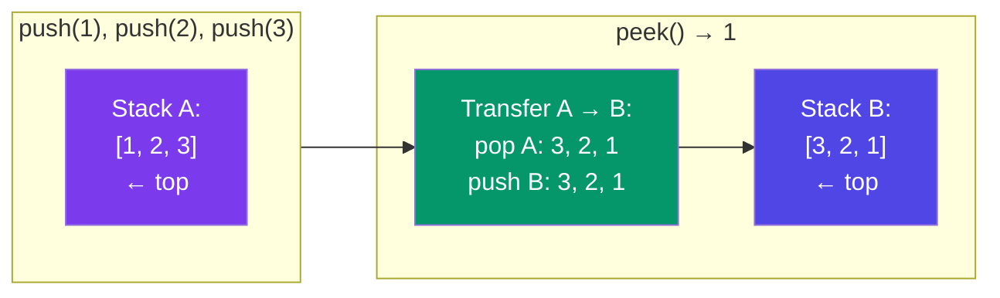

# Stack & Queue Problems

---

## 1. Valid Parentheses

**Problem:** Given a string `s` containing `()`, `{}`, `[]`, determine if brackets are correctly matched and nested.

**Idea:** Push opening brackets onto a stack. When you see a closing bracket, check it matches the top.

```javascript
function isValid(s) {
  const stack = [];
  const pairs = { ')': '(', '}': '{', ']': '[' };

  for (const ch of s) {
    if (ch === '(' || ch === '{' || ch === '[') {
      stack.push(ch);
    } else {
      if (stack.pop() !== pairs[ch]) return false;
    }
  }
  return stack.length === 0; // all brackets closed?
}

// s = "({[]})" → ✅ valid
// s = "({[})"  → ❌ invalid (mismatch)
// s = "({[]}"  → ❌ invalid (unclosed '{')
```

**Time:** O(N) · **Space:** O(N)

---

## 2. Min Stack

**Problem:** Design a stack that supports `push`, `pop`, `top`, and `getMin` — all in **O(1)**.

**Idea:** Store each value alongside the current minimum at that point.

```javascript
class MinStack {
  constructor() {
    this.stack = [];
  }

  push(val) {
    const min = this.stack.length === 0
      ? val
      : Math.min(val, this.stack[this.stack.length - 1].min);
    this.stack.push({ val, min });
  }

  pop() {
    this.stack.pop();
  }

  top() {
    return this.stack[this.stack.length - 1]?.val ?? null;
  }

  getMin() {
    return this.stack[this.stack.length - 1]?.min ?? null;
  }
}

// Usage
const ms = new MinStack();
ms.push(5);           // stack: [{val:5, min:5}]
ms.push(3);           // stack: [{val:5, min:5}, {val:3, min:3}]
ms.push(7);           // stack: [{val:5, min:5}, {val:3, min:3}, {val:7, min:3}]
console.log(ms.getMin()); // 3
ms.pop();
console.log(ms.getMin()); // 3 (still 3 from the middle element)
```

**All operations O(1)** · **Space:** O(N)

---

## 3. Evaluate Reverse Polish Notation

**Problem:** Evaluate an expression in postfix notation like `["2", "1", "+", "3", "*"]`.

**Idea:** Push numbers onto a stack. When you see an operator, pop two numbers, apply, push result.

```javascript
function evalRPN(tokens) {
  const stack = [];
  const ops = {
    '+': (a, b) => a + b,
    '-': (a, b) => a - b,
    '*': (a, b) => a * b,
    '/': (a, b) => Math.trunc(a / b), // truncate toward zero
  };

  for (const token of tokens) {
    if (ops[token]) {
      const b = stack.pop();
      const a = stack.pop();
      stack.push(ops[token](a, b));
    } else {
      stack.push(Number(token));
    }
  }
  return stack[0];
}

// ["2", "1", "+", "3", "*"]
// → push 2, push 1, pop(1,2) → 2+1=3, push 3
// → pop(3,3) → 3*3=9
// Result: 9
```

**Time:** O(N) · **Space:** O(N)

---

## 4. Implement Queue Using Stacks

**Problem:** Use two stacks to implement a FIFO queue.

**Idea:** Stack A for push (back of queue). Stack B reversed for pop/front.



```javascript
class MyQueue {
  constructor() {
    this.inStack  = [];  // back of queue
    this.outStack = [];  // front of queue (reversed)
  }

  push(x) {
    this.inStack.push(x);
  }

  _transfer() {
    if (this.outStack.length === 0) {
      while (this.inStack.length) {
        this.outStack.push(this.inStack.pop());
      }
    }
  }

  pop() {
    this._transfer();
    return this.outStack.pop();
  }

  peek() {
    this._transfer();
    return this.outStack[this.outStack.length - 1];
  }

  empty() {
    return this.inStack.length === 0 && this.outStack.length === 0;
  }
}
```

**Amortized O(1)** per operation · **Space:** O(N)

---

## In Simple Words

- Valid parentheses = push opens, pop and match closes.
- Min stack = store `(value, minSoFar)` pairs.
- RPN evaluation = push numbers, pop two for operators.
- Queue from two stacks = push to inStack, transfer to outStack for pops.
