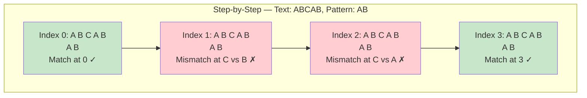
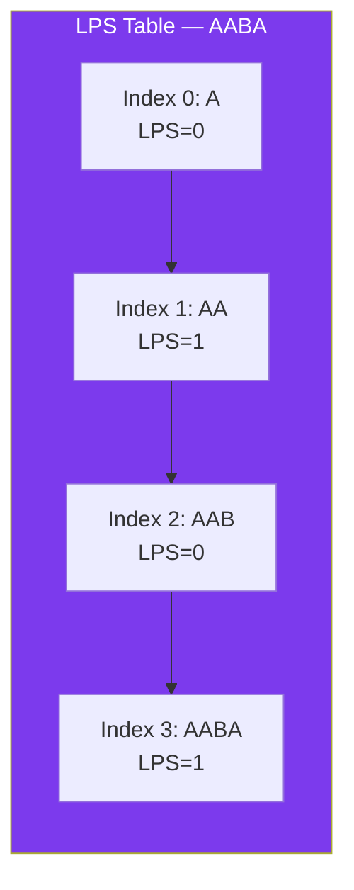
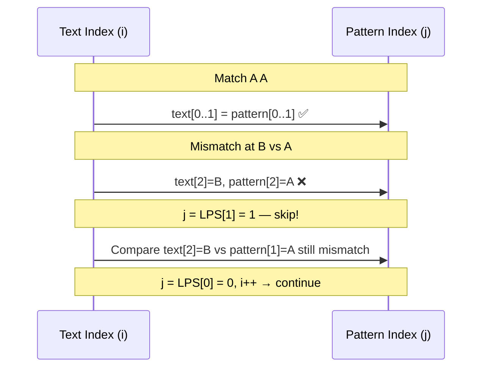

# 🔍 Pattern Matching

## 🎯 What Is Pattern Matching?

Given a **text** (long string) and a **pattern** (short string), find all occurrences of the pattern in the text.

**Example:**
```
Text:    "AABAACAADAABAABA"
Pattern: "AABA"
Output:  [0, 9, 12]  ← starting indices where pattern matches
```

---

## 🔹 Naive Search

Check every possible starting position — slide the pattern one step at a time.



```javascript
function naiveSearch(text, pattern) {
  const result = [];
  for (let i = 0; i <= text.length - pattern.length; i++) {
    let match = true;
    for (let j = 0; j < pattern.length; j++) {
      if (text[i + j] !== pattern[j]) {
        match = false;
        break;
      }
    }
    if (match) result.push(i);
  }
  return result;
}

naiveSearch("AABAACAADAABAABA", "AABA");  // [0, 9, 12]
```

**Time:** O(n × m) worst case | **Space:** O(1)

---

## 🔹 KMP (Knuth-Morris-Pratt)

KMP avoids re-checking characters by using a **prefix table** (LPS — Longest Prefix Suffix).

**Core idea:** When a mismatch occurs, use the LPS to know how many characters we can skip — we don't need to re-check characters we already matched.

```javascript
// Build the LPS (Longest Prefix Suffix) array
// lps[i] = length of the longest proper prefix of pattern[0..i]
//          that is also a suffix of pattern[0..i]
function buildLPS(pattern) {
  const lps = new Array(pattern.length).fill(0);
  let len = 0;  // Length of previous longest prefix suffix
  let i = 1;

  while (i < pattern.length) {
    if (pattern[i] === pattern[len]) {
      len++;
      lps[i] = len;
      i++;
    } else {
      if (len !== 0) {
        len = lps[len - 1];  // Fall back
      } else {
        lps[i] = 0;
        i++;
      }
    }
  }

  return lps;
}

function kmpSearch(text, pattern) {
  if (pattern.length === 0) return [];
  const lps = buildLPS(pattern);
  const result = [];
  let i = 0;  // Index for text
  let j = 0;  // Index for pattern

  while (i < text.length) {
    if (text[i] === pattern[j]) {
      i++;
      j++;
    }

    if (j === pattern.length) {
      result.push(i - j);  // Found a match
      j = lps[j - 1];      // Continue searching
    } else if (i < text.length && text[i] !== pattern[j]) {
      if (j !== 0) {
        j = lps[j - 1];    // Use LPS to skip
      } else {
        i++;
      }
    }
  }

  return result;
}

kmpSearch("AABAACAADAABAABA", "AABA");  // [0, 9, 12]
```

**Time:** O(n + m) | **Space:** O(m) for the LPS array

### LPS Table Visualization

```
Pattern: "AABA"

i=0: LPS[0] = 0
i=1: "A" vs "A" → match → LPS[1] = 1
i=2: "A" vs "B" → mismatch → LPS[2] = 0
i=3: "B" vs "A" → mismatch → LPS[3] = 0 (then check LPS[0])

Final LPS: [0, 1, 0, 0]
```



### KMP Match Visualization



---

## 🔹 Rabin-Karp (Rolling Hash)

Uses a **hash function** to check if the pattern matches the current window. Only when hashes match, we verify character by character.

**Hash trick:** Use a rolling hash so we can update the hash in O(1) when sliding the window.

```javascript
const BASE = 256;   // Number of possible characters
const MOD = 101;    // A prime number for modulo

function rabinKarp(text, pattern) {
  const result = [];
  const n = text.length;
  const m = pattern.length;
  if (m > n || m === 0) return result;

  // Compute hash for pattern and first window
  let patHash = 0;
  let txtHash = 0;
  let h = 1;

  // h = BASE^(m-1) % MOD
  for (let i = 0; i < m - 1; i++) {
    h = (h * BASE) % MOD;
  }

  for (let i = 0; i < m; i++) {
    patHash = (patHash * BASE + pattern.charCodeAt(i)) % MOD;
    txtHash = (txtHash * BASE + text.charCodeAt(i)) % MOD;
  }

  // Slide the window
  for (let i = 0; i <= n - m; i++) {
    // If hashes match, verify character by character
    if (patHash === txtHash) {
      let match = true;
      for (let j = 0; j < m; j++) {
        if (text[i + j] !== pattern[j]) {
          match = false;
          break;
        }
      }
      if (match) result.push(i);
    }

    // Compute hash for next window (rolling)
    if (i < n - m) {
      txtHash = (BASE * (txtHash - text.charCodeAt(i) * h) +
                 text.charCodeAt(i + m)) % MOD;
      if (txtHash < 0) txtHash += MOD;  // Handle negative
    }
  }

  return result;
}

rabinKarp("AABAACAADAABAABA", "AABA");  // [0, 9, 12]
```

**Time:** O(n + m) average, O(n × m) worst (hash collisions) | **Space:** O(1)

---

## 🔹 Algorithm Comparison

| Algorithm | Preprocessing | Average Time | Worst Time | Space | Best For |
|-----------|--------------|-------------|------------|-------|----------|
| Naive | None | O(n × m) | O(n × m) | O(1) | Short patterns, small text |
| KMP | O(m) | O(n + m) | O(n + m) | O(m) | Repeated pattern searches |
| Rabin-Karp | O(m) | O(n + m) | O(n × m) | O(1) | Multiple pattern search (by hashing) |

---

## ✅ In Simple Words

- **Naive search** slides the pattern one character at a time — simple but O(n × m) worst case.
- **KMP** uses a prefix table (LPS) to skip characters that already matched — O(n + m) guaranteed.
- **Rabin-Karp** hashes the pattern and uses a rolling hash to slide — fast on average but hash collisions can degrade it.
- KMP is the interview favorite for "efficient string matching."
