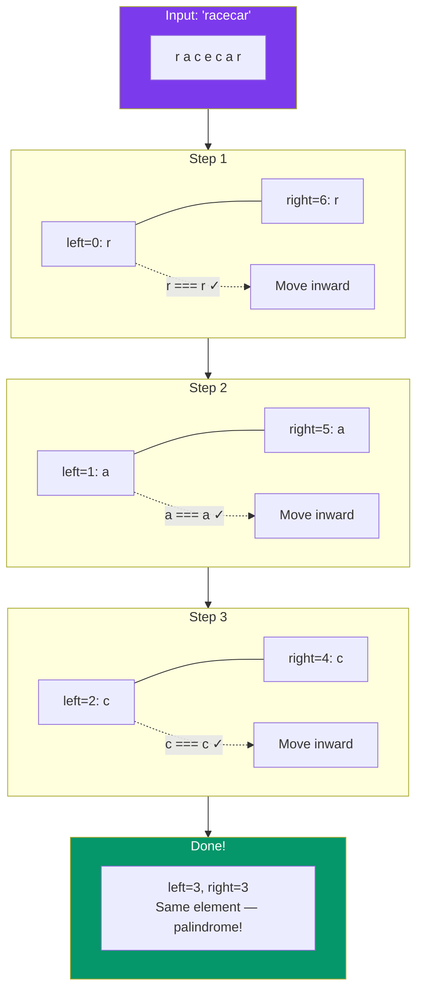

# 👆 Two-Pointer String Problems

## 🎯 What Is the Two-Pointer Technique?

Two pointers on strings means using **two indices** that move toward each other or in the same direction to solve problems efficiently.

**Analogy:** Two people at opposite ends of a hallway walking toward each other, comparing what they see on the walls.

---

## 🔹 Palindrome Check

Check if a string reads the same forward and backward.



```javascript
function isPalindrome(s) {
  let left = 0;
  let right = s.length - 1;

  while (left < right) {
    if (s[left] !== s[right]) return false;
    left++;
    right--;
  }

  return true;
}

isPalindrome("racecar");  // true
isPalindrome("hello");    // false
```

**Time:** O(n) | **Space:** O(1)

### Palindrome with Non-Alphanumeric Skip

Common interview variant — ignore spaces, punctuation, and case:

```javascript
function isPalindromeClean(s) {
  let left = 0;
  let right = s.length - 1;

  while (left < right) {
    // Skip non-alphanumeric characters
    while (left < right && !isAlphanumeric(s[left])) left++;
    while (left < right && !isAlphanumeric(s[right])) right--;

    if (s[left].toLowerCase() !== s[right].toLowerCase()) return false;
    left++;
    right--;
  }

  return true;
}

function isAlphanumeric(ch) {
  return /[a-zA-Z0-9]/.test(ch);
}

isPalindromeClean("A man, a plan, a canal: Panama");  // true
```

---

## 🔹 Reverse a String

```javascript
function reverseString(s) {
  // Convert to array (strings are immutable)
  const arr = s.split("");
  let left = 0;
  let right = arr.length - 1;

  while (left < right) {
    [arr[left], arr[right]] = [arr[right], arr[left]];  // Swap
    left++;
    right--;
  }

  return arr.join("");
}

reverseString("hello");  // "olleh"
```

**Time:** O(n) | **Space:** O(n) for the array, but O(1) extra beyond that.

---

## 🔹 Valid Anagram

Check if two strings use the same characters with the same frequencies.

**Approach 1 — Sort both strings:**
```javascript
function isAnagram(s, t) {
  if (s.length !== t.length) return false;
  return s.split("").sort().join("") === t.split("").sort().join("");
}

isAnagram("listen", "silent");  // true
```
**Time:** O(n log n) | **Space:** O(n)

**Approach 2 — Frequency counter (two-pointer-ish):**
```javascript
function isAnagram(s, t) {
  if (s.length !== t.length) return false;

  const freq = new Array(26).fill(0);

  for (let i = 0; i < s.length; i++) {
    freq[s.charCodeAt(i) - 97]++;
    freq[t.charCodeAt(i) - 97]--;
  }

  return freq.every(count => count === 0);
}

isAnagram("listen", "silent");  // true
```
**Time:** O(n) | **Space:** O(1) — fixed array of 26

---

## 🔹 Two-Pointer Pattern Summary

```mermaid
flowchart TB
    TP[Two-Pointer on Strings] --> Opposite[Opposite Direction<br/>left → ← right]
    TP --> Same[Same Direction<br/>left → right →]
    
    Opposite --> Pal[Palindrome Check<br/>O(n)]
    Opposite --> Rev[Reverse String<br/>O(n)]
    Opposite --> TS[Two Sum II (sorted)<br/>O(n)]
    
    Same --> Window[Sliding Window<br/>Substring problems]
    Same --> Prefix[Prefix/Suffix building]
    
    style TP fill:#7c3aed,color:#fff
    style Opposite fill:#3b82f6,color:#fff
    style Same fill:#f59e0b,color:#fff
```

| Problem | Direction | Pattern | Complexity |
|---------|-----------|---------|------------|
| Palindrome | Opposite | Compare chars, move inward | O(n), O(1) |
| Reverse string | Opposite | Swap chars, move inward | O(n), O(1) |
| Two Sum (sorted) | Opposite | Sum > target → move right, else left | O(n), O(1) |
| Valid Anagram | Frequency | Count up for s, down for t | O(n), O(1) |
| Longest substring (no repeat) | Same (window) | Expand right, shrink left | O(n), O(k) |

---

## ✅ In Simple Words

- **Two pointers** on strings usually means one pointer at each end moving toward the center.
- **Palindrome check** — compare `s[left]` vs `s[right]`, if mismatch → not palindrome.
- **Reverse** — same as palindrome but swap instead of compare.
- **Valid anagram** — easiest with a frequency counter array of size 26 (for lowercase letters).
- All these are O(n) time and O(1) extra space — very efficient.
