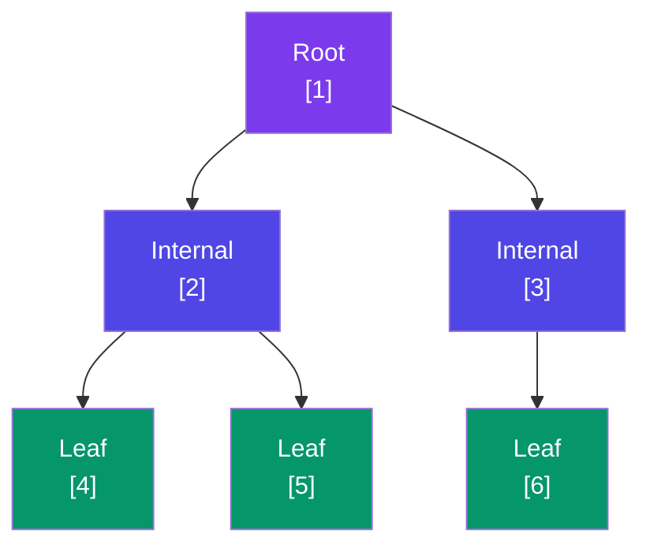
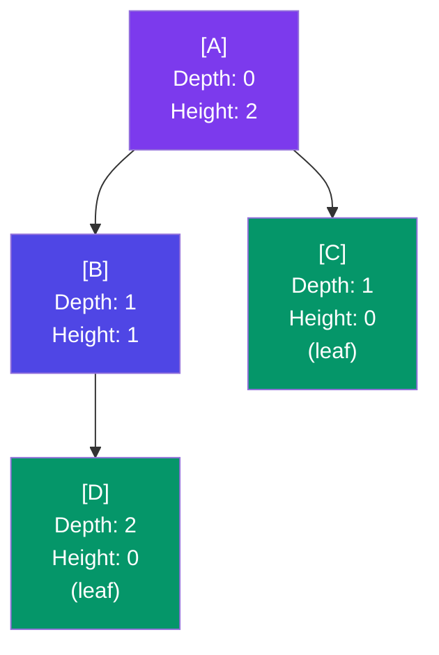

# 🌳 Introduction to Trees

---

## What is a Tree?

A **tree** is a hierarchical, non-linear data structure that consists of **nodes** connected by **edges**. Unlike arrays or linked lists (which are linear), trees branch out — making them ideal for representing hierarchies, relationships, and sorted data.

> **Key insight**: A tree with `N` nodes always has exactly `N - 1` edges.



```
           [1]          ← Root
          /   \
        [2]   [3]       ← Internal Nodes
       /  \      \
     [4]  [5]   [6]     ← Leaf Nodes
```

---

## Terminologies

| Term          | Definition                                                                 |
|---------------|----------------------------------------------------------------------------|
| **Node**      | A basic unit containing data and references to children                    |
| **Root**      | The topmost node with no parent (node `1` above)                          |
| **Parent**    | A node that has one or more children (`2` is parent of `4` and `5`)        |
| **Child**     | A node that has a parent (`4` and `5` are children of `2`)                 |
| **Leaf**      | A node with no children (`4`, `5`, `6` above)                              |
| **Edge**      | The connection/link between two nodes                                      |
| **Subtree**   | A node and all its descendants form a subtree                              |
| **Height**    | Longest path from a node down to a leaf (height of root = height of tree)  |
| **Depth**     | Distance from the root to a given node                                     |
| **Level**     | Level = Depth + 1 (root is at level 1)                                     |
| **Degree**    | Number of children a node has                                              |

---

## Height vs Depth — Visual Clarification



```
           [A]   ← Depth=0, Height=2
           / \
         [B] [C] ← Depth=1, Height=1 (B), Height=0 (C, leaf)
         /
       [D]        ← Depth=2, Height=0 (leaf)
```

- **Height of node B** = 1 (one edge down to leaf D)
- **Depth of node D** = 2 (two edges from root A)
- **Height of tree** = Height of root = 2

---

## Properties of Trees

1. There is **exactly one root** node.
2. Every non-root node has **exactly one parent**.
3. Trees are **acyclic** — no cycles possible.
4. Any two nodes are connected by **exactly one path**.
5. A tree with `N` nodes has exactly `N - 1` edges.
6. Each node's **subtree** is itself a valid tree (enables recursion).

---

## Next Steps

- [Types of Trees](/DSA-Notes-Problems/data-structures/trees/02-types) — Binary Tree, BST, Balanced Trees, and more
- [Tree Representation](/DSA-Notes-Problems/data-structures/trees/04-representation) — Pointer-based & array-based
- [Tree Traversals](/DSA-Notes-Problems/data-structures/trees/06-traversals) — DFS & BFS
