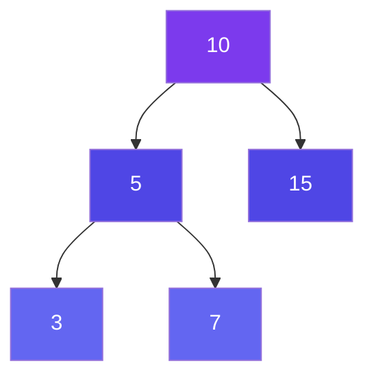
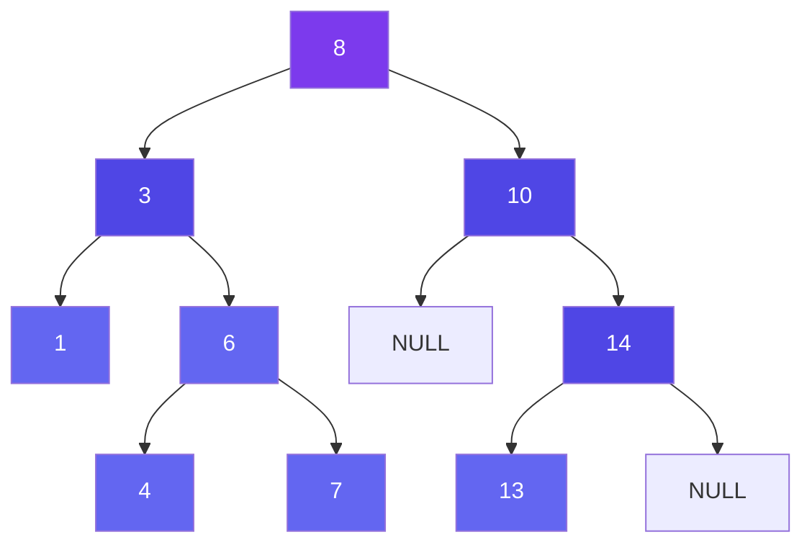
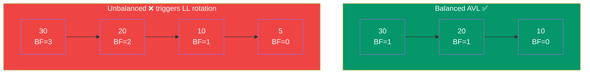
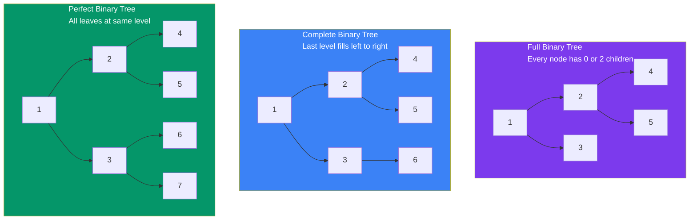

# Types of Trees

---

## Binary Tree

A tree where each node has **at most 2 children**: left and right.



- Most common type in interviews
- Foundation for BST, Heaps, Segment Trees

---

## Binary Search Tree (BST)

A Binary Tree with the **BST Property**:
> For every node N: all values in the **left subtree < N**, all values in the **right subtree > N**



**BST Invariant**: Inorder traversal of a BST always gives a **sorted sequence**.
- `1, 3, 4, 6, 7, 8, 10, 13, 14` ← sorted!

---

## Balanced Trees

### AVL Tree
- A self-balancing BST where the **height difference** between left and right subtrees of any node is **at most 1**.
- **Balance Factor** = `height(left) - height(right)` ∈ `{-1, 0, 1}`.
- On insert/delete, **rotations** (LL, RR, LR, RL) restore balance.
- **Height**: O(log N) guaranteed.



### Red-Black Tree
- Self-balancing BST with color rules (each node is RED or BLACK).
- **Rules**:
  1. Every node is Red or Black.
  2. Root is always Black.
  3. No two consecutive Red nodes (Red's children must be Black).
  4. Every path from root to NULL leaf has the same number of Black nodes.
- Looser balancing than AVL → **faster insertions/deletions** (fewer rotations).
- Used internally by: `std::map` in C++, `TreeMap` in Java, Linux scheduler.

---

## Full, Complete, and Perfect Binary Trees



- A perfect binary tree with height `h` has `2^(h+1) - 1` nodes.

---

## Skewed Trees

A tree where every node has **only one child** — essentially degenerates into a linked list.

```
Left-Skewed:          Right-Skewed:
   [10]                  [10]
   /                        \
 [8]                        [15]
 /                              \
[5]                             [20]
```

- Worst case for BST operations: O(N) instead of O(log N)
- Avoided using balanced trees (AVL, Red-Black)

---

## N-ary Trees

A tree where each node can have **at most N children**.

```
           [1]
         / | \
       [2][3][4]
      / \
    [5] [6]
```

- File systems use N-ary trees (directories with many subdirectories)
- Represented with a list of children per node

---

## Quick Comparison

| Type | Children | Use Case |
|------|----------|----------|
| Binary Tree | ≤ 2 | General purpose |
| BST | ≤ 2 (ordered) | Fast search/sort |
| AVL Tree | ≤ 2 (balanced) | Guaranteed O(log N) |
| Red-Black | ≤ 2 (balanced) | Faster inserts/deletes |
| Full Binary | 0 or 2 | Expression trees |
| Complete Binary | ≤ 2 (left-filled) | Heaps |
| Perfect Binary | Exactly 2 | Theoretical |
| N-ary | ≤ N | File systems, DOM |
| Skewed | 1 (effectively) | Degenerate case |

---

## Related

- [Special Trees](/DSA-Notes-Problems/data-structures/trees/03-special-trees) — Trie, Heap, Segment Tree
- [Tree Representation](/DSA-Notes-Problems/data-structures/trees/04-representation) — Pointer-based & array-based
- [BST Operations](/DSA-Notes-Problems/data-structures/trees/08-bst) — Search, Insert, Delete
