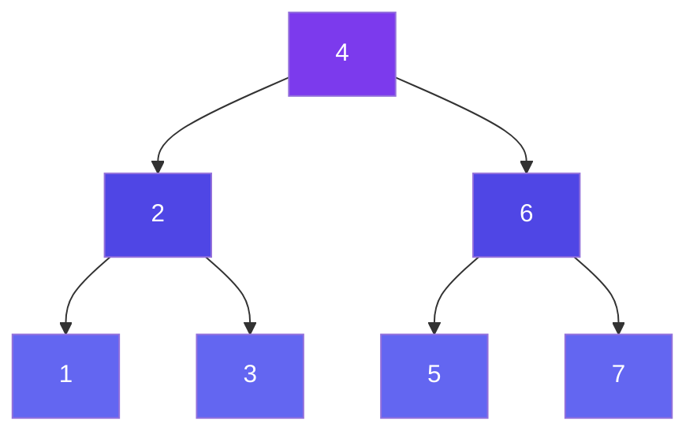

# Tree Traversal Algorithms

There are two fundamental ways to traverse a tree: **DFS** (goes deep first) and **BFS** (goes wide first).

---

## Depth First Search (DFS)

DFS explores a branch fully before backtracking. There are three DFS orders:



### Inorder Traversal (Left → Root → Right)

```
Tree:
         [4]
        /   \
      [2]   [6]
     /  \  /  \
   [1] [3][5] [7]

Step-by-step:
1. Go left all the way: 1
2. Visit root: 2
3. Go right: 3
4. Back up, visit: 4
5. Go left of right: 5
6. Visit: 6
7. Go right: 7

Inorder Output: 1 → 2 → 3 → 4 → 5 → 6 → 7  (SORTED for BST!)
```

```javascript
function inorder(root, result = []) {
  if (root === null) return result;
  inorder(root.left, result);
  result.push(root.val);
  inorder(root.right, result);
  return result;
}
```

> **Use case**: Get sorted order from BST

---

### Preorder Traversal (Root → Left → Right)

```
Step-by-step:
1. Visit root: 4
2. Go left, visit: 2
3. Go left of 2, visit: 1
4. Backtrack, go right of 2, visit: 3
5. Backtrack to root, go right, visit: 6
6. Go left of 6, visit: 5
7. Go right of 6, visit: 7

Preorder Output: 4 → 2 → 1 → 3 → 6 → 5 → 7
```

```javascript
function preorder(root, result = []) {
  if (root === null) return result;
  result.push(root.val);
  preorder(root.left, result);
  preorder(root.right, result);
  return result;
}
```

> **Use case**: Copying/serializing a tree, Expression trees (prefix notation)

---

### Postorder Traversal (Left → Right → Root)

```
Step-by-step:
1. Go left all the way, leaf: 1
2. Go right of 2, leaf: 3
3. Visit parent of 1 and 3: 2
4. Go right subtree, left: 5
5. Right: 7
6. Visit: 6
7. Visit root last: 4

Postorder Output: 1 → 3 → 2 → 5 → 7 → 6 → 4
```

```javascript
function postorder(root, result = []) {
  if (root === null) return result;
  postorder(root.left, result);
  postorder(root.right, result);
  result.push(root.val);
  return result;
}
```

> **Use case**: Deleting a tree, Evaluating expression trees, Directory size calculation

---

### Iterative Inorder (Using Explicit Stack)

```javascript
function inorderIterative(root) {
  const result = [];
  const stack  = [];
  let curr = root;

  while (curr !== null || stack.length > 0) {
    while (curr !== null) {       // Go as left as possible
      stack.push(curr);
      curr = curr.left;
    }
    curr = stack.pop();           // Visit node
    result.push(curr.val);
    curr = curr.right;            // Move to right subtree
  }
  return result;
}
```

---

## Breadth First Search (Level Order Traversal)

Visit all nodes **level by level**, from left to right. Uses a **Queue**.

```
Tree:
         [1]
        /   \
      [2]   [3]
     /  \      \
   [4]  [5]   [6]

Step-by-step:
Queue: [1]
→ Dequeue 1, enqueue children [2, 3]       → Output: 1
→ Dequeue 2, enqueue children [4, 5]       → Output: 2
→ Dequeue 3, enqueue children [6]          → Output: 3
→ Dequeue 4, no children                   → Output: 4
→ Dequeue 5, no children                   → Output: 5
→ Dequeue 6, no children                   → Output: 6

Level Order Output: 1 → 2 → 3 → 4 → 5 → 6
```

```javascript
function levelOrder(root) {
  if (!root) return [];

  const result = [];
  const queue  = [root];

  while (queue.length > 0) {
    const levelSize    = queue.length;  // Number of nodes at current level
    const currentLevel = [];

    for (let i = 0; i < levelSize; i++) {
      const node = queue.shift();
      currentLevel.push(node.val);

      if (node.left)  queue.push(node.left);
      if (node.right) queue.push(node.right);
    }
    result.push(currentLevel);
  }
  return result;
}

// Example Output for [1, 2, 3, 4, 5]:
// [ [1], [2, 3], [4, 5] ]
```

> **Key trick**: Capture `queue.length` at the start of each iteration to process one full level at a time.

---

## Quick Recap

```
┌────────────────────────────────────────────────────────┐
│              TRAVERSAL QUICK RECALL                     │
├────────────────────────────────────────────────────────┤
│  Inorder   (L → N → R):  Sorted output for BST         │
│  Preorder  (N → L → R):  Root first; use for copy/serialize │
│  Postorder (L → R → N):  Children first; use for delete │
│  Level Order:            BFS; use for level problems    │
└────────────────────────────────────────────────────────┘
```

---

## Related

- [Important Patterns](/DSA-Notes-Problems/data-structures/trees/07-patterns) — DFS recursion, BFS level-order patterns
- [BST Operations](/DSA-Notes-Problems/data-structures/trees/08-bst) — Search, Insert, Delete
- [Code Examples](/DSA-Notes-Problems/data-structures/trees/11-code-examples) — Full implementations
