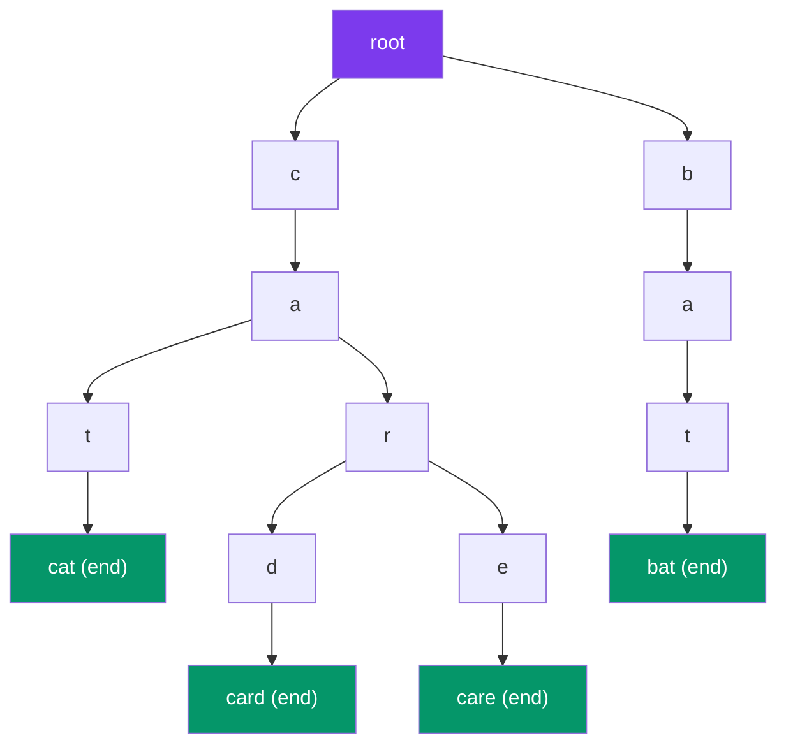

# Trie (Prefix Tree)

> A **Trie** (pronounced "try") stores strings by their **characters**. Words that share a prefix share the same path — making prefix search fast.

---

## Visual: Trie Storing Words



---

## Implementation

```javascript
class TrieNode {
  constructor() {
    this.children = {};   // character → TrieNode
    this.isEnd    = false; // marks a complete word
  }
}

class Trie {
  constructor() {
    this.root = new TrieNode();
  }

  insert(word) {
    let node = this.root;
    for (const ch of word) {
      if (!node.children[ch]) {
        node.children[ch] = new TrieNode();
      }
      node = node.children[ch];
    }
    node.isEnd = true;
  }

  search(word) {
    let node = this.root;
    for (const ch of word) {
      if (!node.children[ch]) return false;
      node = node.children[ch];
    }
    return node.isEnd; // word must end here
  }

  startsWith(prefix) {
    let node = this.root;
    for (const ch of prefix) {
      if (!node.children[ch]) return false;
      node = node.children[ch];
    }
    return true; // prefix found, doesn't need to be a full word
  }

  delete(word) {
    this._delete(this.root, word, 0);
  }

  _delete(node, word, index) {
    if (index === word.length) {
      if (!node.isEnd) return false; // word doesn't exist
      node.isEnd = false;
      return Object.keys(node.children).length === 0; // safe to delete?
    }

    const ch = word[index];
    if (!node.children[ch]) return false;

    const shouldDelete = this._delete(node.children[ch], word, index + 1);
    if (shouldDelete) {
      delete node.children[ch];
      return Object.keys(node.children).length === 0 && !node.isEnd;
    }
    return false;
  }
}

// Usage
const trie = new Trie();
trie.insert("cat");
trie.insert("car");
trie.insert("card");
trie.search("car");      // true
trie.search("can");      // false
trie.startsWith("ca");   // true (prefix exists)
trie.startsWith("dog");  // false
```

---

## Complexity

| Operation | Time | Space |
|-----------|:----:|:-----:|
| Insert | **O(L)** | O(L) new nodes |
| Search | **O(L)** | O(1) |
| Prefix Check | **O(L)** | O(1) |
| Delete | **O(L)** | O(1) |

Where L = length of the word. No hash collisions — pure character-by-character walk.

---

## Use Cases

| Use Case | Why Trie? |
|----------|-----------|
| **Autocomplete** | `startsWith("app")` → collect all words under that prefix |
| **Spell checker** | Search O(L) — faster than hash set for misspellings |
| **IP routing (longest prefix match)** | Binary trie for IP addresses |
| **Boggle / word search solver** | Prune search using prefix existence |
| **Phone directory** | Search by name prefix |

---

## Trie vs HashMap

| Aspect | Trie | HashMap |
|--------|------|---------|
| Search time | O(L) | O(L) average |
| Prefix search | ✅ O(L) | ❌ O(N·L) scan all keys |
| Memory | Shares prefixes | Stores full keys |
| Sorted order | ✅ Keys in sorted order | ❌ No order |
| Hash collisions | None | Possible |

---

## In Simple Words

- Trie = character tree. Each word is a path from root to a marked node.
- Insert / search / prefix-check all run in O(word length).
- Great for autocomplete — just walk the prefix, then collect all words under it.
- More memory efficient than a hash set for large dictionaries with shared prefixes.
